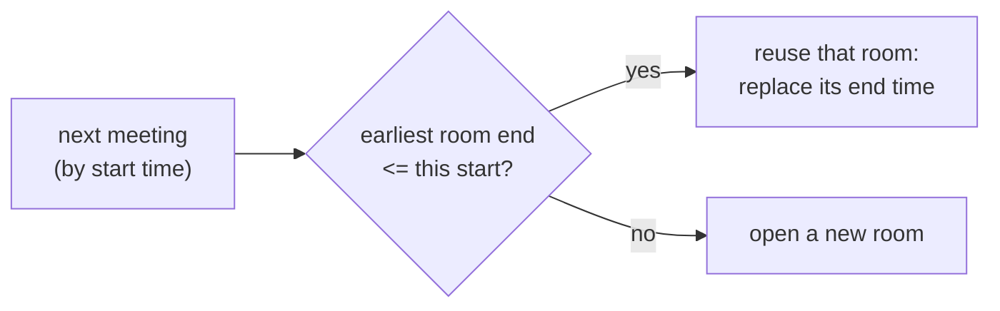
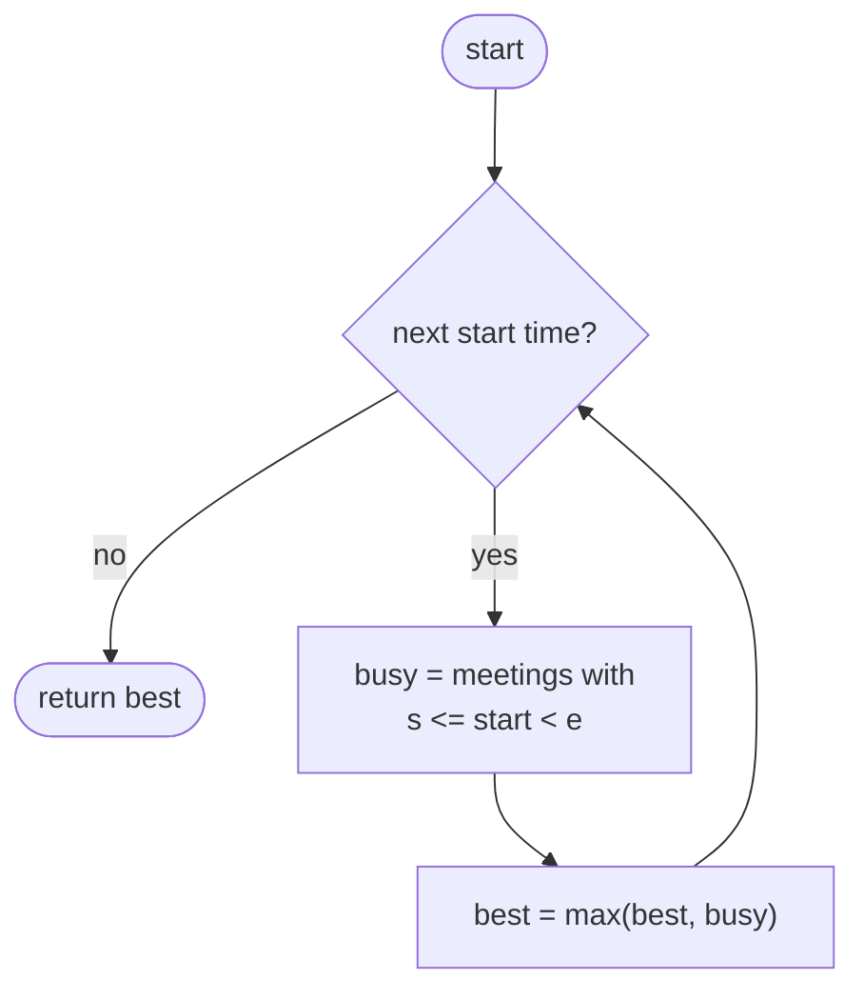
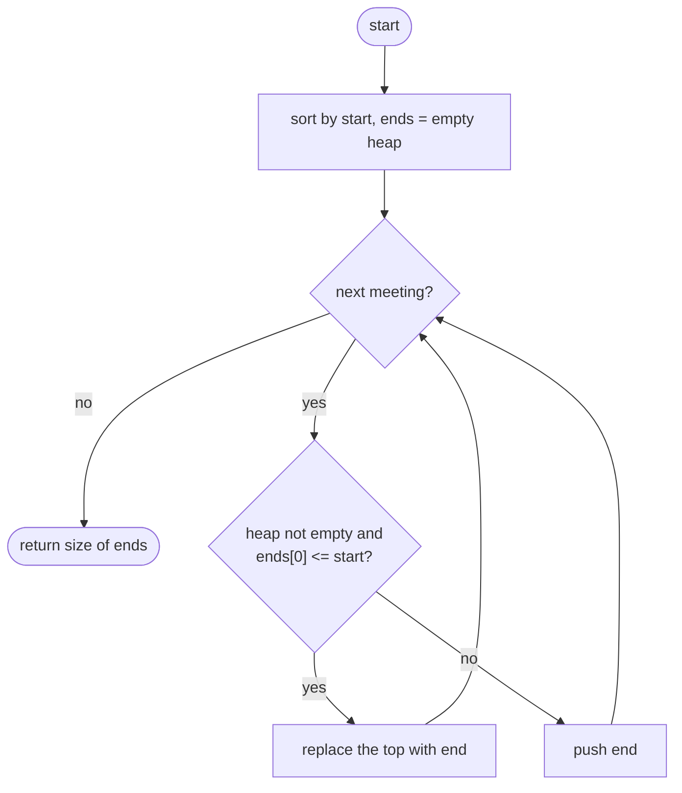

## How to think

**1. Restate the problem.** How many rooms are needed so every meeting has one? That's the largest number of meetings happening **at the same moment**.

**2. Picture the busiest moment.** The number of meetings in progress only goes up when a meeting starts, so the busiest moment is always at some meeting's start time.

**3. Simulate assigning rooms.** Go through meetings in start order. Keep the **end times of rooms in use** in a **min-heap**, so the room that frees up soonest is always on top:

- if that room is free by the time this meeting starts, reuse it (replace its end time);
- otherwise open a new room.



The heap's size at the end is the number of rooms ever needed at once.

**4. A room freed at `t` can be reused at `t`.** So the check is `earliest_end <= start`.

**5. Watch the edge cases.** Identical meetings need one room each. Back-to-back meetings all fit in one room.

## Approach 1: Brute force — count overlaps at each start time
<!-- approach: brute_force | time: O(n²) | space: O(1) -->

At each meeting's start time, count the meetings in progress (started at or before it, and not yet ended). The largest count is the answer.

**Dry run** on `[[0, 30], [5, 10], [15, 20]]`:

| Time | Meetings in progress | Count |
|---|---|---|
| 0 | [0, 30] | 1 |
| 5 | [0, 30], [5, 10] | 2 |
| 15 | [0, 30], [15, 20] | 2 |

Answer: **2**.

### Code
```python
class Solution:
    def minMeetingRooms(self, intervals: List[List[int]]) -> int:
        best = 0
        for start, _ in intervals:
            busy = sum(1 for s, e in intervals if s <= start < e)
            best = max(best, busy)
        return best
```

### Line by line
- `3` The most meetings seen at once so far.
- `4` The busiest moment is always some meeting's start time.
- `5` Count meetings running at that moment: started already and not yet ended. A meeting ending exactly now doesn't count.
- `6-7` The peak count is the number of rooms needed.

### Flowchart


## Approach 2: Optimized — min-heap of room end times
<!-- approach: optimized | time: O(n log n) | space: O(n) -->

Sort meetings by start. For each one, if the room that frees up earliest is free in time, reuse it; otherwise add a room.

**Dry run** on `[[1, 5], [5, 9], [2, 6]]`, sorted to `[1, 5], [2, 6], [5, 9]`:

| Meeting | Earliest end before | Reuse? | Room end times after |
|---|---|---|---|
| [1, 5] | none | new room | {5} |
| [2, 6] | 5 | 5 <= 2? no → new room | {5, 6} |
| [5, 9] | 5 | 5 <= 5: yes | {6, 9} |

Rooms: **2**.

### Code
```python
class Solution:
    def minMeetingRooms(self, intervals: List[List[int]]) -> int:
        ends = []
        for start, end in sorted(intervals):
            if ends and ends[0] <= start:
                heapq.heapreplace(ends, end)
            else:
                heapq.heappush(ends, end)
        return len(ends)
```

### Line by line
- `3` A min-heap of the end times of the rooms in use; the soonest-free room is at `ends[0]`.
- `4` Assign rooms in order of start time.
- `5-6` The soonest-free room is free by now: reuse it. `heapreplace` pops its old end time and pushes the new one in one step.
- `7-8` Every room is still busy: open another.
- `9` Rooms are never closed, so the heap's size is the most needed at once.

### Flowchart

