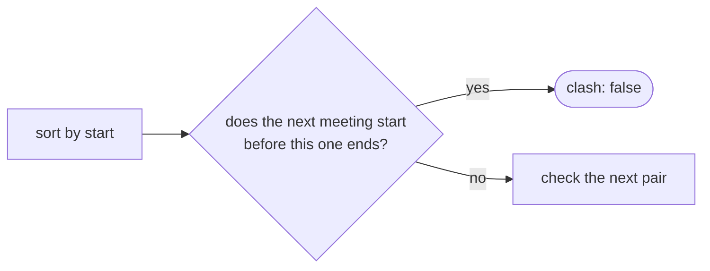
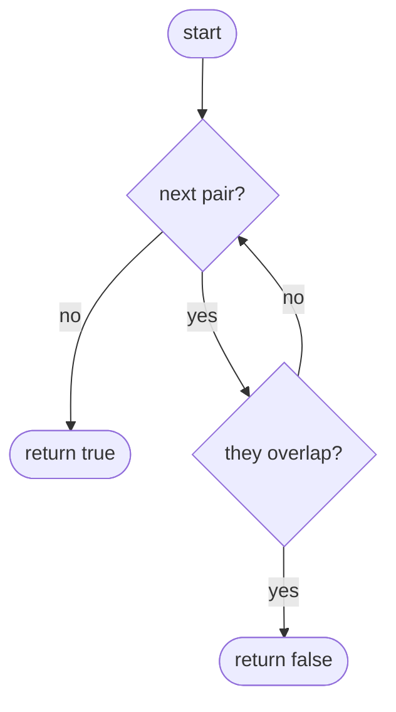
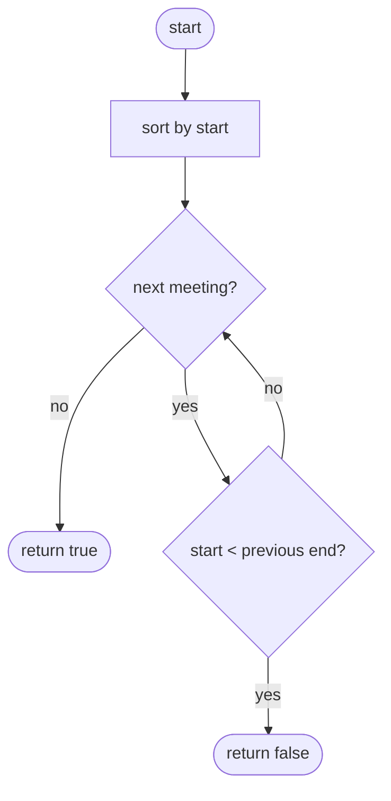

## How to think

**1. Restate the problem.** Can one person go to every meeting? Only if no two meetings overlap. Back-to-back meetings (one ends at 10, the next starts at 10) are fine.

**2. Sorting turns "any pair" into "neighbours".** Unsorted, any meeting might clash with any other. Sorted by start time, a clash always shows up between **consecutive** meetings: if meeting `i` overlaps any later meeting, it overlaps the very next one too, because that one starts even earlier.



**3. The comparison.** After sorting, the answer is false as soon as `start[i] < end[i − 1]`. Using `<` and not `<=` allows back-to-back meetings.

**4. Watch the edge cases.** No meetings or one meeting: always true. A short meeting entirely inside a long one is a clash.

## Approach 1: Brute force — check every pair
<!-- approach: brute_force | time: O(n²) | space: O(1) -->

Two meetings overlap when each starts before the other ends. Test every pair.

**Dry run** on `[[1, 5], [4, 8]]`: does 1 < 8 and 4 < 5? Yes → **false**.

### Code
```python
class Solution:
    def canAttendMeetings(self, intervals: List[List[int]]) -> bool:
        for i in range(len(intervals)):
            for j in range(i + 1, len(intervals)):
                a, b = intervals[i], intervals[j]
                if a[0] < b[1] and b[0] < a[1]:
                    return False
        return True
```

### Line by line
- `3-4` Every pair of meetings, each once.
- `5` Name the two meetings.
- `6-7` Each starts strictly before the other ends: they share some time. Strict `<` lets back-to-back meetings pass.
- `8` No pair clashed.

### Flowchart


## Approach 2: Optimized — sort, then compare neighbours
<!-- approach: optimized | time: O(n log n) | space: O(n) for the sorted copy -->

Sort by start time and check that each meeting starts no earlier than the previous one ends.

**Dry run** on `[[9, 10], [13, 15], [10, 12]]`, sorted to `[9, 10], [10, 12], [13, 15]`:

| Pair | Starts before previous ends? |
|---|---|
| [9, 10] → [10, 12] | 10 < 10? no |
| [10, 12] → [13, 15] | 13 < 12? no |

Answer: **true**.

### Code
```python
class Solution:
    def canAttendMeetings(self, intervals: List[List[int]]) -> bool:
        intervals = sorted(intervals)
        for i in range(1, len(intervals)):
            if intervals[i][0] < intervals[i - 1][1]:
                return False
        return True
```

### Line by line
- `3` Sort by start time (lists compare by their first element first). This also works for an empty list.
- `4` Compare each meeting with the one before it.
- `5-6` It starts before the previous one finished: a clash.
- `7` Every consecutive pair is fine, so no pair at all clashes.

### Flowchart

