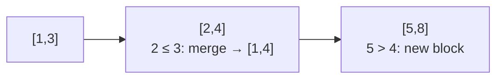
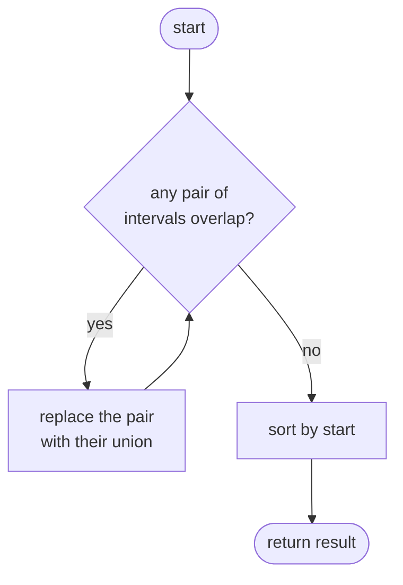
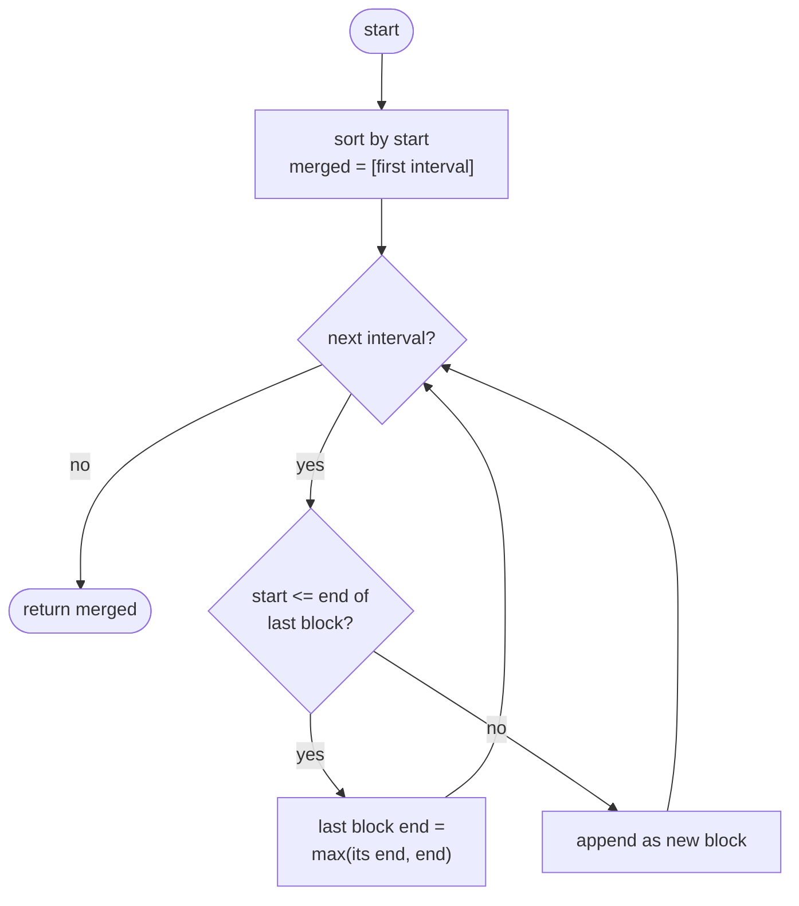

## How to think

**1. Restate the problem.** Given ranges in any order, combine every group that overlaps or touches, and return the combined ranges sorted by start.

**2. What makes overlap hard to see?** In an unsorted list, `[5, 8]` and `[1, 3]` might both connect to `[2, 4]` far away in the list. Any interval could interact with any other, so without structure you'd compare all pairs.

**3. Sorting creates the structure.** Sort by start. Now an interval can only overlap the intervals right next to it in the merged result: if it doesn't touch the last merged block, it can't touch any earlier block either, because those all end before the last one starts.



That's the first example, `[[5,8],[1,3],[2,4]]`, after sorting.

**4. Merge rule.** Two intervals `[a, b]` and `[c, d]` with `a ≤ c` overlap or touch exactly when `c ≤ b`. The merged interval is `[a, max(b, d)]`. Using `max` matters: `[1, 10]` followed by `[2, 3]` must stay `[1, 10]`.

**5. Watch the edge cases.**

- One interval inside another, such as `[1,4]` and `[2,3]`.
- Touching endpoints, such as `[1,5]` and `[5,6]`, merge into `[1,6]`.
- Duplicates, such as `[0,0]` twice, merge into one.

## Approach 1: Brute force — merge any overlapping pair until none remain
<!-- approach: brute_force | time: O(n³) | space: O(n) -->

Without sorting, keep looking for any two intervals that overlap, replace them with their union, and start the search again. Stop when a full search finds no overlapping pair, then sort the result.

**Dry run** on `[[5,8], [1,3], [2,4]]`:

| Round | Overlapping pair found | List afterwards |
|---|---|---|
| 1 | [1,3] and [2,4] | [5,8], [1,4] |
| 2 | none ([5,8] vs [1,4]: 5 > 4) | [5,8], [1,4] |
| sort | | **[1,4], [5,8]** |

Each round compares up to n² pairs, and up to n rounds may be needed.

### Code
```python
class Solution:
    def merge(self, intervals: List[List[int]]) -> List[List[int]]:
        result = [list(interval) for interval in intervals]
        changed = True
        while changed:
            changed = False
            for i in range(len(result)):
                for j in range(i + 1, len(result)):
                    a, b = result[i], result[j]
                    if a[0] <= b[1] and b[0] <= a[1]:
                        result[i] = [min(a[0], b[0]), max(a[1], b[1])]
                        result.pop(j)
                        changed = True
                        break
                if changed:
                    break
        return sorted(result)
```

### Line by line
- `3` Work on a copy so the input lists aren't changed.
- `4-6` Repeat rounds until a full round merges nothing.
- `7-9` Compare every pair of intervals.
- `10` Two ranges overlap or touch when each one starts no later than the other ends.
- `11-12` Replace the pair with its union.
- `13-16` The list just changed, so restart the search from scratch with a new round.
- `17` No overlaps remain; sort by start for the required order.

### Flowchart


## Approach 2: Optimized — sort, then sweep once
<!-- approach: optimized | time: O(n log n) | space: O(n) -->

Sort by start. Walk through the sorted intervals, comparing each one only with the last merged block: extend it if they overlap, otherwise start a new block.

**Dry run** on `[[2,3], [4,5], [6,7], [8,9], [1,10]]`, sorted to `[1,10], [2,3], [4,5], [6,7], [8,9]`:

| Interval | Last merged | Overlap? | Merged afterwards |
|---|---|---|---|
| [1, 10] | (none) | | [1,10] |
| [2, 3] | [1, 10] | 2 ≤ 10 yes | [1, max(10, 3)] = [1,10] |
| [4, 5] | [1, 10] | yes | [1,10] |
| [6, 7] | [1, 10] | yes | [1,10] |
| [8, 9] | [1, 10] | yes | **[1,10]** |

### Code
```python
class Solution:
    def merge(self, intervals: List[List[int]]) -> List[List[int]]:
        intervals.sort(key=lambda interval: interval[0])
        merged = [intervals[0]]
        for start, end in intervals[1:]:
            last = merged[-1]
            if start <= last[1]:
                last[1] = max(last[1], end)
            else:
                merged.append([start, end])
        return merged
```

### Line by line
- `3` Sort by start. This is the only O(n log n) step and the reason a single sweep is enough.
- `4` The first interval starts the first block (the input always has at least one interval).
- `5-6` Each later interval only needs comparing with the most recent block.
- `7-8` It starts before the block ends, so they overlap or touch. Use `max` because the new interval might sit completely inside the block.
- `9-10` There's a gap, so it begins a new block.
- `11` The blocks are already in start order.

### Flowchart

