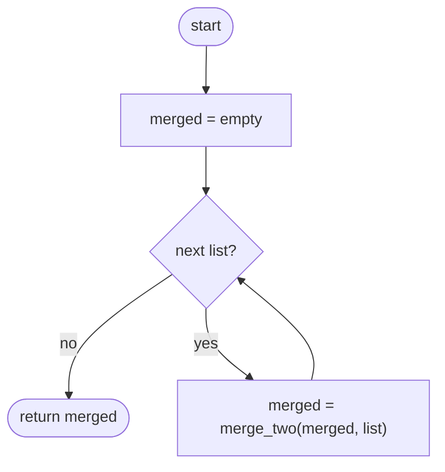
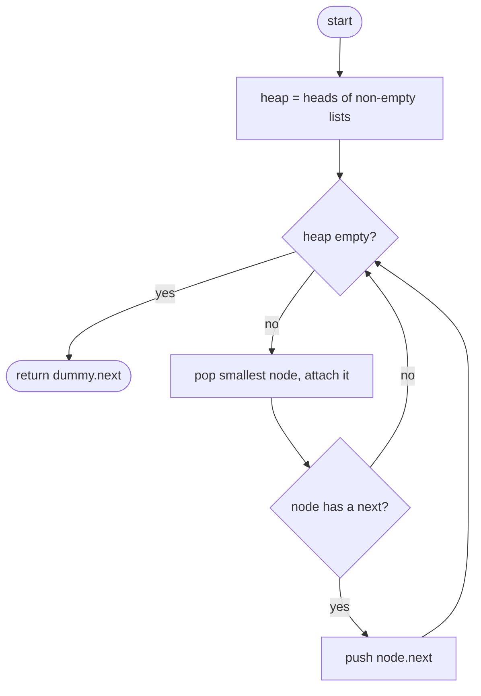

## How to think

**1. Restate the problem.** Combine `k` sorted linked lists into one sorted list.

**2. Start from what you know.** Merging **two** sorted lists is easy (see **Merge Two Sorted Lists**): repeatedly take the smaller head. With `k` lists, the next node is the smallest of `k` heads.

**3. Finding the smallest head fast.** Comparing all `k` heads every time costs O(k) per node. A **min-heap** of the current heads gives the smallest in O(log k): pop it, attach it, and push that list's next node.


**4. Why merging one list at a time is slow.** Merging list 1 with list 2, then the result with list 3, and so on, re-walks the growing result every time. With 10⁴ single-node lists, that's about 5 × 10⁷ steps. The heap handles each node once: O(N log k) for N total nodes.

**5. Watch the edge cases.** No lists, all lists empty, and lists with equal values. In Python's heap, add the list index as a tie-breaker so two nodes are never compared directly.

## Approach 1: Brute force — merge the lists one by one
<!-- approach: brute_force | time: O(k × N) | space: O(1) -->

Merge the first list into an empty result, then the second into that, and so on, using the two-list merge.

**Dry run** on `[[1, 4, 7], [2, 5], [3, 6, 9]]`:

| Step | Merge with | Result so far |
|---|---|---|
| 1 | 1 → 4 → 7 | 1 4 7 |
| 2 | 2 → 5 | 1 2 4 5 7 |
| 3 | 3 → 6 → 9 | 1 2 3 4 5 6 7 9 |

Each step walks the whole result built so far again.

### Code
```python
class Solution:
    def mergeKLists(self, lists: List[Optional[ListNode]]) -> Optional[ListNode]:
        def merge_two(a, b):
            dummy = tail = ListNode()
            while a and b:
                if a.val <= b.val:
                    tail.next, a = a, a.next
                else:
                    tail.next, b = b, b.next
                tail = tail.next
            tail.next = a or b
            return dummy.next

        merged = None
        for head in lists:
            merged = merge_two(merged, head)
        return merged
```

### Line by line
- `3-12` The standard two-list merge: a dummy head, take the smaller node each step, then attach whatever remains.
- `14` The merged result starts empty.
- `15-16` Fold each list into the result. The result grows, and every merge walks it again: O(k × N) overall.
- `17` The fully merged list.

### Flowchart


## Approach 2: Optimized — min-heap of list heads
<!-- approach: optimized | time: O(N log k) | space: O(k) -->

Put every non-empty list's head in a min-heap. Repeatedly pop the smallest node, attach it, and push its successor.

**Dry run** on `[[1, 4, 7], [2, 5], [3, 6, 9]]`:

| Pop | Push (its next) | Heap afterwards | Merged so far |
|---|---|---|---|
| 1 | 4 | 2, 3, 4 | 1 |
| 2 | 5 | 3, 4, 5 | 1 2 |
| 3 | 6 | 4, 5, 6 | 1 2 3 |
| 4 | 7 | 5, 6, 7 | 1 2 3 4 |
| 5 | none | 6, 7 | 1 2 3 4 5 |
| 6 | 9 | 7, 9 | … 6 |
| 7, then 9 | none | empty | 1 2 3 4 5 6 7 9 |

### Code
```python
class Solution:
    def mergeKLists(self, lists: List[Optional[ListNode]]) -> Optional[ListNode]:
        heap = [(head.val, i, head) for i, head in enumerate(lists) if head]
        heapq.heapify(heap)
        dummy = tail = ListNode()
        while heap:
            _, i, node = heapq.heappop(heap)
            tail.next = node
            tail = node
            if node.next:
                heapq.heappush(heap, (node.next.val, i, node.next))
        return dummy.next
```

### Line by line
- `3` One entry per non-empty list: (value, list index, node). The index breaks ties, so Python never has to compare two nodes.
- `4` Arrange the entries into a heap in O(k).
- `5` A dummy head to attach the merged nodes to.
- `6-7` Take the smallest current head across all lists.
- `8-9` Attach it to the result.
- `10-11` That list's next node becomes its new head in the heap. Each list has at most one entry in the heap at a time.
- `12` The merged list starts after the dummy.

### Flowchart

