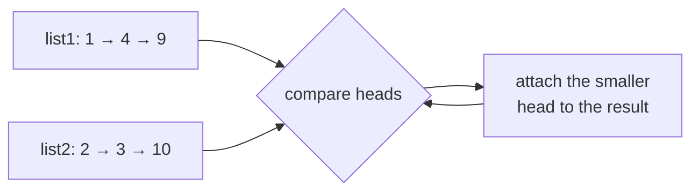
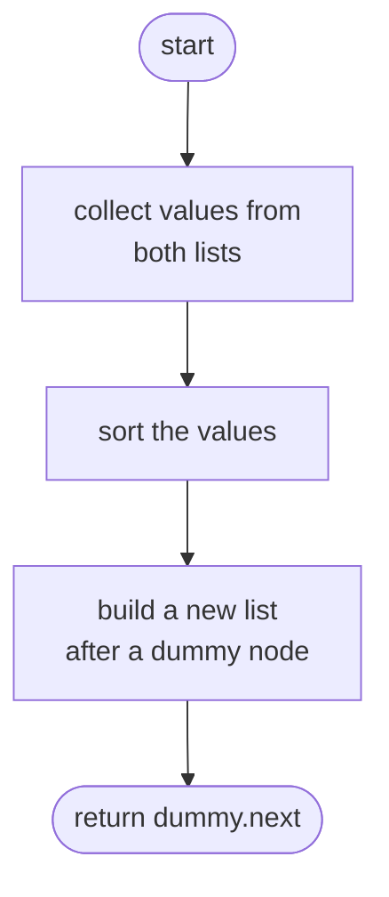
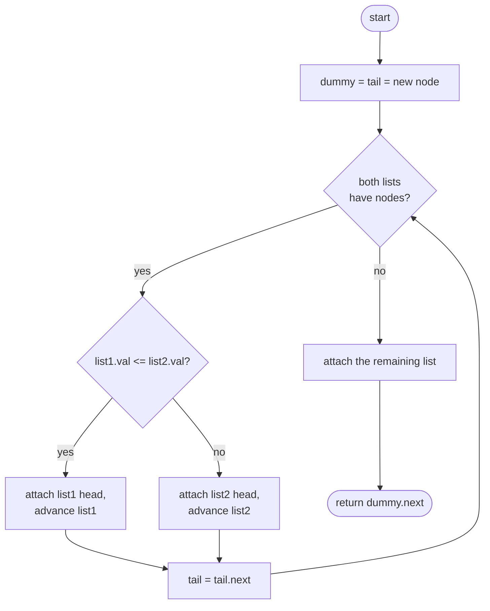

## How to think

**1. Restate the problem.** Two linked lists are each sorted. Join all their nodes into one sorted list by relinking the existing nodes, and return its head.

**2. Use the sorting you're given.** The smallest remaining value overall is always at the front of one of the two lists, so you never need to look deeper than the two heads. Repeatedly take the smaller head, attach it to the result, and advance in that list. This is the merge step of merge sort.



**3. Avoid special-casing the first node.** The result's head isn't known until the first comparison. A **dummy node** in front of the result gives you something to attach to from the very first step; at the end, the real head is `dummy.next`.

**4. Finish in one move.** When one list runs out, the other one's remaining nodes are already sorted and all larger, so attach the whole remainder at once.

**5. Watch the edge cases.**

- Either list, or both, can be empty.
- Equal values: take from either side. Taking from `list1` first keeps equal elements in a stable order.

## Approach 1: Brute force — collect all values, sort, rebuild
<!-- approach: brute_force | time: O((n + m) log(n + m)) | space: O(n + m) -->

Ignore the existing order: gather every value from both lists, sort them, and build a brand-new list. It's correct and short, but it throws away the fact that both inputs were already sorted, allocates new nodes instead of relinking, and needs O(n + m) extra memory.

**Dry run** on `1 → 4 → 9` and `2 → 3 → 10`:

| Step | Values |
|---|---|
| collect | [1, 4, 9, 2, 3, 10] |
| sort | [1, 2, 3, 4, 9, 10] |
| rebuild | 1 → 2 → 3 → 4 → 9 → 10 |

### Code
```python
class Solution:
    def mergeTwoLists(self, list1: Optional[ListNode], list2: Optional[ListNode]) -> Optional[ListNode]:
        values = []
        for node in (list1, list2):
            while node:
                values.append(node.val)
                node = node.next
        dummy = tail = ListNode()
        for value in sorted(values):
            tail.next = ListNode(value)
            tail = tail.next
        return dummy.next
```

### Line by line
- `3` Every value from both lists ends up here.
- `4-7` Walk each list in turn and record its values.
- `8` A dummy node to build after; `tail` tracks the last node of the new list.
- `9` Sorting is the O(k log k) step, where k = n + m.
- `10-11` Append a new node for each value, in sorted order.
- `12` Skip the dummy; the first real node is the head.

### Flowchart


## Approach 2: Optimized — splice the nodes with two pointers
<!-- approach: optimized | time: O(n + m) | space: O(1) -->

Keep a `tail` pointer at the end of the merged list. While both lists have nodes, attach the smaller head and advance in that list. Then attach whatever remains.

**Dry run** on `1 → 4 → 9` and `2 → 3 → 10`:

| list1 head | list2 head | Take | Merged so far |
|---|---|---|---|
| 1 | 2 | 1 | 1 |
| 4 | 2 | 2 | 1 → 2 |
| 4 | 3 | 3 | 1 → 2 → 3 |
| 4 | 10 | 4 | 1 → 2 → 3 → 4 |
| 9 | 10 | 9 | 1 → 2 → 3 → 4 → 9 |
| None | 10 | attach the rest | 1 → 2 → 3 → 4 → 9 → **10** |

### Code
```python
class Solution:
    def mergeTwoLists(self, list1: Optional[ListNode], list2: Optional[ListNode]) -> Optional[ListNode]:
        dummy = tail = ListNode()
        while list1 and list2:
            if list1.val <= list2.val:
                tail.next, list1 = list1, list1.next
            else:
                tail.next, list2 = list2, list2.next
            tail = tail.next
        tail.next = list1 or list2
        return dummy.next
```

### Line by line
- `3` The dummy node sits before the merged list, so attaching the first node needs no special case. `tail` always points at the last attached node.
- `4` Compare while both lists still have nodes.
- `5-6` `list1`'s head is smaller (or equal, which keeps the merge stable): attach it and advance `list1`. The right-hand side is evaluated first, so this reads the old `list1.next` before anything changes.
- `7-8` Otherwise attach `list2`'s head and advance `list2`.
- `9` Move `tail` to the node just attached.
- `10` At most one list has nodes left; they're sorted and all larger, so attach them in one step. `list1 or list2` picks whichever isn't empty.
- `11` The real head is the node after the dummy.

### Flowchart

