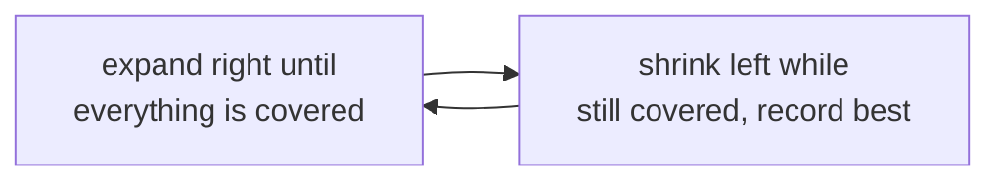
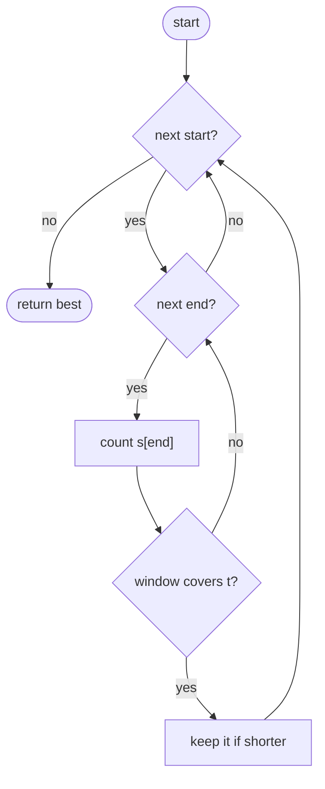
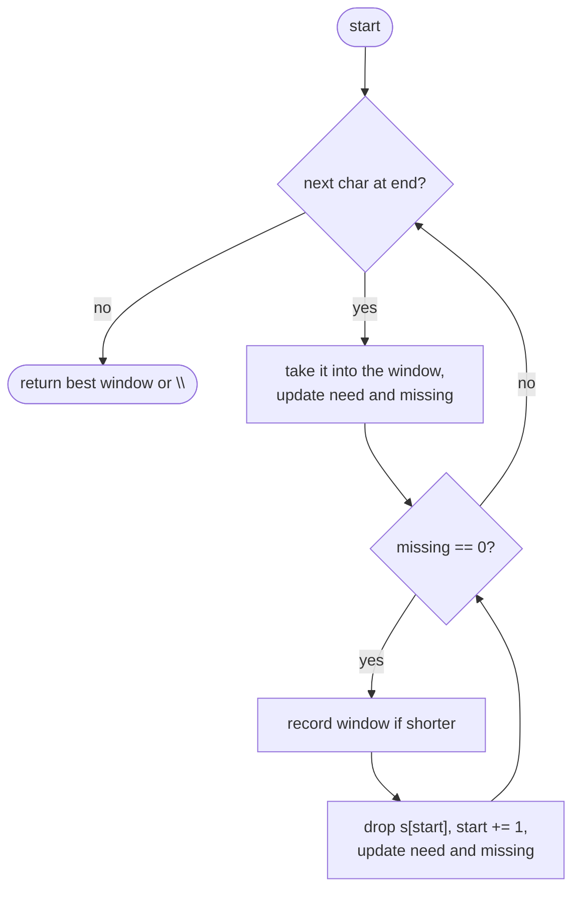

## How to think

**1. Restate the problem.** Find the shortest stretch of `s` containing every character of `t`, counting repeats. Ties go to the earliest window.

**2. Two moves: expand to satisfy, shrink to minimize.** Grow the window's right edge until it contains everything needed. Then shrink from the left as long as it **still** contains everything, recording the shortest window seen. When removing a character breaks it, go back to growing.



**3. Track "how much is still missing" with one number.** Keep `need[c]`: how many more of character `c` the window requires (it can go negative when there are extras). Also keep `missing`: the total still needed. The window is valid exactly when `missing == 0`, so checking validity is O(1), not a comparison of two maps.

**4. Why it's O(n).** Each character enters the window once (right edge) and leaves at most once (left edge).

**5. Watch the edge cases.** Repeated characters in `t` (two `a`s need two `a`s), no valid window (return `""`), and `t` longer than `s`.

## Approach 1: Brute force — every start, extend until covered
<!-- approach: brute_force | time: O(n² × k) | space: O(k) -->

For each start position, extend the end until the window covers `t`, then compare its length with the best. Moving on to the next start throws away everything learned.

**Dry run** on `s = "hello"`, `t = "l"`:

| start | First covering window | Length |
|---|---|---|
| 0 | "hel" | 3 |
| 1 | "el" | 2 |
| 2 | "l" | **1** |
| 3 | "l" | 1 (a tie: the earlier one stays) |

### Code
```python
class Solution:
    def minWindow(self, s: str, t: str) -> str:
        need = Counter(t)
        best = ""
        for start in range(len(s)):
            have = Counter()
            for end in range(start, len(s)):
                have[s[end]] += 1
                if all(have[char] >= count for char, count in need.items()):
                    if not best or end - start + 1 < len(best):
                        best = s[start:end + 1]
                    break
        return best
```

### Line by line
- `3` How many of each character `t` requires.
- `4` The shortest window found; empty means none yet.
- `5-6` Each start gets fresh counts.
- `7-8` Extend the end one character at a time.
- `9` Does the window have enough of every required character?
- `10-11` Keep it only if strictly shorter, so ties keep the earliest start.
- `12` A longer window from this start can't be shorter, so stop extending.
- `13` The shortest window, or `""`.

### Flowchart


## Approach 2: Optimized — sliding window with a missing count
<!-- approach: optimized | time: O(n + m) | space: O(k) -->

Expand the right edge, decreasing `need` for each character (and `missing` when it was actually needed). Whenever nothing is missing, record the window and shrink from the left until something is missing again.

**Dry run** on `s = "XADOBECODEBANC"`, `t = "ABC"` (key moments):

| Window | missing | Event |
|---|---|---|
| XADOBEC | 0 | first full cover; shrink: drop X → ADOBEC (6) recorded |
| DOBEC | 1 | dropping A broke it; expand |
| DOBECODEBA | 0 | covered again; shrink to CODEBA (6), not shorter |
| ODEBANC | 0 | after more expanding and shrinking |
| BANC | 0 | **length 4: new best** |

Answer: **"BANC"**.

### Code
```python
class Solution:
    def minWindow(self, s: str, t: str) -> str:
        need = Counter(t)
        missing = len(t)
        start = best_start = 0
        best_length = float("inf")
        for end, char in enumerate(s):
            if need[char] > 0:
                missing -= 1
            need[char] -= 1
            while missing == 0:
                if end - start + 1 < best_length:
                    best_start, best_length = start, end - start + 1
                need[s[start]] += 1
                if need[s[start]] > 0:
                    missing += 1
                start += 1
        return "" if best_length == float("inf") else s[best_start:best_start + best_length]
```

### Line by line
- `3` `need[c]`: how many more `c` the window needs. Negative means extras.
- `4` Total characters still missing; 0 means the window covers `t`.
- `5-6` Window start, and the best window found (none yet).
- `7` Expand the right edge.
- `8-9` This character was actually needed, so one fewer is missing.
- `10` Count it either way (extras push `need` below zero).
- `11` While the window covers `t`, try to shrink it.
- `12-13` Record it if strictly shorter, keeping the earliest among ties.
- `14-16` Remove the leftmost character. If that makes it needed again, the window no longer covers `t`.
- `17` Advance the left edge.
- `18` The best window, or `""` if none ever covered `t`.

### Flowchart

