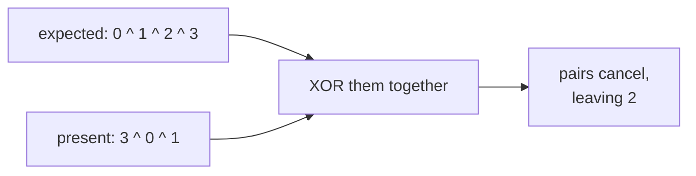
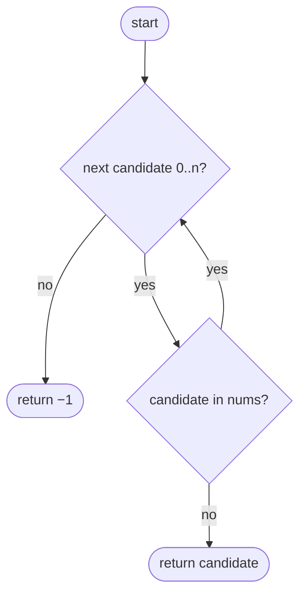
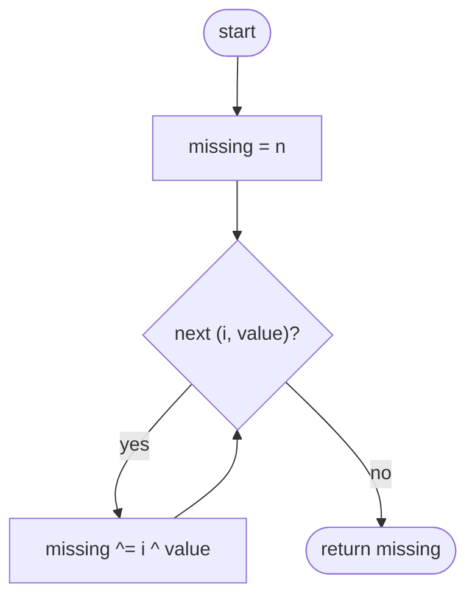

## How to think

**1. Restate the problem.** The numbers `0` to `n` should all be present, but one is missing from the `n` numbers given. Find it.

**2. Compare with what should be there.** You know exactly which numbers *should* appear: `0, 1, …, n`. The answer is the difference between "everything that should be there" and "everything that is there".

**3. Two ways to take that difference in O(1) space.**

- **Sums:** `0 + 1 + … + n = n(n + 1) / 2`. Subtract the actual sum, and what's left is the missing number.
- **XOR:** XOR every number from `0` to `n` together with every number in the list. Each present number appears twice and cancels (`x ^ x = 0`), leaving only the missing one.



The XOR version never builds a large intermediate number, which matters in languages with fixed-size integers.

**4. Pair indices with values.** Indices run `0 … n − 1`. Starting the XOR at `n` covers the one expected number that has no index.

**5. Watch the edge cases.** The missing number can be `0` or `n` itself.

## Approach 1: Brute force — check each candidate
<!-- approach: brute_force | time: O(n²) | space: O(1) -->

For each candidate from `0` to `n`, scan the list to see whether it's there. The first one that isn't is the answer.

**Dry run** on `[3, 0, 1]`:

| Candidate | In the list? |
|---|---|
| 0 | yes |
| 1 | yes |
| 2 | **no → answer** |

### Code
```python
class Solution:
    def missingNumber(self, nums: List[int]) -> int:
        for candidate in range(len(nums) + 1):
            if candidate not in nums:
                return candidate
        return -1
```

### Line by line
- `3` Every number from 0 to n is a candidate.
- `4-5` `in` on a list scans it, which is O(n). The first absent number is the answer.
- `6` Unreachable for valid input; there's always exactly one missing number.

### Flowchart


## Approach 2: Optimized — XOR indices with values
<!-- approach: optimized | time: O(n) | space: O(1) -->

Start with `n`, then XOR in every index and every value. Every number that's present appears once as an index (or as `n`) and once as a value, so it cancels.

**Dry run** on `[3, 0, 1]` (n = 3):

| Step | i | value | missing ^= i ^ value |
|---|---|---|---|
| start | | | 3 |
| 1 | 0 | 3 | 3 ^ 0 ^ 3 = 0 |
| 2 | 1 | 0 | 0 ^ 1 ^ 0 = 1 |
| 3 | 2 | 1 | 1 ^ 2 ^ 1 = **2** |

### Code
```python
class Solution:
    def missingNumber(self, nums: List[int]) -> int:
        missing = len(nums)
        for i, value in enumerate(nums):
            missing ^= i ^ value
        return missing
```

### Line by line
- `3` Start with `n`: it's an expected number that no index covers.
- `4-5` XOR in each index (the expected numbers 0 … n − 1) and each actual value. Equal numbers cancel in pairs.
- `6` Only the number that appeared once, the missing one, survives.

### Flowchart

