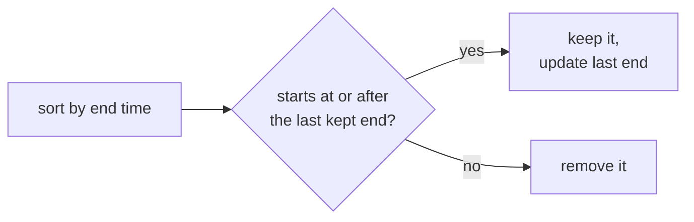
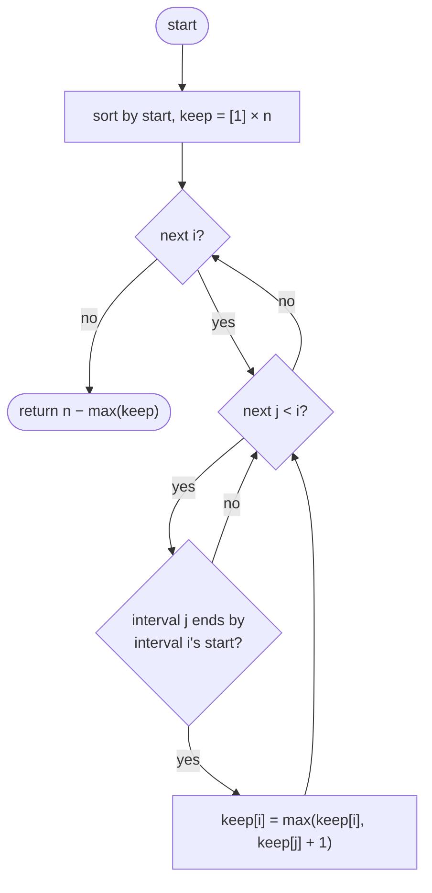
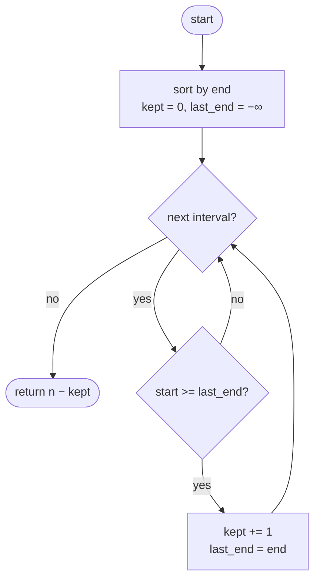

## How to think

**1. Restate the problem.** Remove as few intervals as possible so the rest don't overlap. Equivalently: **keep as many as possible**, then the answer is `n − kept`.

**2. Which interval should you keep first?** The one that **finishes earliest**. Whatever the best set of kept intervals is, its first interval can be swapped for the earliest-finishing one without causing any new overlap, because that interval ends no later. Choosing it leaves the most room for everything after.



**3. Why not sort by start?** A long interval that starts first would block many short ones. In `[1, 100], [2, 3], [4, 5]`, keeping `[1, 100]` first allows only 1 interval, while sorting by end keeps 2.

**4. Touching is allowed.** `[1, 2]` and `[2, 3]` don't overlap here, so the test is `start >= last_end`.

**5. Watch the edge cases.** Identical intervals (keep one), one interval covering all the others, and a single interval (remove 0).

## Approach 1: Brute force — longest chain DP, O(n²)
<!-- approach: brute_force | time: O(n²) | space: O(n) -->

Sort by start. `keep[i]` is the most non-overlapping intervals you can keep ending with interval `i`: one more than the best earlier interval that ends before `i` starts. It's correct, but quadratic.

**Dry run** on `[[1, 3], [2, 4], [3, 5], [1, 2]]`, sorted to `[1, 2], [1, 3], [2, 4], [3, 5]`:

| i | Interval | Earlier intervals ending by its start | keep[i] |
|---|---|---|---|
| 0 | [1, 2] | none | 1 |
| 1 | [1, 3] | none | 1 |
| 2 | [2, 4] | [1, 2] (1) | 2 |
| 3 | [3, 5] | [1, 2] (1), [1, 3] (1) | 2 |

Most kept: 2, so remove 4 − 2 = **2**.

### Code
```python
class Solution:
    def eraseOverlapIntervals(self, intervals: List[List[int]]) -> int:
        intervals = sorted(intervals)
        keep = [1] * len(intervals)
        for i in range(len(intervals)):
            for j in range(i):
                if intervals[j][1] <= intervals[i][0]:
                    keep[i] = max(keep[i], keep[j] + 1)
        return len(intervals) - max(keep)
```

### Line by line
- `3` Sort by start, so any interval that can come before `i` appears earlier in the list.
- `4` Each interval alone is a chain of 1.
- `5-6` Look back at every earlier interval.
- `7-8` If it ends by the time `i` starts, `i` can follow it in the chain.
- `9` Everything outside the longest chain must be removed.

### Flowchart


## Approach 2: Optimized — greedy by earliest end
<!-- approach: optimized | time: O(n log n) | space: O(n) for the sorted copy -->

Sort by end time. Walk through, keeping each interval that starts at or after the end of the last kept one.

**Dry run** on the same intervals, sorted by end: `[1, 2], [1, 3], [2, 4], [3, 5]`:

| Interval | Last kept end | Starts at or after? | Kept |
|---|---|---|---|
| [1, 2] | −∞ | yes | 1 (end 2) |
| [1, 3] | 2 | no → remove | 1 |
| [2, 4] | 2 | yes (touching) | 2 (end 4) |
| [3, 5] | 4 | no → remove | 2 |

Remove **2**.

### Code
```python
class Solution:
    def eraseOverlapIntervals(self, intervals: List[List[int]]) -> int:
        intervals = sorted(intervals, key=lambda interval: interval[1])
        kept = 0
        last_end = float("-inf")
        for start, end in intervals:
            if start >= last_end:
                kept += 1
                last_end = end
        return len(intervals) - kept
```

### Line by line
- `3` Earliest-finishing first: the greedy choice.
- `4-5` Nothing kept yet, so the first interval always fits.
- `6` Consider intervals in order of their end.
- `7-9` It starts once the last kept interval has ended (touching is fine): keep it, and it becomes the new boundary.
- `10` Everything not kept had to be removed.

### Flowchart

