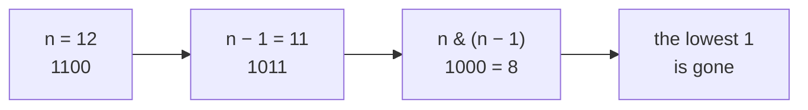
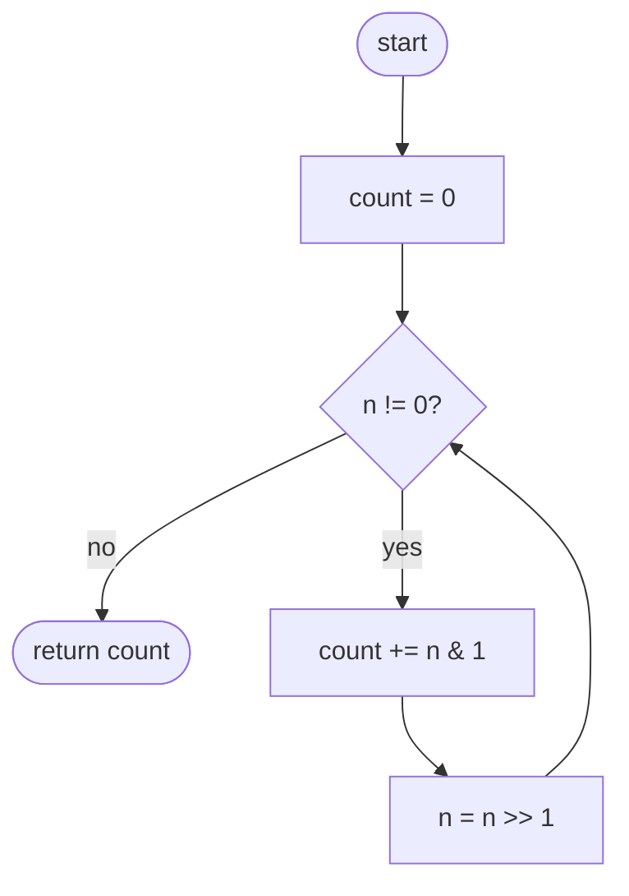
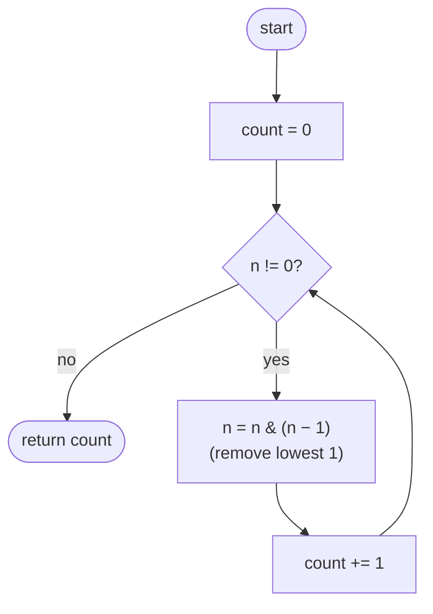

## How to think

**1. Restate the problem.** Count how many 1s appear when `n` is written in binary. For 13 = `1101`, the answer is 3.

**2. Let the constraints guide you.** `n` fits in 31 bits, so even checking every bit is only 31 steps. Speed isn't the challenge here; the point is learning to **look at bits**, a skill the harder bit problems rely on.

**3. Two ways to see the bits.**

- **Read them one by one.** `n & 1` is the last bit. Shifting right (`n >> 1`) drops the last bit and brings the next one into its place. Repeat until `n` is 0.
- **Jump straight from one 1 to the next.** Look at what subtracting 1 does to a binary number: the lowest 1 becomes 0, and every 0 below it becomes 1. AND-ing with the original then wipes out exactly that lowest 1.



So `n = n & (n − 1)` removes one 1 per step. Counting the steps until `n` reaches 0 counts the 1s, without visiting a single 0 bit.

**4. Watch the edge cases.**

- `n = 0` has no 1 bits; both loops must exit immediately.
- `n = 2³¹ − 1` is 31 ones, the most steps either method takes.

## Approach 1: Brute force — check every bit
<!-- approach: brute_force | time: O(log n) | space: O(1) -->

Look at the last bit with `n & 1`, add it to the count, and shift `n` right to bring the next bit down. Stop when `n` becomes 0.

**Dry run** for `n = 13` (`1101`):

| n (binary) | n & 1 | count |
|---|---|---|
| `1101` | 1 | 1 |
| `110` | 0 | 1 |
| `11` | 1 | 2 |
| `1` | 1 | 3 |
| `0` | stop | **3** |

The loop runs once per bit up to the highest 1: O(log n), at most 31 steps.

### Code
```python
class Solution:
    def hammingWeight(self, n: int) -> int:
        count = 0
        while n:
            count += n & 1
            n >>= 1
        return count
```

### Line by line
- `3` No 1 bits counted yet.
- `4` Keep going while any 1 bits remain; once `n` is 0, the rest are all zeros.
- `5` `n & 1` is the lowest bit, either 0 or 1, so adding it counts it.
- `6` Shift right: the lowest bit falls off and the next one takes its place.
- `7` Every bit has been checked.

### Flowchart


## Approach 2: Optimized — clear the lowest 1 each step
<!-- approach: optimized | time: O(number of 1 bits) | space: O(1) -->

Use `n & (n − 1)` to delete the lowest 1 bit, and count how many times you can do that before `n` is 0. Zero bits are skipped entirely.

**Dry run** for `n = 13`:

| n | n − 1 | n & (n − 1) | count |
|---|---|---|---|
| `1101` (13) | `1100` | `1100` (12) | 1 |
| `1100` (12) | `1011` | `1000` (8) | 2 |
| `1000` (8) | `0111` | `0000` (0) | 3 |

Three steps for three 1s, where the brute force took four steps for four bit positions. For a number like 2³⁰, the difference is 1 step versus 31.

### Code
```python
class Solution:
    def hammingWeight(self, n: int) -> int:
        count = 0
        while n:
            n &= n - 1
            count += 1
        return count
```

### Line by line
- `3` No 1 bits removed yet.
- `4` Each pass removes one 1 bit, so the loop runs exactly as many times as there are 1s.
- `5` Subtracting 1 flips the lowest 1 and the zeros below it; AND-ing with the original clears that 1 and leaves the higher bits unchanged.
- `6` Count the bit just removed.
- `7` When `n` is 0 every 1 has been removed and counted.

### Flowchart

