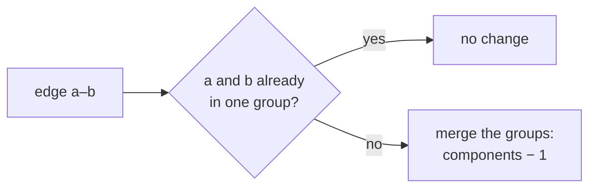
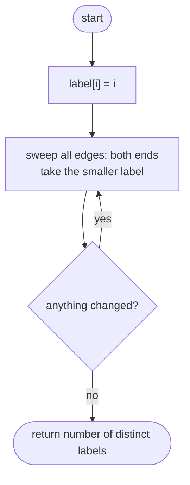
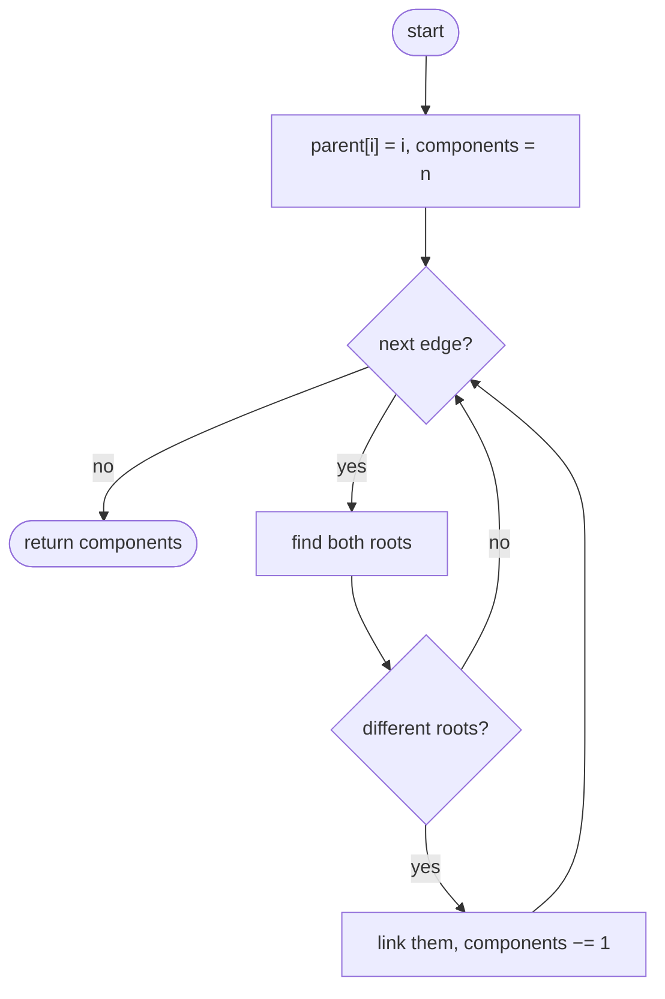

## How to think

**1. Restate the problem.** Group the nodes so that two nodes are in the same group exactly when some path connects them. Count the groups.

**2. Start with every node alone.** With no edges there are `n` components. Each edge either **joins two different components** (the count drops by one) or connects two nodes that were already together (no change).



**3. Union-find answers "same group?" fast.** Every node points toward a representative (its root). `find` follows the pointers to the root; merging two groups points one root at the other. With **path compression**, which shortcuts the pointers while finding, each operation is nearly O(1).

**4. Alternatives.** A depth-first search from each unvisited node, counting the searches, also gives O(V + E). Union-find shines when edges arrive one at a time.

**5. Watch the edge cases.** No edges gives `n`. Edges forming cycles don't reduce the count further.

## Approach 1: Brute force — propagate the smallest label until nothing changes
<!-- approach: brute_force | time: O(n × E) | space: O(n) -->

Give every node its own number as a label. Repeatedly sweep all edges, setting both endpoints to the smaller of their labels. When a full sweep changes nothing, every component shares one label (its smallest node); count the distinct labels.

**Dry run** on `n = 5`, edges `[[0, 1], [1, 2], [3, 4]]`:

| Sweep | Labels of nodes 0-4 |
|---|---|
| start | 0, 1, 2, 3, 4 |
| 1 | 0, 0, 0, 3, 3 |
| 2 | no change |

Distinct labels {0, 3}: **2** components.

### Code
```python
class Solution:
    def countComponents(self, n: int, edges: List[List[int]]) -> int:
        label = list(range(n))
        changed = True
        while changed:
            changed = False
            for a, b in edges:
                low = min(label[a], label[b])
                if label[a] != low or label[b] != low:
                    label[a] = label[b] = low
                    changed = True
        return len(set(label))
```

### Line by line
- `3` Each node starts in its own group, labelled by itself.
- `4-6` Sweep until a sweep changes nothing.
- `7-10` Connected nodes adopt the smaller label; labels spread one edge further per sweep.
- `11` One label per component.

### Flowchart


## Approach 2: Optimized — union-find
<!-- approach: optimized | time: O(E × α(n)) ≈ O(E) | space: O(n) -->

Start with `n` components. For each edge, find the roots of both endpoints; if they differ, link them and decrease the count.

**Dry run** on `n = 5`, edges `[[0, 1], [1, 2], [3, 4]]`:

| Edge | Roots | Different? | Components |
|---|---|---|---|
| start | | | 5 |
| 0–1 | 0, 1 | yes → link | 4 |
| 1–2 | 1, 2 | yes → link | 3 |
| 3–4 | 3, 4 | yes → link | **2** |

### Code
```python
class Solution:
    def countComponents(self, n: int, edges: List[List[int]]) -> int:
        parent = list(range(n))

        def find(x):
            while parent[x] != x:
                parent[x] = parent[parent[x]]
                x = parent[x]
            return x

        components = n
        for a, b in edges:
            root_a, root_b = find(a), find(b)
            if root_a != root_b:
                parent[root_a] = root_b
                components -= 1
        return components
```

### Line by line
- `3` Every node is its own root at first.
- `5-9` `find` follows parent pointers to the root. `parent[x] = parent[parent[x]]` halves the path as it goes (path compression), keeping later finds fast.
- `11` No edges yet: `n` separate components.
- `12-13` For each edge, find both groups.
- `14-16` Different groups: merge them, and there's one component fewer.
- `17` The remaining count.

### Flowchart

