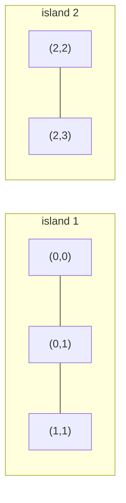
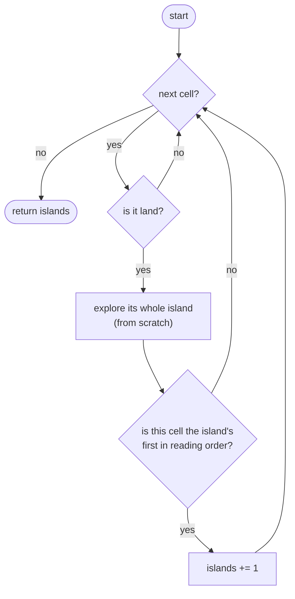
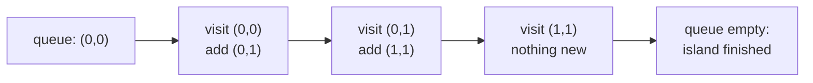
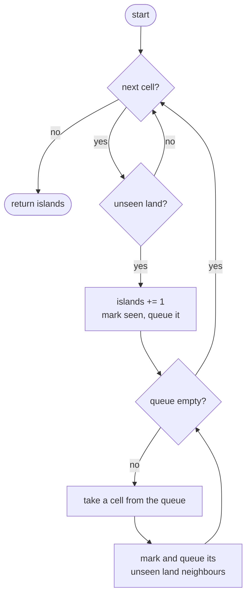

## How to think

**1. Restate the problem.** The grid is a map: `1` is land, `0` is water. Land cells touching up, down, left or right belong to the same island. Count the islands.

**2. See it as a graph.** Each land cell is a node, connected to its land neighbours in four directions. An island is a **connected component**, so the question becomes "how many connected components are there?"



That picture is the first example, `["1100", "0100", "0011"]`.

**3. Count each island once.** Scan the grid. The first time you meet a land cell that belongs to no island seen so far, that's a new island: count it, then **flood fill** from it to visit every cell of that island and remember them as seen. Later cells of the same island are then skipped.

**4. Remembering is what makes it fast.** Without a shared "seen" record, you'd rediscover the same island from each of its cells. With it, every cell is visited a constant number of times: O(rows × cols).

**5. Watch the edge cases.**

- Diagonal neighbours do **not** connect; only the four directions count.
- A single winding island can be thousands of cells long. A recursive flood fill can then hit the recursion limit, which is why the optimized version uses an explicit queue.
- An all-water grid has 0 islands.

## Approach 1: Brute force — explore the whole island from every land cell
<!-- approach: brute_force | time: O((r × c)²) | space: O(r × c) -->

For each land cell, explore its entire island from scratch, and count the cell only if it's the island's first cell in reading order (top row first, then left to right). Each island is counted exactly once, but a big island is re-explored from every one of its cells.

**Dry run** on `["1100", "0100", "0011"]`:

| Land cell | Its island | First cell of that island | Counted? |
|---|---|---|---|
| (0,0) | (0,0), (0,1), (1,1) | (0,0) | **yes** |
| (0,1) | same island, explored again | (0,0) | no |
| (1,1) | same island, explored again | (0,0) | no |
| (2,2) | (2,2), (2,3) | (2,2) | **yes** |
| (2,3) | same island, explored again | (2,2) | no |

Answer: 2. The repeated exploration is the waste the optimized version removes.

### Code
```python
class Solution:
    def numIslands(self, grid: List[str]) -> int:
        rows, cols = len(grid), len(grid[0])

        def island_of(r, c):
            cells, stack = {(r, c)}, [(r, c)]
            while stack:
                cr, cc = stack.pop()
                for nr, nc in ((cr + 1, cc), (cr - 1, cc), (cr, cc + 1), (cr, cc - 1)):
                    if 0 <= nr < rows and 0 <= nc < cols and grid[nr][nc] == "1" and (nr, nc) not in cells:
                        cells.add((nr, nc))
                        stack.append((nr, nc))
            return cells

        islands = 0
        for r in range(rows):
            for c in range(cols):
                if grid[r][c] == "1" and min(island_of(r, c)) == (r, c):
                    islands += 1
        return islands
```

### Line by line
- `3` Grid dimensions, used for bounds checks.
- `5-6` `island_of` collects every cell connected to `(r, c)`. `cells` is both the result and the record of what's been visited during this one exploration.
- `7-8` Take a cell off the stack and look at its four neighbours.
- `9-11` A neighbour joins the island if it's inside the grid, is land, and hasn't been added yet.
- `12` The full set of cells in this island.
- `14-16` Visit every cell of the grid in reading order.
- `17-18` Tuples compare row first, then column, so `min` is the island's first cell in reading order. Counting only that cell counts each island once, at the cost of exploring it again from every one of its cells.
- `19` The number of islands.

### Flowchart


## Approach 2: Optimized — flood fill with a shared seen grid
<!-- approach: optimized | time: O(r × c) | space: O(r × c) -->

Keep one `seen` grid for the whole scan. When an unseen land cell appears, it starts a new island: count it, then breadth-first search outward with a queue, marking every reachable land cell as seen. Each cell enters the queue at most once.

**Dry run** on `["1100", "0100", "0011"]`:

| Scan reaches | State | Action | Islands |
|---|---|---|---|
| (0,0) | land, unseen | new island; BFS marks (0,0), (0,1), (1,1) | 1 |
| (0,1) | already seen | skip | 1 |
| (1,1) | already seen | skip | 1 |
| (2,2) | land, unseen | new island; BFS marks (2,2), (2,3) | 2 |
| (2,3) | already seen | skip | **2** |



### Code
```python
class Solution:
    def numIslands(self, grid: List[str]) -> int:
        rows, cols = len(grid), len(grid[0])
        seen = [[False] * cols for _ in range(rows)]
        islands = 0
        for r in range(rows):
            for c in range(cols):
                if grid[r][c] != "1" or seen[r][c]:
                    continue
                islands += 1
                seen[r][c] = True
                queue = deque([(r, c)])
                while queue:
                    cr, cc = queue.popleft()
                    for nr, nc in ((cr + 1, cc), (cr - 1, cc), (cr, cc + 1), (cr, cc - 1)):
                        if 0 <= nr < rows and 0 <= nc < cols and grid[nr][nc] == "1" and not seen[nr][nc]:
                            seen[nr][nc] = True
                            queue.append((nr, nc))
        return islands
```

### Line by line
- `3` Grid dimensions.
- `4` One `seen` flag per cell, shared across the whole scan. The rows are strings, which can't be changed, so we track visits separately instead of overwriting land with water.
- `5` No islands found yet.
- `6-7` Scan every cell.
- `8-9` Skip water and land that already belongs to a counted island.
- `10` An unseen land cell means a brand-new island.
- `11-12` Mark it seen and start a breadth-first search from it.
- `13-14` Take the next cell and look at its four neighbours.
- `15-17` Add each in-bounds, unseen land neighbour. Marking it seen *when it's added*, not when it's taken out, stops the same cell from being queued twice.
- `18` Every island was counted exactly once.

### Flowchart

