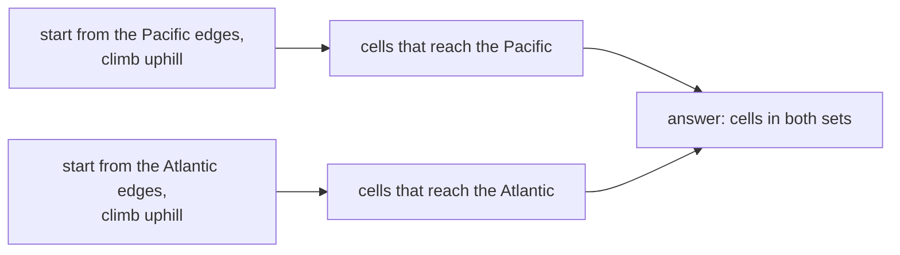
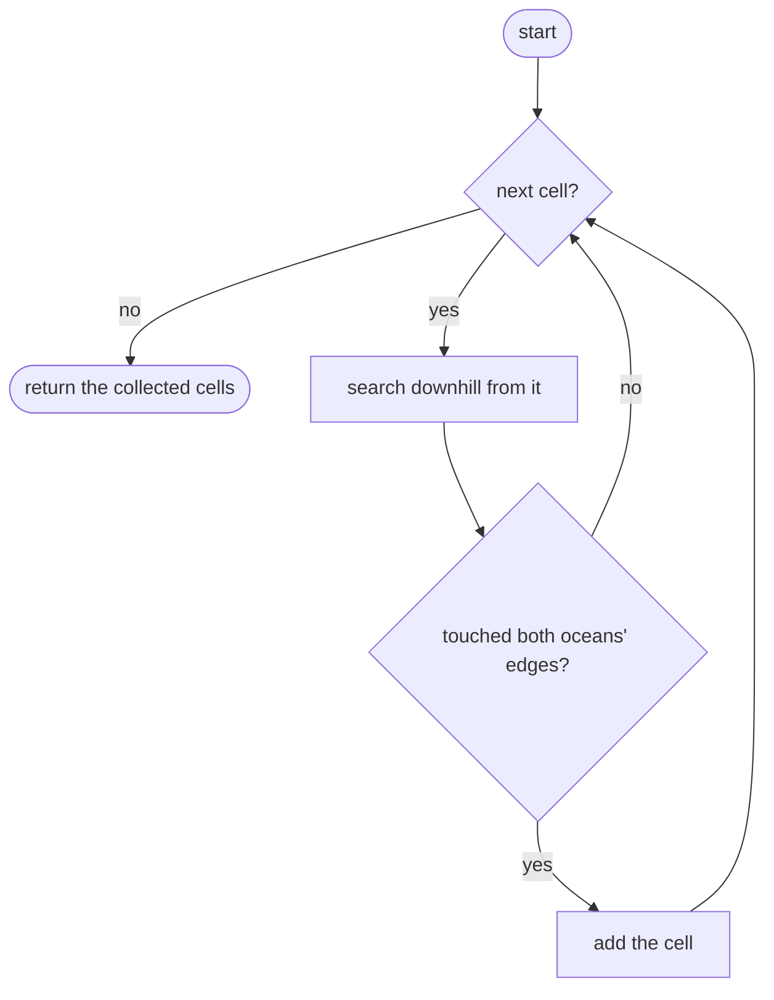
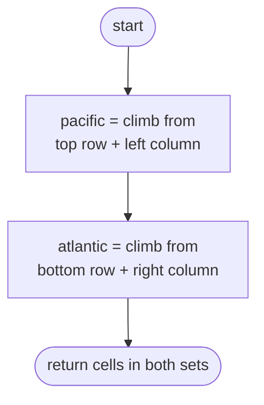

## How to think

**1. Restate the problem.** Water flows downhill (or across flat ground) to a neighbour. Find every cell whose water can reach the top/left edge (Pacific) **and** the bottom/right edge (Atlantic).

**2. The direct way repeats work.** Starting a search from every cell and following the water downhill works, but neighbouring cells explore almost the same regions again and again: up to O((rows × cols)²).

**3. Flip the direction.** Instead of asking "where can this cell's water go?", ask "which cells can send water **to this ocean**?" Start from the ocean's edge cells and walk **uphill** (to neighbours at least as high). Every cell you reach can drain into that ocean.



Two searches in total, each visiting every cell at most once: O(rows × cols).

**4. Watch the direction of the comparison.** Water flows from `h` to a neighbour of height `<= h`. Climbing backwards, you may step to a neighbour of height `>= h`.

**5. Watch the edge cases.** A single cell touches both oceans. A single row or column touches both oceans at every cell.

## Approach 1: Brute force — follow the water from every cell
<!-- approach: brute_force | time: O((r × c)²) | space: O(r × c) -->

For each cell, search everywhere its water can flow, and note whether that region touches each ocean's edges.

**Dry run** on

```
1 2 3
8 9 4
7 6 5
```

| Cell (height) | Water can reach | Pacific? | Atlantic? |
|---|---|---|---|
| (0, 0) (1) | itself only | yes | no |
| (0, 2) (3) | 3, 2, 1 | yes (top) | yes (right) |
| (1, 1) (9) | everything below 9 | yes | yes |

### Code
```python
class Solution:
    def pacificAtlantic(self, heights: List[List[int]]) -> List[List[int]]:
        rows, cols = len(heights), len(heights[0])

        def oceans_from(r, c):
            pacific = atlantic = False
            seen, stack = {(r, c)}, [(r, c)]
            while stack:
                cr, cc = stack.pop()
                pacific = pacific or cr == 0 or cc == 0
                atlantic = atlantic or cr == rows - 1 or cc == cols - 1
                for nr, nc in ((cr + 1, cc), (cr - 1, cc), (cr, cc + 1), (cr, cc - 1)):
                    if 0 <= nr < rows and 0 <= nc < cols and (nr, nc) not in seen and heights[nr][nc] <= heights[cr][cc]:
                        seen.add((nr, nc))
                        stack.append((nr, nc))
            return pacific and atlantic

        return [[r, c] for r in range(rows) for c in range(cols) if oceans_from(r, c)]
```

### Line by line
- `3` Grid size.
- `5` `oceans_from` checks whether water starting at `(r, c)` reaches both oceans.
- `6-7` Track which oceans have been touched, and search with a stack.
- `8-11` A cell on the top or left edge drains into the Pacific; bottom or right into the Atlantic.
- `12-15` Water moves to neighbours that are no higher.
- `16` Both oceans reached?
- `18` Run the search from every cell: the repeated work that makes this slow.

### Flowchart


## Approach 2: Optimized — climb uphill from each ocean
<!-- approach: optimized | time: O(r × c) | space: O(r × c) -->

Run two searches: one from all Pacific edge cells and one from all Atlantic edge cells, each moving only to neighbours at least as high. Return the cells reached by both.

**Dry run** on the same grid:

| Search | Starts at | Climbs to | Cells reached |
|---|---|---|---|
| Pacific | 1, 2, 3 (top) and 8, 7 (left) | 3 → 4 → 5 → 6, and 2 → 9 | all 9 cells |
| Atlantic | 7, 6, 5 (bottom) and 3, 4 (right) | 7 → 8 → 9 | every cell except (0, 0) and (0, 1) |
| both | | | (0,2), (1,0), (1,1), (1,2), (2,0), (2,1), (2,2) |

The cells holding 1 and 2 can only drain to the Pacific: every Atlantic path would have to go uphill to leave them.

### Code
```python
class Solution:
    def pacificAtlantic(self, heights: List[List[int]]) -> List[List[int]]:
        rows, cols = len(heights), len(heights[0])

        def climb(starts):
            reached, stack = set(starts), list(starts)
            while stack:
                r, c = stack.pop()
                for nr, nc in ((r + 1, c), (r - 1, c), (r, c + 1), (r, c - 1)):
                    if 0 <= nr < rows and 0 <= nc < cols and (nr, nc) not in reached and heights[nr][nc] >= heights[r][c]:
                        reached.add((nr, nc))
                        stack.append((nr, nc))
            return reached

        pacific = climb([(0, c) for c in range(cols)] + [(r, 0) for r in range(rows)])
        atlantic = climb([(rows - 1, c) for c in range(cols)] + [(r, cols - 1) for r in range(rows)])
        return [[r, c] for r, c in pacific & atlantic]
```

### Line by line
- `3` Grid size.
- `5` `climb` finds every cell whose water can flow down to one of the starting cells.
- `6` Every edge cell drains into its ocean directly.
- `7-11` Step to neighbours at least as high: water could flow from them down to here. Each cell is added at most once.
- `12` All cells that drain into this ocean.
- `14-15` One search per ocean, starting from its two edges.
- `16` Cells in both sets reach both oceans. (The judge accepts them in any order.)

### Flowchart

