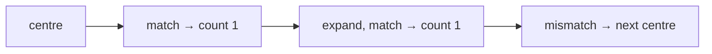
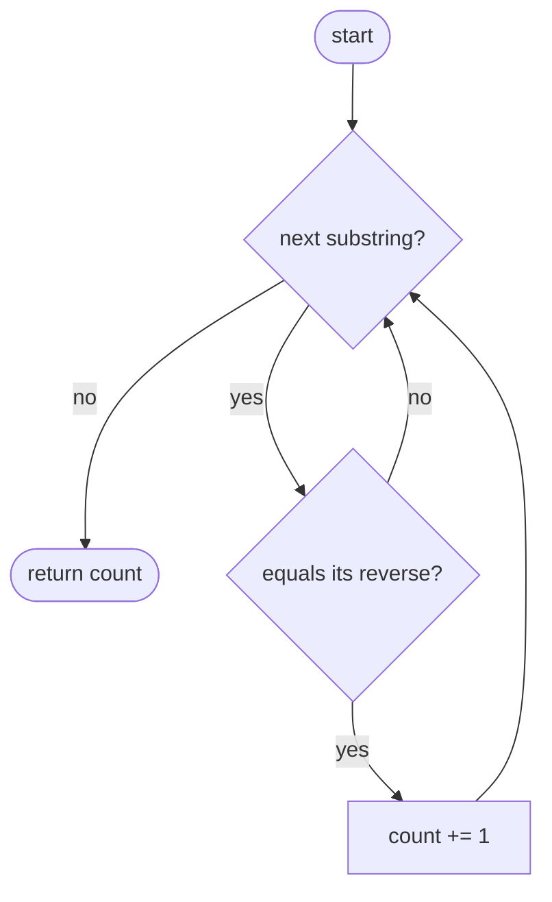
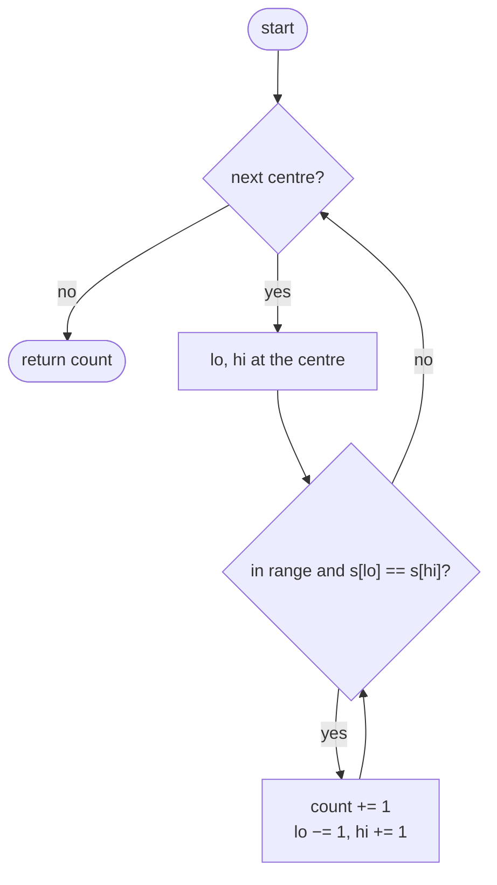

## How to think

**1. Restate the problem.** Count every substring (by position) that is a palindrome.

**2. Brute force does too much copying.** Checking each of the ~n²/2 substrings separately costs O(n) each: O(n³).

**3. Every expansion step is one palindrome.** Expanding from a centre (see **Longest Palindromic Substring**) visits palindromes of increasing length: `b`, then `aba`, then `xabax`. Each successful step is **exactly one** palindromic substring, so counting the steps counts them all, with nothing copied.



**4. Both kinds of centre.** Odd palindromes centre on a character, even ones on the gap between two. With 2n − 1 centres and at most n/2 steps each, it's O(n²).

**5. Watch the edge cases.** `"aaa"` has 6 palindromes: three `a`, two `aa`, one `aaa`. Every single character counts.

## Approach 1: Brute force — check every substring
<!-- approach: brute_force | time: O(n³) | space: O(n) -->

Enumerate every substring and test it by comparing it with its reverse.

**Dry run** on `"aaa"`:

| Length | Substrings | Palindromes |
|---|---|---|
| 1 | a, a, a | 3 |
| 2 | aa, aa | 2 |
| 3 | aaa | 1 |

Total: **6**.

### Code
```python
class Solution:
    def countSubstrings(self, s: str) -> int:
        count = 0
        for start in range(len(s)):
            for end in range(start, len(s)):
                piece = s[start:end + 1]
                if piece == piece[::-1]:
                    count += 1
        return count
```

### Line by line
- `3` Palindromes found.
- `4-5` Every substring `s[start..end]`.
- `6-8` Copy it and compare it with its reverse: O(n) per substring.
- `9` The total.

### Flowchart


## Approach 2: Optimized — expand around centres and count each step
<!-- approach: optimized | time: O(n²) | space: O(1) -->

For each of the 2n − 1 centres, expand while the ends match, adding one for every successful step.

**Dry run** on `"abba"` (centres that produce palindromes):

| Centre | Palindromes found |
|---|---|
| each letter | a, b, b, a (4) |
| gap between the b's | bb, then abba (2) |
| other gaps | none |

Total: **6**.

### Code
```python
class Solution:
    def countSubstrings(self, s: str) -> int:
        count = 0
        for center in range(2 * len(s) - 1):
            lo, hi = center // 2, center // 2 + center % 2
            while lo >= 0 and hi < len(s) and s[lo] == s[hi]:
                count += 1
                lo, hi = lo - 1, hi + 1
        return count
```

### Line by line
- `3` Palindromes found.
- `4-5` Each centre: a character (`lo == hi`) or the gap between two (`hi == lo + 1`).
- `6-8` Every match while expanding is one more palindrome centred here.
- `9` The total.

### Flowchart

