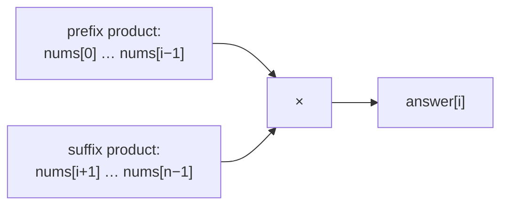
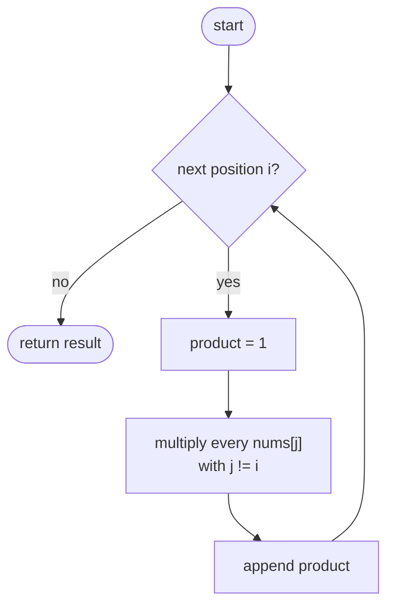
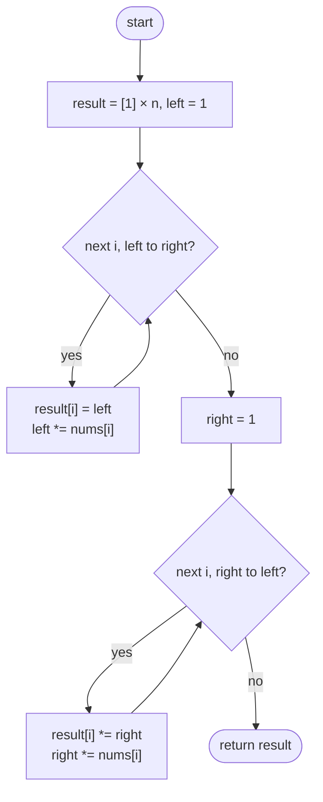

## How to think

**1. Restate the problem.** For each position, multiply together every *other* element. Division isn't allowed, and the target is O(n).

**2. Why not divide?** "Multiply everything, then divide by `nums[i]`" breaks as soon as there's a zero, and the problem forbids it anyway. We need another way to exclude one element.

**3. Split "everything except i" into two parts.** The elements other than `nums[i]` are exactly the ones to its **left** and the ones to its **right**:

```
answer[i] = (product of everything left of i) × (product of everything right of i)
```



**4. Build both in two sweeps.** A left-to-right sweep carries a running product of everything seen, giving every prefix product. A right-to-left sweep does the same for suffixes. Writing the prefixes into the answer array first, then multiplying the suffixes in, needs no extra arrays.

**5. Watch the edge cases.** One zero makes every answer 0 except at the zero's own position. Two zeros make every answer 0. Negative numbers need no special handling.

## Approach 1: Brute force — multiply all the others for each position
<!-- approach: brute_force | time: O(n²) | space: O(1) besides the output -->

For each index, loop over the whole array and multiply every element except that index.

**Dry run** on `[2, 3, 4, 5]`:

| i | Elements multiplied | answer[i] |
|---|---|---|
| 0 | 3 × 4 × 5 | 60 |
| 1 | 2 × 4 × 5 | 40 |
| 2 | 2 × 3 × 5 | 30 |
| 3 | 2 × 3 × 4 | 24 |

Each answer redoes almost the same multiplications: that repeated work is what the optimized version removes.

### Code
```python
class Solution:
    def productExceptSelf(self, nums: List[int]) -> List[int]:
        n = len(nums)
        result = []
        for i in range(n):
            product = 1
            for j in range(n):
                if j != i:
                    product *= nums[j]
            result.append(product)
        return result
```

### Line by line
- `3-4` The length, and the answers in order.
- `5` Compute the answer for each position.
- `6` Start from 1, the identity for multiplication.
- `7-9` Multiply every element except the one at position `i`.
- `10` Record this position's answer.
- `11` All n answers, each built with n − 1 multiplications.

### Flowchart


## Approach 2: Optimized — prefix and suffix products
<!-- approach: optimized | time: O(n) | space: O(1) besides the output -->

First sweep: store in `result[i]` the product of everything left of `i`. Second sweep, from the right: multiply `result[i]` by the product of everything right of `i`.

**Dry run** on `[2, 3, 4, 5]`:

| i | left (before i) | result after pass 1 | right (after i) | result after pass 2 |
|---|---|---|---|---|
| 0 | 1 | 1 | 3 × 4 × 5 = 60 | **60** |
| 1 | 2 | 2 | 4 × 5 = 20 | **40** |
| 2 | 2 × 3 = 6 | 6 | 5 | **30** |
| 3 | 2 × 3 × 4 = 24 | 24 | 1 | **24** |

### Code
```python
class Solution:
    def productExceptSelf(self, nums: List[int]) -> List[int]:
        n = len(nums)
        result = [1] * n
        left = 1
        for i in range(n):
            result[i] = left
            left *= nums[i]
        right = 1
        for i in range(n - 1, -1, -1):
            result[i] *= right
            right *= nums[i]
        return result
```

### Line by line
- `3-4` The output array doubles as storage for the prefix products, so no extra arrays are needed.
- `5` Product of everything left of the current index; nothing is left of index 0, so it starts at 1.
- `6-7` Store the product of everything *before* `i`...
- `8` ...then include `nums[i]` for the next position.
- `9` Product of everything right of the current index, starting empty at the far end.
- `10` Sweep right to left.
- `11` Multiply in everything *after* `i`: now `result[i]` is left × right.
- `12` Include `nums[i]` for the next position to the left.
- `13` Every position now holds the product of all the others.

### Flowchart

