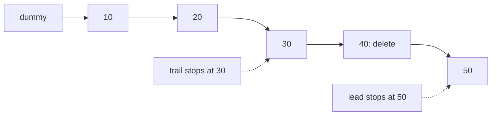
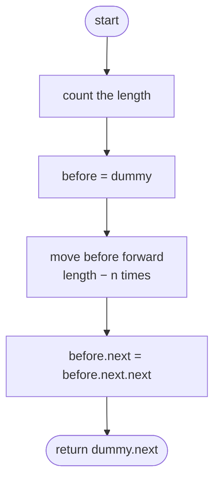
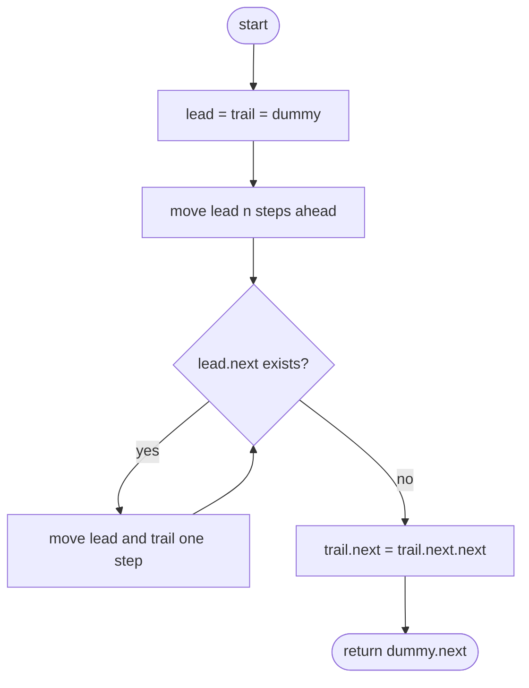

## How to think

**1. Restate the problem.** Delete the node that is `n` positions from the end. To delete a node in a singly linked list, you need the node **just before it**, so you can point its `next` past the deleted one.

**2. Counting from the end is awkward.** A singly linked list only walks forwards. The direct fix is to count the length first, then walk `length − n` steps. That's two passes.

**3. One pass with a gap.** Start a `lead` pointer `n` nodes ahead of a `trail` pointer, then move both together. When `lead` reaches the last node, `trail` is exactly `n` nodes behind it: just before the node to delete.



**4. Use a dummy node.** If `n` equals the length, the head itself is deleted, and there's no node before it. A dummy in front of the head gives every node, including the head, a predecessor.

**5. Watch the edge cases.** Removing the only node gives an empty list. Removing the head or the tail are the cases most often broken.

## Approach 1: Brute force — count, then walk to the node before
<!-- approach: brute_force | time: O(n) | space: O(1) -->

Walk the list once to count its length. Then walk from a dummy node `length − n` steps to reach the node before the target, and unlink the target.

**Dry run** on `10 → 20 → 30 → 40 → 50`, `n = 2`:

| Step | Result |
|---|---|
| count | length = 5 |
| walk 5 − 2 = 3 steps from the dummy | dummy → 10 → 20 → 30 |
| unlink | 30.next = 50 → **10 20 30 50** |

### Code
```python
class Solution:
    def removeNthFromEnd(self, head: Optional[ListNode], n: int) -> Optional[ListNode]:
        length = 0
        node = head
        while node:
            length += 1
            node = node.next
        dummy = ListNode(0, head)
        before = dummy
        for _ in range(length - n):
            before = before.next
        before.next = before.next.next
        return dummy.next
```

### Line by line
- `3-7` First pass: count the nodes.
- `8` A dummy node in front, so removing the head needs no special case.
- `9-11` Second pass: the node before the target is `length − n` steps from the dummy.
- `12` Skip over the target node.
- `13` The head may have changed, so return the node after the dummy.

### Flowchart


## Approach 2: Optimized — two pointers n apart, one pass
<!-- approach: optimized | time: O(n) | space: O(1) -->

Move `lead` `n` steps ahead of `trail` (both start at a dummy). Then move both until `lead` is at the last node. `trail` is now just before the target.

**Dry run** on `10 → 20 → 30 → 40 → 50`, `n = 2`:

| Step | trail | lead |
|---|---|---|
| after moving lead 2 steps | dummy | 20 |
| together | 10 | 30 |
| together | 20 | 40 |
| together | 30 | 50 (last node: stop) |

Unlink `trail.next` (40): **10 20 30 50**.

### Code
```python
class Solution:
    def removeNthFromEnd(self, head: Optional[ListNode], n: int) -> Optional[ListNode]:
        dummy = ListNode(0, head)
        lead = trail = dummy
        for _ in range(n):
            lead = lead.next
        while lead.next:
            lead = lead.next
            trail = trail.next
        trail.next = trail.next.next
        return dummy.next
```

### Line by line
- `3` A dummy in front of the head, so every node has a predecessor.
- `4` Both pointers start at the dummy.
- `5-6` Open a gap of `n` nodes.
- `7-9` Move together until `lead` is on the last node. The gap stays `n`, so `trail` ends up right before the n-th node from the end.
- `10` Unlink the target.
- `11` The (possibly new) head.

### Flowchart

