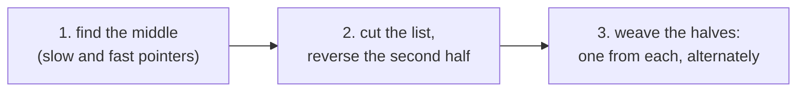
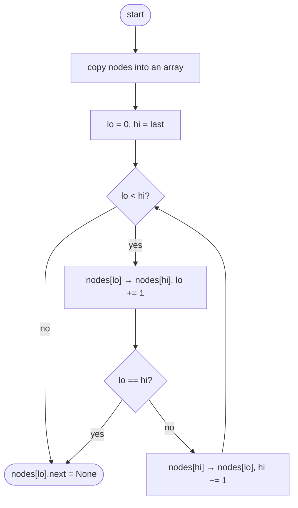
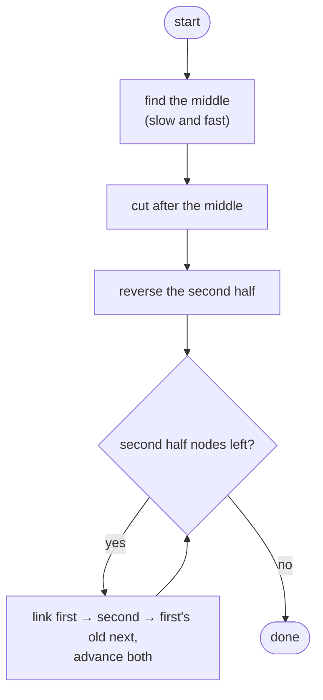

## How to think

**1. Restate the problem.** Rearrange `L0, L1, …, Ln` into `L0, Ln, L1, Ln−1, …`, alternating from the front and the back, by relinking nodes.

**2. The difficulty: reaching the back.** A singly linked list can't walk backwards, and the pattern keeps needing the *last remaining* node.

**3. Split, reverse, weave.** The back half, read backwards, is exactly the order in which the back nodes are used. So:



For `1 2 3 4 5`: halves `1 2 3` and `4 5`; reversed second half `5 4`; woven: `1 5 2 4 3`.

**4. The simpler alternative.** Copy the nodes into an array, which gives random access to the back, then relink using two indices from both ends. That's easier to reason about, but it uses O(n) extra memory.

**5. Watch the edge cases.** One or two nodes need no change. With an odd count, the first half is one node longer, and its extra node (the middle) ends up last. With an even count, the halves are equal. Either way, the weave stops when the second half runs out.

## Approach 1: Brute force — store the nodes in an array
<!-- approach: brute_force | time: O(n) | space: O(n) -->

Put every node in an array, then relink: front, back, front, back, moving two indices toward each other. Finally end the list at the last node placed.

**Dry run** on `1 2 3 4`:

| lo | hi | Links set |
|---|---|---|
| 0 | 3 | 1 → 4, then 4 → 2 |
| 1 | 2 | 2 → 3, then lo meets hi |
| | | 3 → None |

Result: **1 4 2 3**.

### Code
```python
class Solution:
    def reorderList(self, head: Optional[ListNode]) -> None:
        nodes = []
        node = head
        while node:
            nodes.append(node)
            node = node.next
        lo, hi = 0, len(nodes) - 1
        while lo < hi:
            nodes[lo].next = nodes[hi]
            lo += 1
            if lo == hi:
                break
            nodes[hi].next = nodes[lo]
            hi -= 1
        nodes[lo].next = None
```

### Line by line
- `3-7` Copy every node into an array: random access, including the back.
- `8` One index from each end.
- `9-11` A front node points to the current back node, then the front index moves.
- `12-13` The indices met: every node has been placed.
- `14-15` The back node points to the next front node, then the back index moves.
- `16` The node placed last becomes the new tail; without this, the old links could form a cycle.

### Flowchart


## Approach 2: Optimized — middle, reverse, weave
<!-- approach: optimized | time: O(n) | space: O(1) -->

Find the middle with slow and fast pointers, cut the list there, reverse the second half in place, then weave the two halves together.

**Dry run** on `1 2 3 4 5`:

| Step | Result |
|---|---|
| middle | slow stops at 3 |
| cut | first: 1 2 3, second: 4 5 |
| reverse second | 5 4 |
| weave | 1 5 2 4 3 |

### Code
```python
class Solution:
    def reorderList(self, head: Optional[ListNode]) -> None:
        slow = fast = head
        while fast.next and fast.next.next:
            slow = slow.next
            fast = fast.next.next
        second = slow.next
        slow.next = None
        prev, node = None, second
        while node:
            nxt = node.next
            node.next = prev
            prev, node = node, nxt
        first, second = head, prev
        while second:
            first_next, second_next = first.next, second.next
            first.next = second
            second.next = first_next
            first, second = first_next, second_next
```

### Line by line
- `3-6` `fast` moves twice as fast, so when it can't take another double step, `slow` is at the end of the first half (the middle for odd lengths).
- `7-8` Cut the list after `slow`. The first half keeps any extra node.
- `9-13` Reverse the second half in place, flipping one link per step.
- `14` `prev` is now the head of the reversed second half.
- `15` The second half is never longer than the first, so weave until it runs out.
- `16` Save both successors before relinking.
- `17-18` Slot one node from the back between two front nodes.
- `19` Advance in both halves.

### Flowchart

