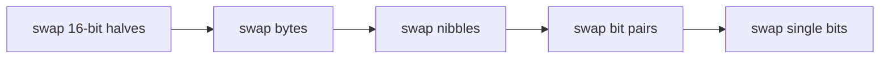
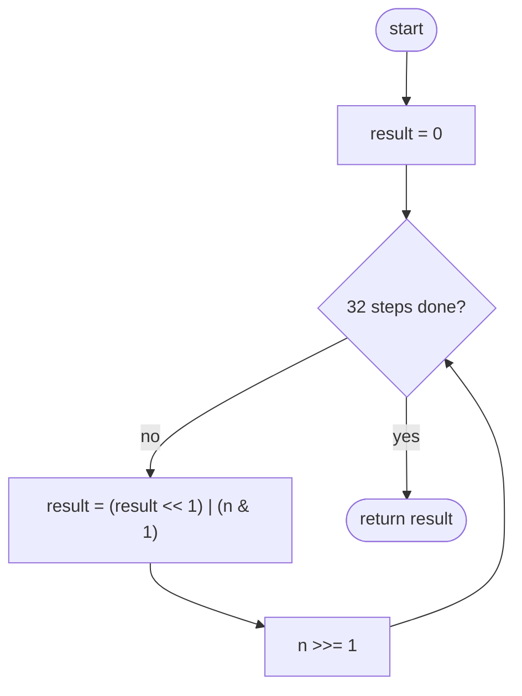
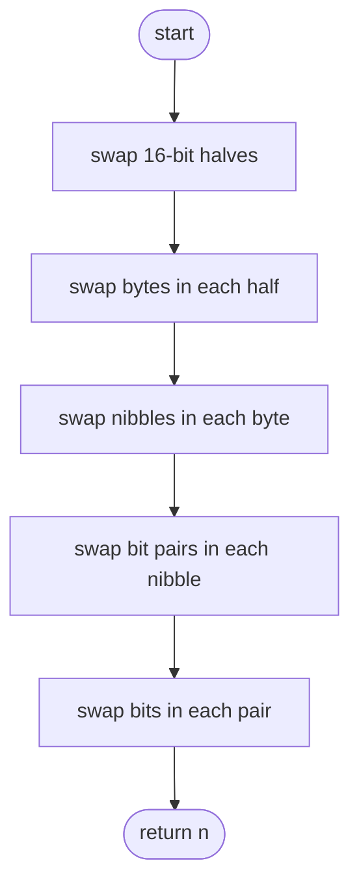

## How to think

**1. Restate the problem.** Write `n` as exactly 32 bits, including leading zeros, reverse their order, and read the result back as a number.

**2. Leading zeros matter.** `1` is `000…0001`, and reversed it's `1000…000` = 2³¹. Working only with the bits up to the highest 1 gives the wrong answer, so always handle all 32 positions.

**3. The direct way: move one bit at a time.** Read `n` from its lowest bit up, and build the result from its highest bit down: shift the result left, drop in `n`'s lowest bit, then shift `n` right.

**4. The clever way: swap halves, then smaller and smaller pieces.** Reversing is the same as swapping the two 16-bit halves, then the bytes within each half, then the 4-bit nibbles, then 2-bit pairs, then neighbouring bits. Each swap is one line of masks and shifts, so 5 steps reverse all 32 bits.



**5. Watch the edge cases.** `0` stays `0`, and all 32 ones stays all ones. In Python, mask to 32 bits after shifting left, because Python integers grow instead of dropping bits.

## Approach 1: Brute force — move one bit per step
<!-- approach: brute_force | time: O(32) | space: O(1) -->

Repeat 32 times: shift the result left to make room, copy `n`'s lowest bit into it, then shift `n` right.

**Dry run** for `n = 6` (`…0110`), first 4 of the 32 steps:

| Step | n's lowest bit | result (low bits) |
|---|---|---|
| 1 | 0 | 0 |
| 2 | 1 | 01 |
| 3 | 1 | 011 |
| 4 | 0 | 0110 |

After all 32 steps, those bits sit at the top: `0110 0000 … 0000` = 2³⁰ + 2²⁹ = **1610612736**.

### Code
```python
class Solution:
    def reverseBits(self, n: int) -> int:
        result = 0
        for _ in range(32):
            result = (result << 1) | (n & 1)
            n >>= 1
        return result
```

### Line by line
- `3` The reversed bits are built here.
- `4` Exactly 32 steps, so leading zeros of `n` become trailing zeros of the result.
- `5` Make room in the result and append `n`'s lowest bit.
- `6` Move to `n`'s next bit.
- `7` After 32 steps the result holds all bits in reverse order.

### Flowchart


## Approach 2: Optimized — swap with masks: halves, bytes, nibbles, pairs, bits
<!-- approach: optimized | time: O(log 32) = 5 steps | space: O(1) -->

Each line swaps adjacent blocks of one size. A mask such as `0xFF00FF00` picks out the left block of every pair, and `0x00FF00FF` picks out the right block. Shift each mask's bits toward the other block and combine.

**Dry run** on the 8-bit value `1101 0010`, to show the idea (the real code does 32 bits):

| Step | Swap | Result |
|---|---|---|
| start | | 1101 0010 |
| nibbles | 1101 ↔ 0010 | 0010 1101 |
| pairs | 00 10 11 01 → 10 00 01 11 | 1000 0111 |
| single bits | 1 0 0 0 0 1 1 1 → 0 1 0 0 1 0 1 1 | **0100 1011** |

`1101 0010` reversed is `0100 1011`. ✓

### Code
```python
class Solution:
    def reverseBits(self, n: int) -> int:
        n = ((n >> 16) | (n << 16)) & 0xFFFFFFFF
        n = ((n & 0xFF00FF00) >> 8) | ((n & 0x00FF00FF) << 8)
        n = ((n & 0xF0F0F0F0) >> 4) | ((n & 0x0F0F0F0F) << 4)
        n = ((n & 0xCCCCCCCC) >> 2) | ((n & 0x33333333) << 2)
        n = ((n & 0xAAAAAAAA) >> 1) | ((n & 0x55555555) << 1)
        return n
```

### Line by line
- `3` Swap the two 16-bit halves. The mask drops what Python would otherwise keep above bit 31.
- `4` Within each half, swap the two bytes: `FF00FF00` selects the high byte of each pair, `00FF00FF` the low byte.
- `5` Within each byte, swap the two 4-bit nibbles (`F0` and `0F` patterns).
- `6` Within each nibble, swap the two 2-bit pairs (`C` = 1100, `3` = 0011).
- `7` Within each pair, swap the two bits (`A` = 1010, `5` = 0101).
- `8` Five swaps of shrinking size reverse all 32 bits.

### Flowchart

