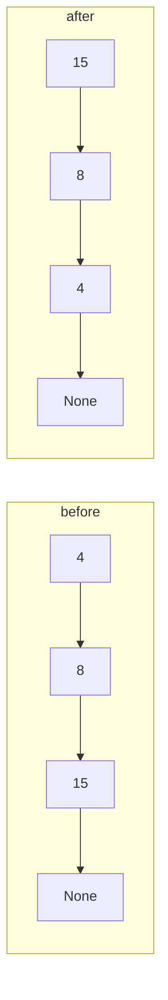
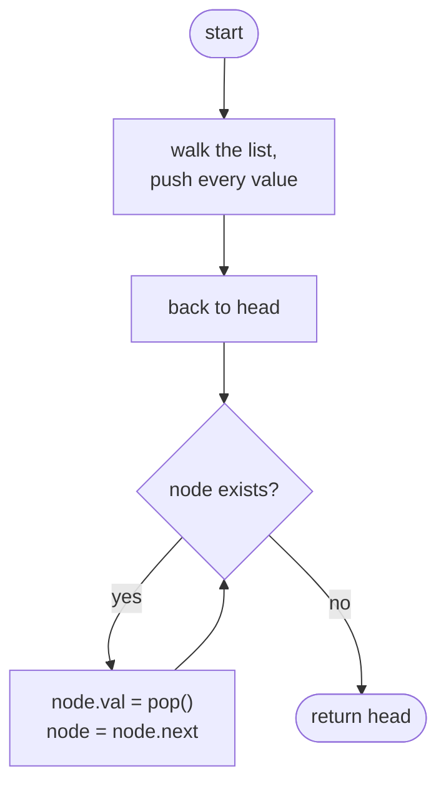
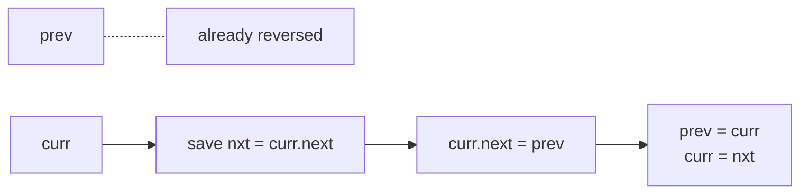
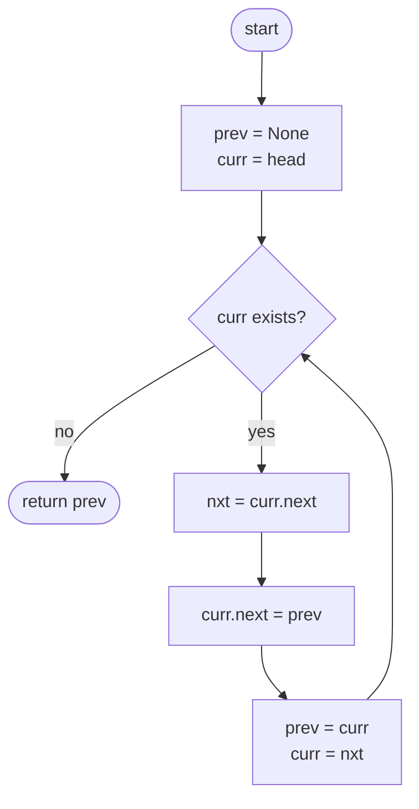

## How to think

**1. Restate the problem.** Each node points to the next one. Make every arrow point the other way and return the new first node (the old last one).

**2. See what has to change.** Reversing doesn't move any node; it only redirects the `next` arrows:



**3. The trap: losing the rest of the list.** The moment you point a node's `next` backwards, you lose your only link to the nodes ahead of it. So before changing `curr.next`, save it in a temporary variable.

**4. Three pointers do it.** Walk the list with `prev` (the already-reversed part) and `curr` (the next node to flip). At each node: save `curr.next`, point `curr.next` at `prev`, then move both pointers forward. When `curr` falls off the end, `prev` is the new head.

**5. Watch the edge cases.** An empty list (`head` is `None`) and a single node both come back unchanged. The new last node, the old head, must point to `None`; starting with `prev = None` handles that automatically.

## Approach 1: Brute force — copy the values out and write them back reversed
<!-- approach: brute_force | time: O(n) | space: O(n) -->

Walk the list and collect all values into an array. Walk it again, overwriting each node's value by popping from the end of the array. The nodes stay where they are, but the values come out reversed.

**Dry run** on `4 → 8 → 15`:

| Pass | Node | Action | Stack of values |
|---|---|---|---|
| 1 | 4, 8, 15 | collect | [4, 8, 15] |
| 2 | first node | val = pop() = 15 | [4, 8] |
| 2 | second node | val = pop() = 8 | [4] |
| 2 | third node | val = pop() = 4 | [] |

Result: `15 → 8 → 4`. This is correct and linear, but uses O(n) extra memory, and it changes values instead of links. An interviewer usually wants the links reversed.

### Code
```python
class Solution:
    def reverseList(self, head: Optional[ListNode]) -> Optional[ListNode]:
        values = []
        node = head
        while node:
            values.append(node.val)
            node = node.next
        node = head
        while node:
            node.val = values.pop()
            node = node.next
        return head
```

### Line by line
- `3` Holds every value in list order.
- `4-7` First pass: walk to the end, recording each value.
- `8` Go back to the start for the second pass.
- `9-11` Second pass: `pop()` takes the *last* recorded value, so the first node gets the last value, and so on.
- `12` The same first node, now holding the values in reverse order.

### Flowchart


## Approach 2: Optimized — reverse the links in place
<!-- approach: optimized | time: O(n) | space: O(1) -->

Walk once with two pointers, flipping one arrow per step, as described in *How to think*.

**Dry run** on `4 → 8 → 15`:

| Step | prev (reversed part) | curr | Saved next | After flipping |
|---|---|---|---|---|
| start | None | 4 | | |
| 1 | None | 4 | 8 | 4 → None |
| 2 | 4 | 8 | 15 | 8 → 4 → None |
| 3 | 8 | 15 | None | 15 → 8 → 4 → None |
| end | **15** | None | | return prev |



### Code
```python
class Solution:
    def reverseList(self, head: Optional[ListNode]) -> Optional[ListNode]:
        prev = None
        curr = head
        while curr:
            nxt = curr.next
            curr.next = prev
            prev = curr
            curr = nxt
        return prev
```

### Line by line
- `3` The reversed part starts empty. It's also what the old head will end up pointing to.
- `4` Start flipping at the head.
- `5` Keep going until every node has been flipped.
- `6` Save the rest of the list *before* breaking the link to it.
- `7` Flip this node's arrow to point back at the reversed part.
- `8-9` Move forward: this node joins the reversed part, and the saved node is the next to flip.
- `10` `curr` ran off the end, so `prev` is the old last node, which is the new head. For an empty list it's `None`.

### Flowchart

