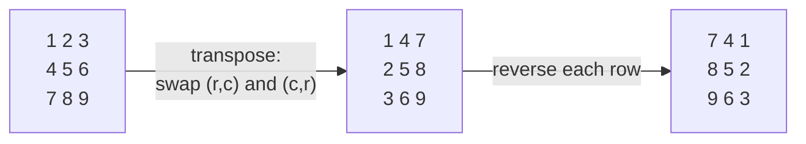
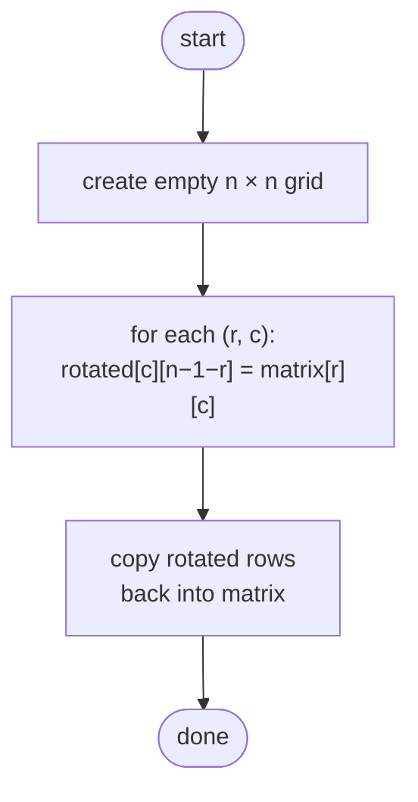
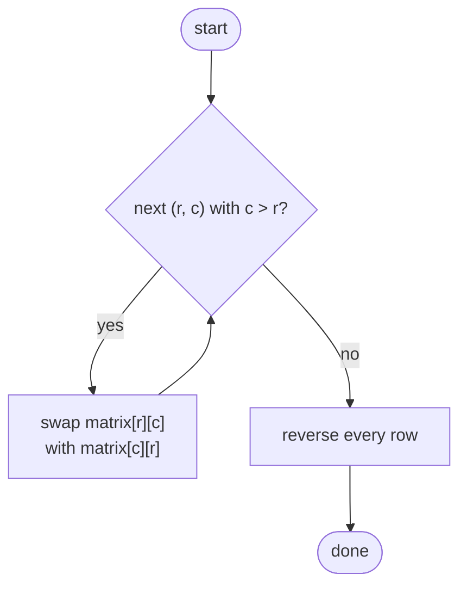

## How to think

**1. Restate the problem.** Turn an `n × n` matrix 90° clockwise, in place, without building a second matrix.

**2. Find where each cell goes.** Rotating clockwise, the first row becomes the last column, the second row becomes the second-to-last column, and so on. In coordinates:

```
the value at (row r, column c) moves to (row c, column n − 1 − r)
```

Check with `[[1,2],[3,4]]`: the `3` at (1, 0) moves to (0, 1), giving `[[3,1],[4,2]]`.

**3. Break the rotation into two easy moves.** Doing that mapping in place is fiddly, because writing a value destroys the one already there. But a clockwise rotation equals two simple reflections:



Both reflections are just swaps, so each can be done in place.

**4. Don't swap twice.** When transposing, swap each pair `(r, c)` and `(c, r)` only once: loop over cells *above* the diagonal (`c > r`). Swapping every pair twice would undo the transpose.

**5. Watch the edge cases.** A 1×1 matrix doesn't change. Negative values and repeated values need no special handling.

## Approach 1: Brute force — build the rotated copy, then copy it back
<!-- approach: brute_force | time: O(n²) | space: O(n²) -->

Use the mapping directly: create a new `n × n` matrix, place each value at its rotated position, then copy the rows back into the original. It's easy to get right, but the extra matrix breaks the "in place" requirement.

**Dry run** on `[[1,2],[3,4]]`:

| From (r, c) | Value | To (c, n − 1 − r) |
|---|---|---|
| (0, 0) | 1 | (0, 1) |
| (0, 1) | 2 | (1, 1) |
| (1, 0) | 3 | (0, 0) |
| (1, 1) | 4 | (1, 0) |

Rotated: `[[3,1],[4,2]]`.

### Code
```python
class Solution:
    def rotate(self, matrix: List[List[int]]) -> None:
        n = len(matrix)
        rotated = [[0] * n for _ in range(n)]
        for r in range(n):
            for c in range(n):
                rotated[c][n - 1 - r] = matrix[r][c]
        for r in range(n):
            matrix[r][:] = rotated[r]
```

### Line by line
- `3` The matrix is square, so one size is enough.
- `4` A separate n × n grid: the O(n²) extra space. Each row is created separately so rows aren't shared.
- `5-7` Send every value to its rotated position, `(c, n − 1 − r)`.
- `8-9` Copy the result back. `matrix[r][:] = ...` overwrites the contents of the existing row instead of replacing the row object, so the caller sees the change.

### Flowchart


## Approach 2: Optimized — transpose, then reverse each row
<!-- approach: optimized | time: O(n²) | space: O(1) -->

First reflect the matrix across its main diagonal (transpose), then reverse every row. Every cell is touched a constant number of times, and nothing extra is allocated.

**Dry run** on `[[2,4,6],[8,1,3],[5,7,9]]`:

| Step | Matrix |
|---|---|
| start | [[2,4,6],[8,1,3],[5,7,9]] |
| transpose | [[2,8,5],[4,1,7],[6,3,9]] |
| reverse rows | **[[5,8,2],[7,1,4],[9,3,6]]** |

### Code
```python
class Solution:
    def rotate(self, matrix: List[List[int]]) -> None:
        n = len(matrix)
        for r in range(n):
            for c in range(r + 1, n):
                matrix[r][c], matrix[c][r] = matrix[c][r], matrix[r][c]
        for row in matrix:
            row.reverse()
```

### Line by line
- `3` Size of the square matrix.
- `4-5` Visit only the cells above the main diagonal (`c > r`), so each pair is swapped exactly once. The diagonal itself stays put.
- `6` Swap the cell with its mirror image across the diagonal. Tuple assignment swaps without a temporary variable.
- `7-8` Reverse each row in place, which turns the transpose into a clockwise rotation. (Reversing the order of the rows instead would give a counter-clockwise rotation.)

### Flowchart

