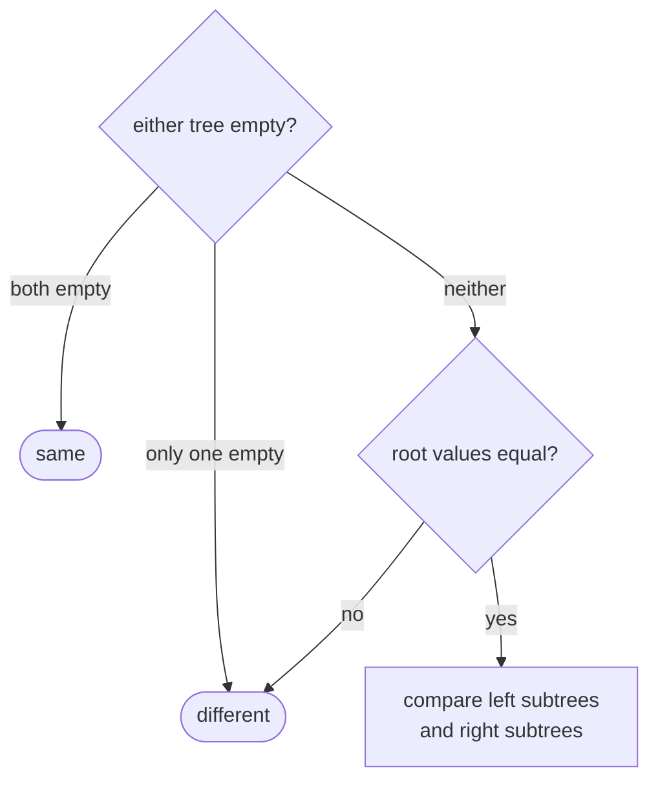
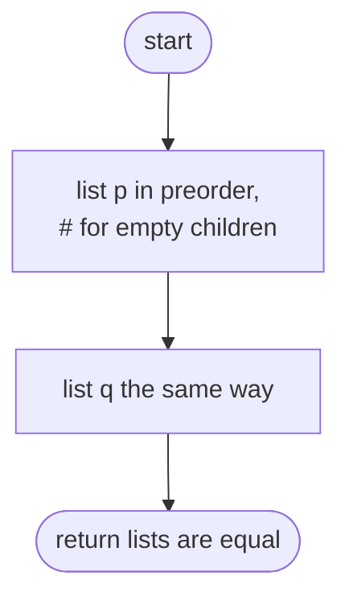
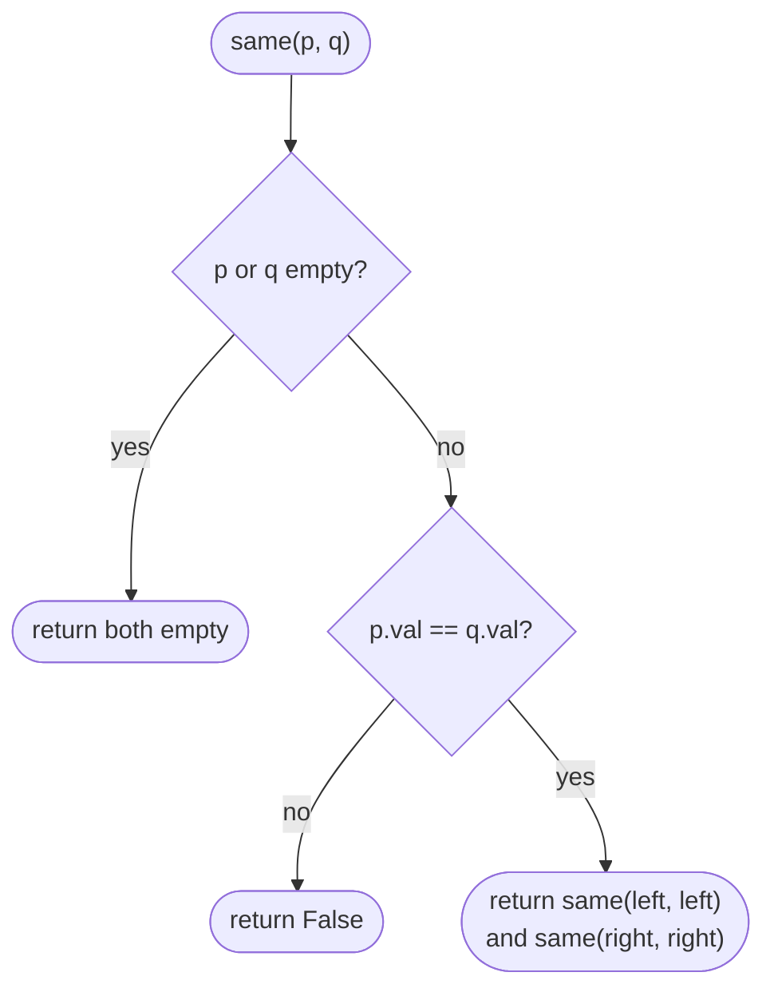

## How to think

**1. Restate the problem.** Two trees are the same when they have the same shape and the same value at every position.

**2. Compare recursively.** Two trees are the same exactly when:

- both are empty, **or**
- both are non-empty, their roots hold the same value, their left subtrees are the same, **and** their right subtrees are the same.



**3. Stop at the first difference.** Comparing node by node lets you return `false` as soon as anything differs, without looking at the rest.

**4. Shape matters, not just values.** `[1, 2]` (2 on the left) and `[1, null, 2]` (2 on the right) contain the same values but are different trees. Any approach must record where the empty children are.

**5. Watch the edge cases.** Two empty trees are the same; an empty tree and a non-empty one are not.

## Approach 1: Brute force — serialize both trees and compare
<!-- approach: brute_force | time: O(n × h) | space: O(n) -->

Turn each tree into a list in preorder, writing `#` for every empty child so the shape is captured, then compare the two lists. It always builds both lists in full, even if the roots already differ.

**Dry run** on `[1, 2]` and `[1, null, 2]`:

| Tree | Serialized |
|---|---|
| [1, 2] | 1, 2, #, #, # |
| [1, null, 2] | 1, #, 2, #, # |

The lists differ: **false**.

### Code
```python
class Solution:
    def isSameTree(self, p: Optional[TreeNode], q: Optional[TreeNode]) -> bool:
        def serialize(node):
            if node is None:
                return ["#"]
            return [node.val] + serialize(node.left) + serialize(node.right)

        return serialize(p) == serialize(q)
```

### Line by line
- `3` `serialize` writes a tree as a preorder list.
- `4-5` An empty child is recorded as `#`, so the shape is part of the list.
- `6` The node's value, then its left subtree, then its right subtree. Joining lists copies them at every level.
- `8` Same lists exactly when same trees.

### Flowchart


## Approach 2: Optimized — compare node by node
<!-- approach: optimized | time: O(min(n, m)) | space: O(h) -->

Recurse on both trees together, stopping at the first mismatch.

**Dry run** on `[1, 2, 3]` and `[1, 2, 3]`:

| Pair compared | Result |
|---|---|
| roots 1, 1 | equal → check children |
| left 2, 2 | equal; their children are all empty |
| right 3, 3 | equal; their children are all empty |

All matched: **true**.

### Code
```python
class Solution:
    def isSameTree(self, p: Optional[TreeNode], q: Optional[TreeNode]) -> bool:
        if p is None or q is None:
            return p is q
        return p.val == q.val and self.isSameTree(p.left, q.left) and self.isSameTree(p.right, q.right)
```

### Line by line
- `3-4` If either is empty, they're the same only if both are.
- `5` Same root value, same left subtree, same right subtree. `and` stops at the first `False`.

### Flowchart

