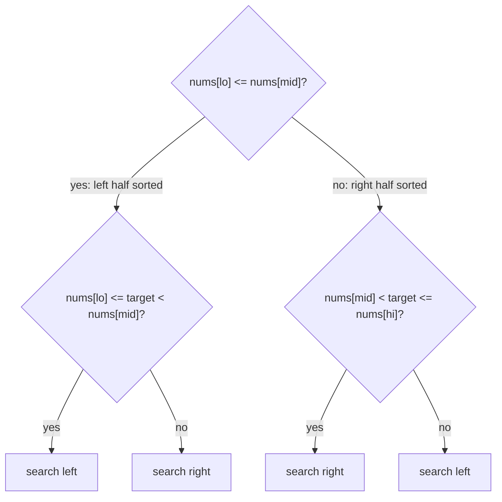
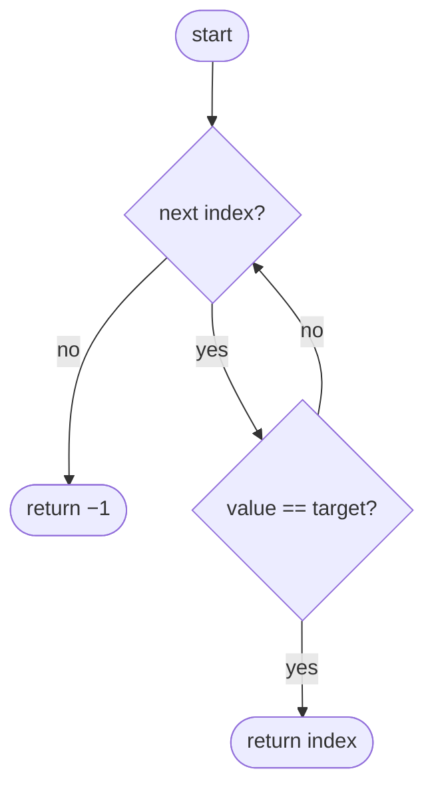
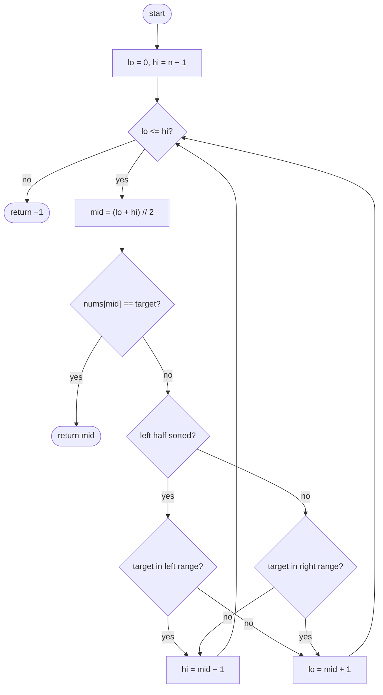

## How to think

**1. Restate the problem.** Find `target`'s index in a rotated sorted list of distinct values, such as `[9, 13, 20, 1, 4, 6]`, in O(log n).

**2. The key fact: one half is always sorted.** Cut the range at `mid`. Since there's only one drop, at least one of the two halves, `[lo, mid]` or `[mid, hi]`, has no drop and is fully sorted.

**3. Use the sorted half to decide.** In a sorted half, checking whether the target lies inside is just comparing with its two ends. If it's inside, search there; otherwise search the other half.



**4. Every step halves the range,** so the search is O(log n), exactly like ordinary binary search, with one extra comparison.

**5. Watch the edge cases.** A target that's absent, a list of one or two elements, a target at the rotation point, and an unrotated list. Use `<=` with `nums[lo]` so that `lo == mid` is treated as a sorted left half.

## Approach 1: Brute force — linear scan
<!-- approach: brute_force | time: O(n) | space: O(1) -->

Check every position until the target turns up. Correct and simple, but it ignores the structure and isn't O(log n).

**Dry run** on `[9, 13, 20, 1, 4, 6]` for target 4: indices 0, 1, 2 and 3 don't match; index **4** does.

### Code
```python
class Solution:
    def search(self, nums: List[int], target: int) -> int:
        for i, value in enumerate(nums):
            if value == target:
                return i
        return -1
```

### Line by line
- `3` Visit each index and value in order.
- `4-5` Found it: return the index.
- `6` The target isn't in the list.

### Flowchart


## Approach 2: Optimized — binary search using the sorted half
<!-- approach: optimized | time: O(log n) | space: O(1) -->

Each step looks at the middle. If it isn't the target, find the sorted half, check whether the target falls inside it, and discard the other half.

**Dry run** on `[9, 13, 20, 1, 4, 6]`, target 4:

| lo | hi | mid (value) | Sorted half | Target inside it? | Move |
|---|---|---|---|---|---|
| 0 | 5 | 2 (20) | left: 9 … 20 | 9 ≤ 4 < 20? no | lo = 3 |
| 3 | 5 | 4 (4) | | **found** | return 4 |

### Code
```python
class Solution:
    def search(self, nums: List[int], target: int) -> int:
        lo, hi = 0, len(nums) - 1
        while lo <= hi:
            mid = (lo + hi) // 2
            if nums[mid] == target:
                return mid
            if nums[lo] <= nums[mid]:
                if nums[lo] <= target < nums[mid]:
                    hi = mid - 1
                else:
                    lo = mid + 1
            else:
                if nums[mid] < target <= nums[hi]:
                    lo = mid + 1
                else:
                    hi = mid - 1
        return -1
```

### Line by line
- `3` Search the whole list.
- `4` `<=` because a one-element range still needs checking.
- `5-7` Check the middle; done if it's the target.
- `8` The left half `[lo, mid]` is sorted. `<=` matters when `lo == mid`.
- `9-10` The target is within the sorted left half's range: search there.
- `11-12` Otherwise it can only be in the right half.
- `13` Otherwise the right half `[mid, hi]` is sorted.
- `14-15` The target is within the sorted right half's range: search there.
- `16-17` Otherwise it can only be in the left half.
- `18` The range is empty: the target isn't present.

### Flowchart

