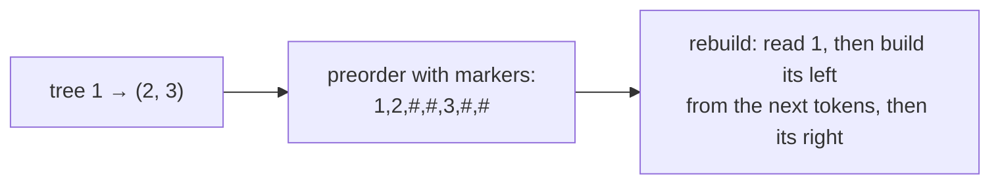
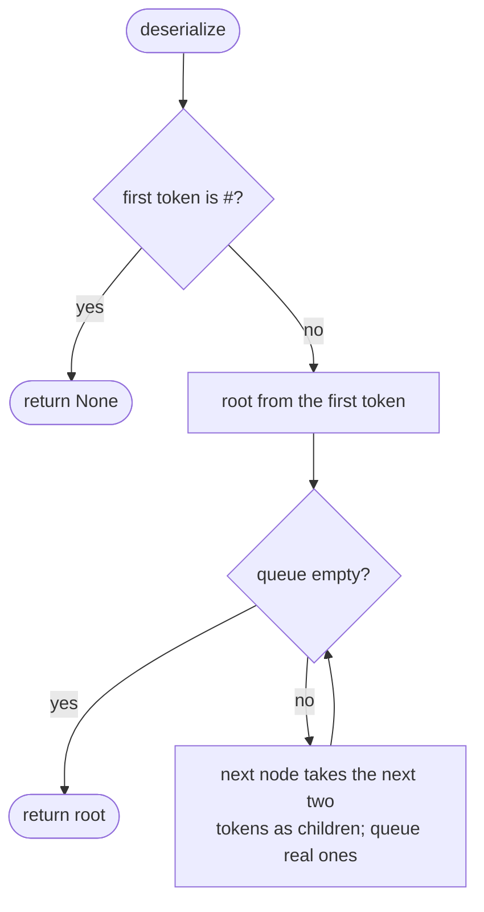
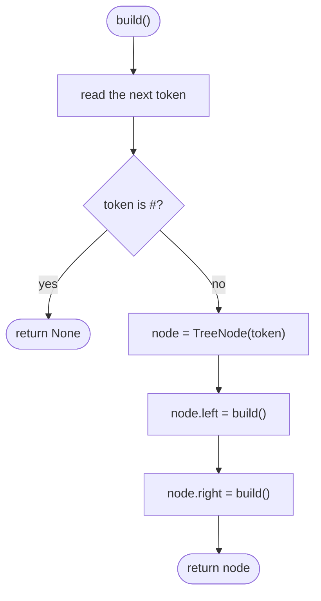

## How to think

**1. Restate the problem.** Choose a string format for trees, and write both directions: tree → string and string → the identical tree.

**2. Values alone aren't enough.** Many different trees contain the same values, even in the same traversal order. The string must also record **where the empty children are**. A marker such as `#` for every missing child makes the shape unambiguous.



**3. Two natural formats.**

- **Level order (BFS):** write nodes row by row with `#` for gaps, and rebuild with a queue, handing out children to parents in the same order.
- **Preorder (DFS):** write node, left subtree, right subtree, with `#` for empty subtrees. Rebuild with a recursive function that reads tokens in the same order. The markers tell it exactly when a subtree ends.

**4. Separate the values.** Values can be negative or have several digits, so use a separator (like `,`) between tokens.

**5. Watch the edge cases.** The empty tree must survive the round trip (`"#"`). Repeated values must still rebuild in the right positions.

## Approach 1: Brute force — level order with markers
<!-- approach: brute_force | time: O(n) | space: O(n) -->

Breadth-first: write each node's value, or `#` for an empty slot. To rebuild, read the first value as the root, then give each queued node its left and right children from the next two tokens.

**Dry run** on `[1, 2, 3, null, null, 4, 5]`:

| Step | Result |
|---|---|
| serialize | `1,2,3,#,#,4,5,#,#,#,#` |
| rebuild 1 | children 2, 3 |
| rebuild 2 | children #, # |
| rebuild 3 | children 4, 5 |
| 4, 5 | all children # |

This isn't slower than the other approach; it's the more "obvious" format, and it writes markers for every empty child slot.

### Code
```python
class Codec:
    def serialize(self, root: Optional[TreeNode]) -> str:
        values, queue = [], deque([root])
        while queue:
            node = queue.popleft()
            if node is None:
                values.append("#")
            else:
                values.append(str(node.val))
                queue.extend((node.left, node.right))
        return ",".join(values)

    def deserialize(self, data: str) -> Optional[TreeNode]:
        values = data.split(",")
        if values[0] == "#":
            return None
        root = TreeNode(int(values[0]))
        queue, i = deque([root]), 1
        while queue:
            node = queue.popleft()
            for side in ("left", "right"):
                if values[i] != "#":
                    child = TreeNode(int(values[i]))
                    setattr(node, side, child)
                    queue.append(child)
                i += 1
        return root
```

### Line by line
- `3` Tokens written so far, and a queue that starts with the root (even if it's empty).
- `4-10` Breadth-first: an empty slot becomes `#`; a node writes its value and queues both children, empty or not.
- `11` Comma-separated, so negative and multi-digit values stay intact.
- `14-16` The empty tree is just `#`.
- `17-18` Rebuild the root, and walk the tokens with the same queue order as when writing.
- `19-25` Each node takes the next two tokens as its left and right children; real children are queued for their own turn.
- `26` The rebuilt tree.

### Flowchart


## Approach 2: Optimized — preorder with markers, rebuilt recursively
<!-- approach: optimized | time: O(n) | space: O(n) -->

Write node, left subtree, right subtree, with `#` for empty subtrees. Reading the tokens back in the same order with the same recursion rebuilds the tree. The code mirrors itself, which makes it hard to get wrong.

**Dry run** on `[1, 2, 3, null, null, 4, 5]`:

| Step | Tokens |
|---|---|
| serialize | `1,2,#,#,3,4,#,#,5,#,#` |
| build() reads 1 | left = build() reads 2 (with children #, #); right = build() reads 3 |
| under 3 | left reads 4 (#, #); right reads 5 (#, #) |

### Code
```python
class Codec:
    def serialize(self, root: Optional[TreeNode]) -> str:
        out = []

        def walk(node):
            if node is None:
                out.append("#")
                return
            out.append(str(node.val))
            walk(node.left)
            walk(node.right)

        walk(root)
        return ",".join(out)

    def deserialize(self, data: str) -> Optional[TreeNode]:
        tokens = iter(data.split(","))

        def build():
            token = next(tokens)
            if token == "#":
                return None
            node = TreeNode(int(token))
            node.left = build()
            node.right = build()
            return node

        return build()
```

### Line by line
- `3` Collected tokens.
- `5-11` Preorder: `#` for an empty subtree, otherwise the value followed by the left and right subtrees.
- `13-14` Walk the whole tree and join the tokens.
- `17` A shared iterator: every call to `build` consumes tokens from where the last one stopped.
- `19-22` One token per call; `#` means this subtree is empty.
- `23-26` Create the node, then build its left subtree and its right subtree from the following tokens, in the same order they were written.
- `28` Rebuild from the first token.

### Flowchart

