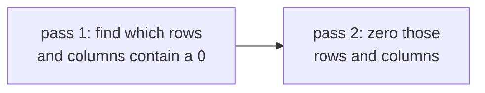
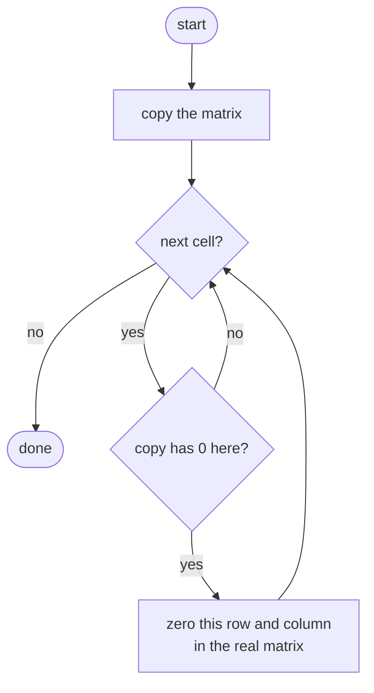
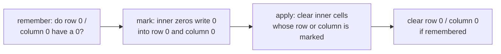
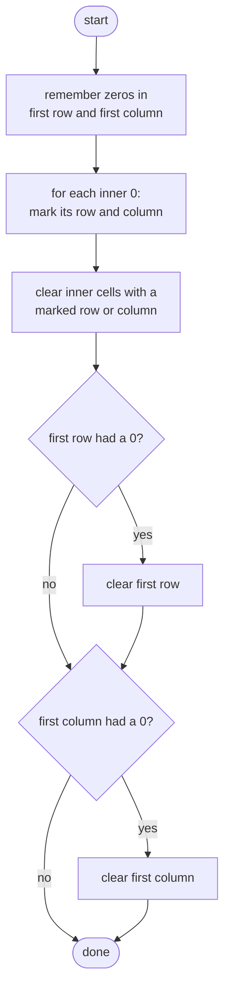

## How to think

**1. Restate the problem.** Every 0 in the *original* matrix wipes out its whole row and its whole column. Change the matrix in place.

**2. The trap: zeros you create aren't instructions.** If you zero out a row as soon as you see a 0, the new zeros will look like original zeros when you reach them later, and they'll wipe out more rows and columns than they should. You must **decide first, then change**.



**3. How much do you really need to remember?** Not the whole matrix, just *which rows* and *which columns* to clear. That's two sets: O(rows + cols) space.

**4. Store the marks inside the matrix itself.** The first row has one cell per column, and the first column has one cell per row. Those cells can hold the marks: `matrix[0][c] = 0` means "clear column c", and `matrix[r][0] = 0` means "clear row r". That brings extra space down to O(1). The catch is that the first row and column are also real data, so first remember separately whether *they* originally contained a 0.

**5. Watch the edge cases.**

- A single row or a single column.
- A 0 in the top-left corner, which is in both the first row and the first column.
- Very large and very small numbers just need to stay unchanged unless cleared.

## Approach 1: Brute force — work from a copy
<!-- approach: brute_force | time: O(m × n × (m + n)) | space: O(m × n) -->

Make a full copy of the matrix. Look for zeros in the **copy**, which never changes, and clear rows and columns in the **real** matrix. Created zeros can't trigger anything, because they never appear in the copy.

**Dry run** on `[[1,2,3],[4,0,6],[7,8,9]]`:

| Zero found in copy at | Clear row | Clear column | Matrix afterwards |
|---|---|---|---|
| (1, 1) | row 1 | column 1 | [[1,0,3],[0,0,0],[7,0,9]] |

Only one zero exists in the copy, even though the real matrix now has five.

### Code
```python
class Solution:
    def setZeroes(self, matrix: List[List[int]]) -> None:
        original = [row[:] for row in matrix]
        rows, cols = len(matrix), len(matrix[0])
        for r in range(rows):
            for c in range(cols):
                if original[r][c] == 0:
                    for k in range(cols):
                        matrix[r][k] = 0
                    for k in range(rows):
                        matrix[k][c] = 0
```

### Line by line
- `3` A full copy, so decisions are based only on the original zeros. `row[:]` copies each row; copying just the outer list would share the rows.
- `4` Matrix dimensions.
- `5-7` Look for original zeros in the copy.
- `8-9` Clear the whole row in the real matrix.
- `10-11` Clear the whole column in the real matrix. Each zero costs O(m + n), and there can be up to m × n zeros.

### Flowchart


## Approach 2: Optimized — use the first row and column as markers
<!-- approach: optimized | time: O(m × n) | space: O(1) -->

Remember whether the first row and first column originally had a zero. Then use them as markers for the rest of the matrix, apply the marks to the inner cells, and finally clear the first row and column if needed.

**Dry run** on `[[1,2,3,4],[5,0,7,8],[9,10,11,12],[0,14,15,16]]`:

| Step | What happens |
|---|---|
| check edges | first row has no 0; first column has a 0 (row 3) |
| mark | (1,1) is 0 → mark row 1 (`matrix[1][0] = 0`) and column 1 (`matrix[0][1] = 0`) |
| apply marks | every inner cell in row 1 or column 1 becomes 0 |
| clear edges | first column had a 0 → clear column 0 |

Result: `[[0,0,3,4],[0,0,0,0],[0,0,11,12],[0,0,0,0]]`. Row 3 was cleared by its own marker, `matrix[3][0]`, which was already 0.



### Code
```python
class Solution:
    def setZeroes(self, matrix: List[List[int]]) -> None:
        rows, cols = len(matrix), len(matrix[0])
        first_row_zero = any(matrix[0][c] == 0 for c in range(cols))
        first_col_zero = any(matrix[r][0] == 0 for r in range(rows))
        for r in range(1, rows):
            for c in range(1, cols):
                if matrix[r][c] == 0:
                    matrix[r][0] = 0
                    matrix[0][c] = 0
        for r in range(1, rows):
            for c in range(1, cols):
                if matrix[r][0] == 0 or matrix[0][c] == 0:
                    matrix[r][c] = 0
        if first_row_zero:
            for c in range(cols):
                matrix[0][c] = 0
        if first_col_zero:
            for r in range(rows):
                matrix[r][0] = 0
```

### Line by line
- `3` Matrix dimensions.
- `4-5` Remember whether the first row and column had real zeros, *before* they get overwritten with markers.
- `6-10` Scan the inner cells. Each zero marks its row (in column 0) and its column (in row 0).
- `11-14` Clear every inner cell whose row or column is marked. The edges are skipped here, so the markers stay intact while they're still being read.
- `15-17` Now clear the first row if it originally had a zero.
- `18-20` Same for the first column. This runs last, because column 0 held the row markers.

### Flowchart

