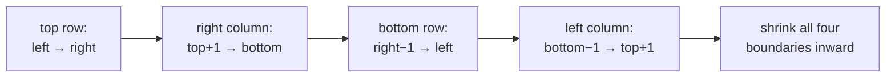
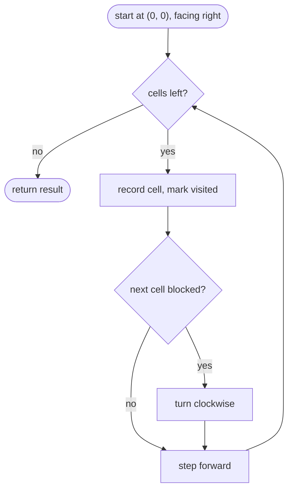
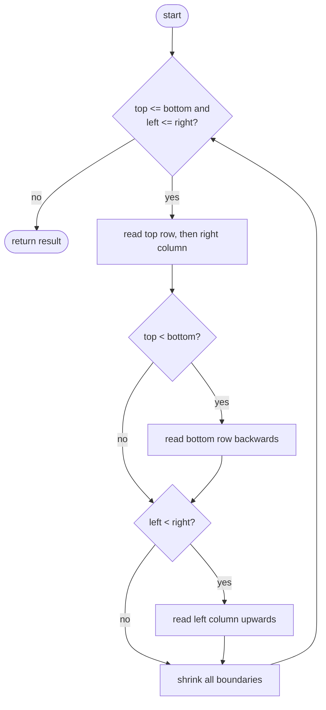

## How to think

**1. Restate the problem.** Read the matrix like peeling an onion: around the outer ring clockwise, then the next ring inside, and so on.

**2. Track the four edges.** Keep four boundaries: `top`, `bottom`, `left`, `right`. One ring is:



Then move every boundary one step inward and repeat while `top <= bottom` and `left <= right`.

**3. The trap: a single row or column in the middle.** When only one row is left (`top == bottom`), walking "back along the bottom row" would read that row a second time. When only one column is left, walking "up the left column" would repeat it. Guard those two walks with `top < bottom` and `left < right`.

**4. A simpler (but heavier) idea.** Walk cell by cell, turning right whenever the next step would leave the grid or hit an already-visited cell. Easy to get right, but it needs an extra grid of visited flags.

**5. Watch the edge cases.** 1 × 1, a single row, a single column, and wide or tall rectangles.

## Approach 1: Brute force — simulate the walk with a visited grid
<!-- approach: brute_force | time: O(m × n) | space: O(m × n) -->

Start at the top-left facing right. After each step, if the next cell is outside the grid or already visited, turn clockwise.

**Dry run** on `[[1, 2, 3], [4, 5, 6], [7, 8, 9]]`:

| Visit | Direction | Next cell blocked? |
|---|---|---|
| 1, 2, 3 | right | after 3: yes → turn down |
| 6, 9 | down | after 9: yes → turn left |
| 8, 7 | left | after 7: yes → turn up |
| 4 | up | 1 is visited → turn right |
| 5 | right | done |

Result: **1, 2, 3, 6, 9, 8, 7, 4, 5**.

### Code
```python
class Solution:
    def spiralOrder(self, matrix: List[List[int]]) -> List[int]:
        rows, cols = len(matrix), len(matrix[0])
        seen = [[False] * cols for _ in range(rows)]
        directions = ((0, 1), (1, 0), (0, -1), (-1, 0))
        r = c = d = 0
        result = []
        for _ in range(rows * cols):
            result.append(matrix[r][c])
            seen[r][c] = True
            nr, nc = r + directions[d][0], c + directions[d][1]
            if not (0 <= nr < rows and 0 <= nc < cols) or seen[nr][nc]:
                d = (d + 1) % 4
                nr, nc = r + directions[d][0], c + directions[d][1]
            r, c = nr, nc
        return result
```

### Line by line
- `3` Grid size.
- `4` Visited flags: the extra O(m × n) memory.
- `5` Right, down, left, up: clockwise order.
- `6` Start at the top-left, facing right.
- `8` Exactly one step per cell.
- `9-10` Record the cell and mark it visited.
- `11` Where the current direction leads next.
- `12-14` Off the grid or already visited: turn clockwise and step that way instead.
- `15` Move.
- `16` Every cell, in spiral order.

### Flowchart


## Approach 2: Optimized — shrink four boundaries
<!-- approach: optimized | time: O(m × n) | space: O(1) besides the output -->

Read one ring using the four boundaries, then move them all inward. No visited grid is needed.

**Dry run** on `[[1, 2, 3, 4], [5, 6, 7, 8]]`:

| Ring | top, bottom, left, right | Top row | Right column | Bottom row | Left column |
|---|---|---|---|---|---|
| 1 | 0, 1, 0, 3 | 1, 2, 3, 4 | 8 | 7, 6, 5 | (none: rows 0 to 1 exclusive) |
| 2 | 1, 0, 1, 2 | stop: top > bottom | | | |

Result: **1, 2, 3, 4, 8, 7, 6, 5**.

### Code
```python
class Solution:
    def spiralOrder(self, matrix: List[List[int]]) -> List[int]:
        result = []
        top, bottom = 0, len(matrix) - 1
        left, right = 0, len(matrix[0]) - 1
        while top <= bottom and left <= right:
            for c in range(left, right + 1):
                result.append(matrix[top][c])
            for r in range(top + 1, bottom + 1):
                result.append(matrix[r][right])
            if top < bottom:
                for c in range(right - 1, left - 1, -1):
                    result.append(matrix[bottom][c])
            if left < right:
                for r in range(bottom - 1, top, -1):
                    result.append(matrix[r][left])
            top, bottom, left, right = top + 1, bottom - 1, left + 1, right - 1
        return result
```

### Line by line
- `3` Values in spiral order.
- `4-5` The boundaries of the ring still to be read.
- `6` Continue while some cells remain inside the boundaries.
- `7-8` Top row, left to right.
- `9-10` Right column, downward, skipping the corner already read.
- `11-13` Bottom row, right to left, but only if it's a different row from the top.
- `14-16` Left column, upward, but only if it's a different column from the right; it stops before the top-left corner.
- `17` Move every boundary one step inward for the next ring.
- `18` Every element exactly once.

### Flowchart

