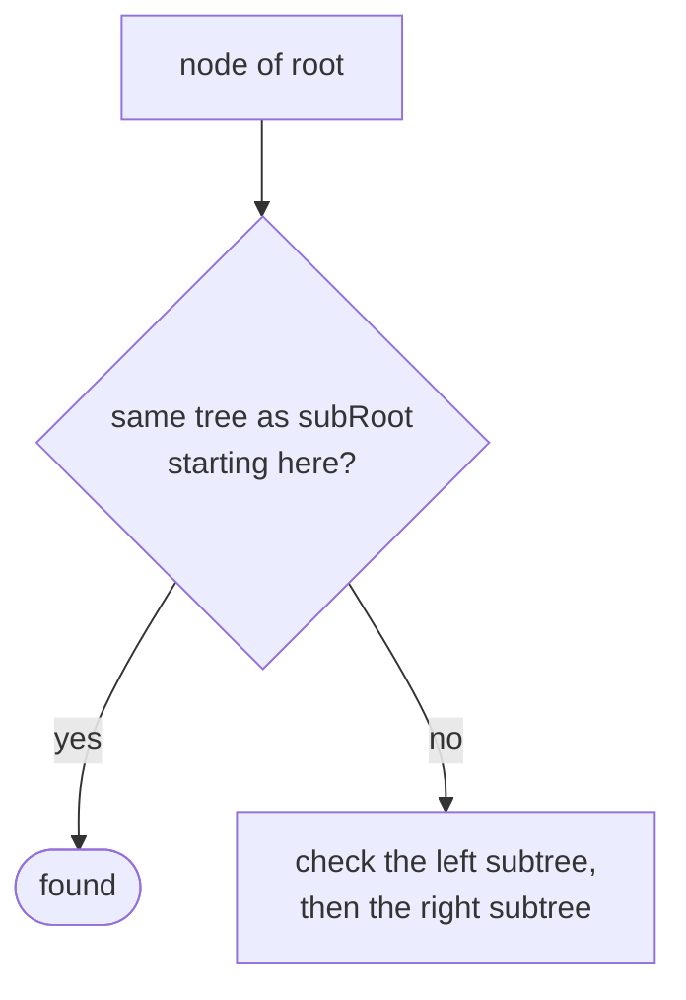
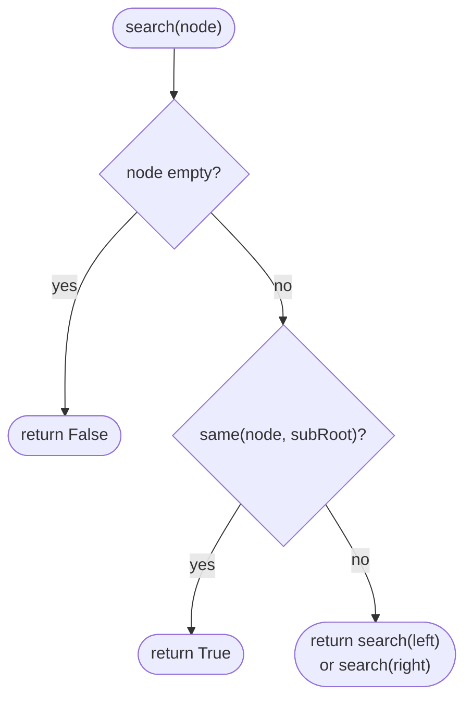
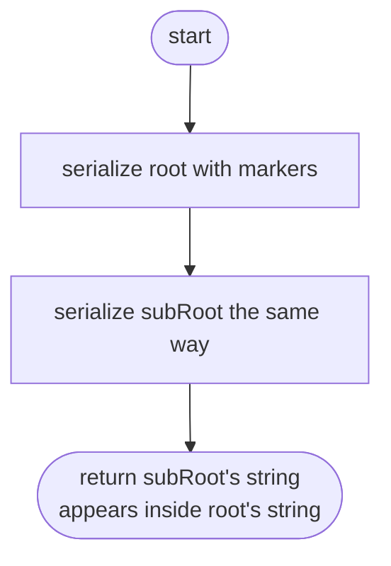

## How to think

**1. Restate the problem.** Does some node of `root`, together with everything below it, exactly match `subRoot`?

**2. Combine two smaller questions.** "Is this tree the same as `subRoot`?" is **Same Tree**. So check every node of `root`: is the subtree starting here the same as `subRoot`?



That's O(n × m) in the worst case: up to m comparisons at each of n nodes.

**3. A linear-time idea: compare strings.** Serialize both trees in preorder with markers for empty children (the same format as **Serialize and Deserialize**). A subtree of `root` is a **contiguous piece** of `root`'s serialization, so the question becomes "is one string inside the other?"

**4. Delimit carefully.** Without separators, a subtree `[2]` would wrongly match inside `[12]`. Put a separator *before* every token (`,12` versus `,2`), and record empty children (`,#`), so only whole values and whole subtrees can match.

**5. Watch the edge cases.** A match must include all descendants: `[4, 1, 2]` doesn't match a node 4 whose subtree has an extra child. Repeated values mean several candidate starting nodes.

## Approach 1: Brute force — compare subRoot at every node
<!-- approach: brute_force | time: O(n × m) | space: O(h) -->

Walk every node of `root` and run a Same Tree check against `subRoot`.

**Dry run** on `root = [3, 4, 5, 1, 2]`, `subRoot = [4, 1, 2]`:

| Node | Same as subRoot? |
|---|---|
| 3 | no (3 ≠ 4) |
| 4 | 4 = 4, left 1 = 1, right 2 = 2 → **yes** |

### Code
```python
class Solution:
    def isSubtree(self, root: Optional[TreeNode], subRoot: Optional[TreeNode]) -> bool:
        def same(a, b):
            if a is None or b is None:
                return a is b
            return a.val == b.val and same(a.left, b.left) and same(a.right, b.right)

        def search(node):
            if node is None:
                return False
            return same(node, subRoot) or search(node.left) or search(node.right)

        return search(root)
```

### Line by line
- `3-6` The Same Tree check: both empty, or equal roots with equal subtrees on both sides.
- `8-11` Try the subtree starting at each node of `root`, stopping as soon as one matches.
- `13` Start the search at the root.

### Flowchart


## Approach 2: Optimized — serialize both and search the string
<!-- approach: optimized | time: O(n + m) with a linear string search | space: O(n + m) -->

Write both trees as preorder strings with a separator before every token and `#` for empty children. `subRoot` is a subtree exactly when its string appears inside `root`'s.

**Dry run** on `root = [3, 4, 5, 1, 2]`, `subRoot = [4, 1, 2]`:

| Tree | Serialized |
|---|---|
| root | `,3,4,1,#,#,2,#,#,5,#,#` |
| subRoot | `,4,1,#,#,2,#,#` |

The second string appears inside the first: **true**. Python's `in` is fast in practice; a KMP search would guarantee linear time.

### Code
```python
class Solution:
    def isSubtree(self, root: Optional[TreeNode], subRoot: Optional[TreeNode]) -> bool:
        def serialize(node, out):
            if node is None:
                out.append(",#")
                return
            out.append("," + str(node.val))
            serialize(node.left, out)
            serialize(node.right, out)

        whole, part = [], []
        serialize(root, whole)
        serialize(subRoot, part)
        return "".join(part) in "".join(whole)
```

### Line by line
- `3-9` Preorder with a comma before every token and `#` for empty children, so the string encodes the exact shape.
- `11-13` Serialize both trees.
- `14` A complete subtree is a contiguous piece of the preorder string; the separators stop partial numbers like `2` matching inside `12`.

### Flowchart

