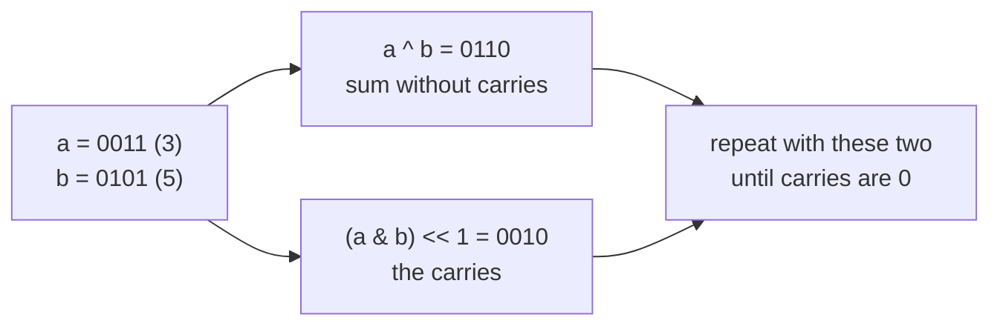
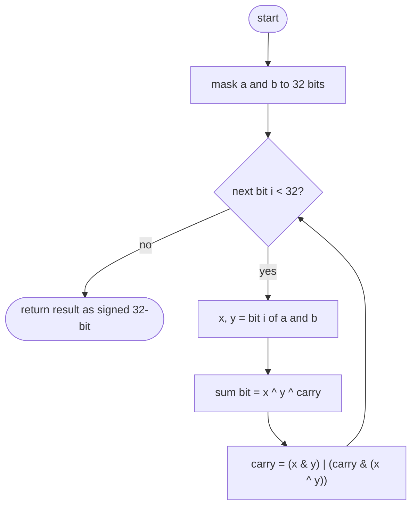
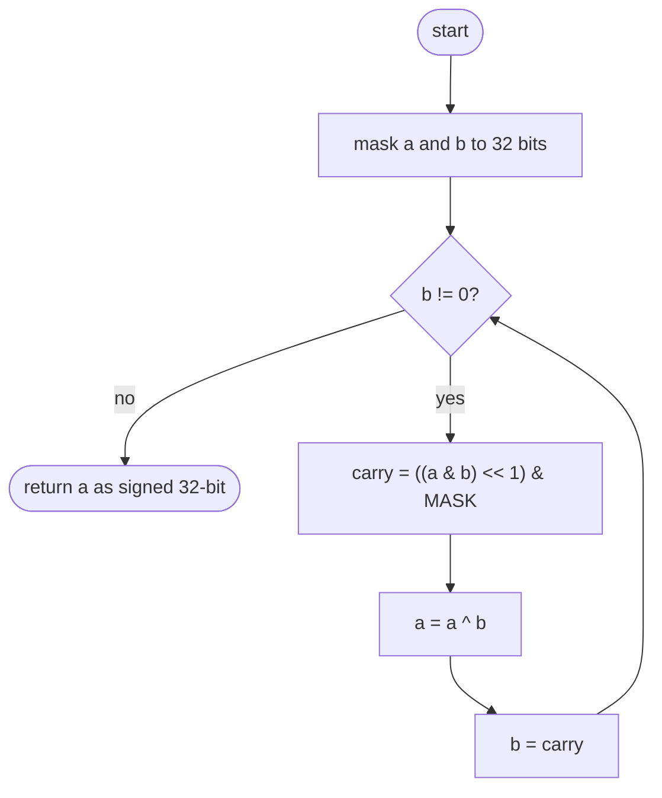

## How to think

**1. Restate the problem.** Add two integers using only bit operations: no `+` and no `−`.

**2. How does binary addition work by hand?** Line the numbers up and go right to left. At each position, the sum bit is 1 when exactly one of (a bit, b bit, carry) is 1, or all three are. A carry goes to the next position when at least two of them are 1.

**3. Do every position at once.** Two operators capture this for the whole number in one step:

- `a ^ b` adds every position **ignoring carries** (1 + 1 gives 0).
- `(a & b) << 1` is every carry, moved to the position it lands in.

Adding those two results is the same problem again, so repeat until there's no carry left.



**4. Python needs a 32-bit fence.** Python integers never overflow, so a negative number's carry would travel left forever. Mask with `0xFFFFFFFF` to stay within 32 bits, then convert a result with the top bit set back into a negative number: `~(x ^ 0xFFFFFFFF)`. C++ and Java do this automatically with 32-bit `int`s.

**5. Watch the edge cases.** Negative plus positive, two negatives, and a long carry chain such as 255 + 1 = 256.

## Approach 1: Brute force — a ripple-carry adder, one bit at a time
<!-- approach: brute_force | time: O(32) | space: O(1) -->

Simulate pencil-and-paper addition: for each of the 32 positions, compute the sum bit and the carry from the two input bits and the incoming carry.

**Dry run** for 3 + 5 (only the low 4 bits shown):

| Bit | a | b | carry in | Sum bit | Carry out |
|---|---|---|---|---|---|
| 0 | 1 | 1 | 0 | 0 | 1 |
| 1 | 1 | 0 | 1 | 0 | 1 |
| 2 | 0 | 1 | 1 | 0 | 1 |
| 3 | 0 | 0 | 1 | 1 | 0 |

Result `1000` = **8**.

### Code
```python
class Solution:
    def getSum(self, a: int, b: int) -> int:
        MASK = 0xFFFFFFFF
        a, b = a & MASK, b & MASK
        result, carry = 0, 0
        for i in range(32):
            x, y = (a >> i) & 1, (b >> i) & 1
            result |= (x ^ y ^ carry) << i
            carry = (x & y) | (carry & (x ^ y))
        return result if result < 0x80000000 else ~(result ^ MASK)
```

### Line by line
- `3-4` View both numbers as 32-bit patterns; a negative number becomes its two's complement bits.
- `5` The answer bits, and the carry moving between positions.
- `6-7` Take bit `i` of each number.
- `8` The sum bit is 1 when an odd number of the three inputs are 1, which is exactly what XOR computes.
- `9` A carry happens when both bits are 1, or when one of them is 1 and a carry came in.
- `10` If bit 31 is set, the 32-bit pattern means a negative number: convert it back to Python's negative form.

### Flowchart


## Approach 2: Optimized — XOR for the sum, AND for the carry
<!-- approach: optimized | time: O(32) worst case | space: O(1) -->

Repeat `sum = a ^ b`, `carry = (a & b) << 1` until the carry is 0. Each round settles at least one more bit, so it ends within 32 rounds, and often much sooner.

**Dry run** for 3 + 5:

| Round | a | b (carry) | a ^ b | (a & b) << 1 |
|---|---|---|---|---|
| 1 | 0011 | 0101 | 0110 | 0010 |
| 2 | 0110 | 0010 | 0100 | 0100 |
| 3 | 0100 | 0100 | 0000 | 1000 |
| 4 | 0000 | 1000 | 1000 | 0000 → stop |

Result `1000` = **8**.

### Code
```python
class Solution:
    def getSum(self, a: int, b: int) -> int:
        MASK = 0xFFFFFFFF
        a, b = a & MASK, b & MASK
        while b:
            carry = ((a & b) << 1) & MASK
            a = a ^ b
            b = carry
        return a if a < 0x80000000 else ~(a ^ MASK)
```

### Line by line
- `3-4` Work on 32-bit patterns, so negative numbers behave as they would in C++ or Java.
- `5` While there are carries left to add.
- `6` Every position where both have a 1 produces a carry into the next position; the mask drops anything pushed past bit 31.
- `7` Add without carries.
- `8` The carries become the next number to add.
- `9` Convert the 32-bit pattern back to a signed Python integer.

### Flowchart

