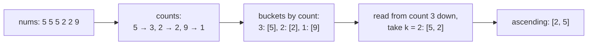
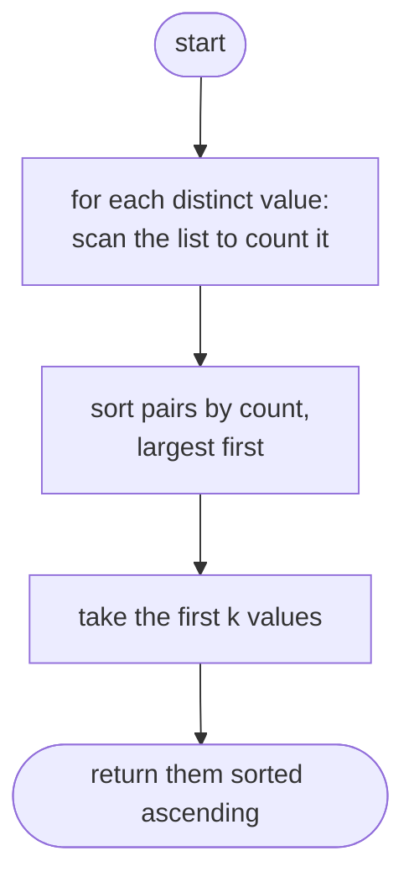
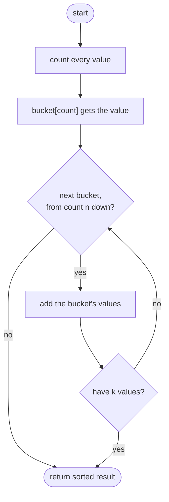

## How to think

**1. Restate the problem.** Find the `k` values that appear most often, and return them in ascending order. The problem guarantees the answer set is unique.

**2. Split it into two jobs.**

1. **Count** how often each value appears: one pass with a hash map.
2. **Select** the `k` values with the largest counts.

Counting is always O(n). The interesting part is selecting.

**3. Selecting without a full sort.** Sorting all distinct values by count is O(d log d). But a count can only be between 1 and n, so values can be dropped into **buckets indexed by count**. Reading the buckets from the highest count down gives the most frequent values first, in O(n). (A size-k heap is another option: O(n log k).)



**4. Why ascending order?** "Any order" answers are hard to judge the same way in every language. Sorting the final `k` values makes the expected output unique, at a cost of only O(k log k).

**5. Watch the edge cases.**

- `k` can equal the number of distinct values: return all of them.
- Negative numbers count like any other value.
- Several values can share a count. Since the answer is unique, a tie never straddles the cut-off.

## Approach 1: Brute force — count each value by scanning, then sort
<!-- approach: brute_force | time: O(n × d) | space: O(d) -->

For every distinct value, count its occurrences by scanning the whole list (`nums.count`). Sort the (count, value) pairs from most to least frequent, and keep the first `k`. With d distinct values, that's d full scans.

**Dry run** on `nums = [5, 5, 5, 2, 2, 9]`, `k = 2`:

| Value | Scan count | Sorted by count, descending |
|---|---|---|
| 5 | 3 | (3, 5) |
| 2 | 2 | (2, 2) |
| 9 | 1 | (1, 9) |

Top 2: 5 and 2 → ascending **[2, 5]**.

### Code
```python
class Solution:
    def topKFrequent(self, nums: List[int], k: int) -> List[int]:
        counts = [(nums.count(value), value) for value in set(nums)]
        counts.sort(reverse=True)
        return sorted(value for _, value in counts[:k])
```

### Line by line
- `3` For each distinct value, scan the whole list to count it: O(n) per value, so O(n × d) in total.
- `4` Most frequent first. Tuples compare by count first.
- `5` Keep the top `k` values and put them in ascending order, as required.

### Flowchart


## Approach 2: Optimized — hash map count + bucket sort
<!-- approach: optimized | time: O(n) | space: O(n) -->

Count everything in one pass. Put each value into the bucket for its count. Walk the buckets from the highest possible count (n) down, collecting values until there are `k`.

**Dry run** on `nums = [1, 2, 2, 3, 3, 3, 4, 4, 4, 4]`, `k = 3`:

| Bucket (count) | Values | Collected so far |
|---|---|---|
| 10 … 5 | (empty) | |
| 4 | [4] | 4 |
| 3 | [3] | 4, 3 |
| 2 | [2] | 4, 3, 2 → have k = 3, stop |

Ascending: **[2, 3, 4]**.

### Code
```python
class Solution:
    def topKFrequent(self, nums: List[int], k: int) -> List[int]:
        counts = Counter(nums)
        buckets = [[] for _ in range(len(nums) + 1)]
        for value, count in counts.items():
            buckets[count].append(value)
        result = []
        for count in range(len(nums), 0, -1):
            result.extend(buckets[count])
            if len(result) >= k:
                break
        return sorted(result[:k])
```

### Line by line
- `3` One O(n) pass gives each value's count.
- `4` One bucket for every possible count, 0 to n. No value can appear more than n times.
- `5-6` Drop each value into the bucket for its count. No comparisons needed.
- `7-11` Read buckets from the highest count down, collecting values until we have at least `k`. The unique-answer guarantee means we never have to choose between values with the same count at the cut-off.
- `12` Trim to exactly `k` and sort ascending for the required output.

### Flowchart

