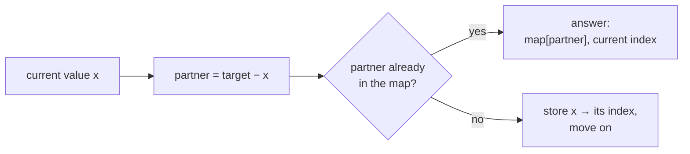
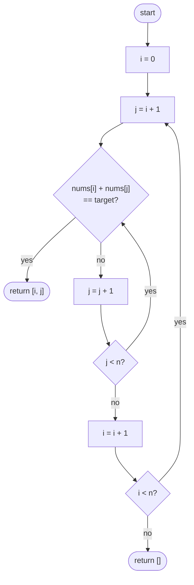
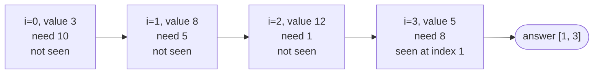
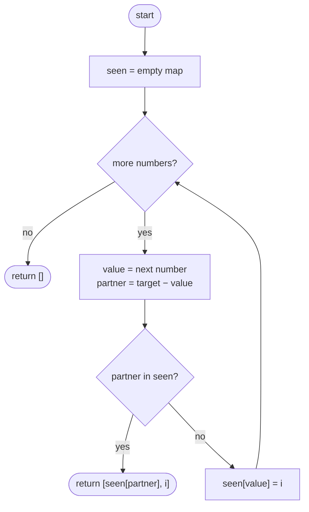

## How to think

**1. Restate the problem.** Find two *different positions* whose values add up to `target`. Exactly one such pair exists, and the answer is the two indices, smaller first.

**2. Let the constraints guide you.** `nums` can hold 10⁵ numbers. Checking every pair is about n²/2 = 5 × 10⁹ additions, far too slow. We need roughly one pass: O(n) or O(n log n).

**3. Turn "find a pair" into "find one number".** Once you fix one number `x`, its partner is no longer a mystery: it must be exactly `target − x`. So the real question at each position is:

> Have I already seen the value `target − x`, and where?

**4. Pick the data structure that answers that question fast.** "Have I seen this value, and at which index?" is a lookup by value, which a **hash map** answers in O(1) on average. Walk left to right, and before storing each number, check whether its partner is already in the map.



**5. Watch the edge cases.**

- **Equal values** such as `[7, 7]` with target 14: the partner of 7 is 7. Checking *before* storing means the first 7 can't pair with itself, but the second 7 finds the first.
- **Order of the answer:** the index from the map is always earlier than the current index, so the pair comes out smaller-first automatically.
- **Negative numbers and zero** need no special handling; the arithmetic works the same.

## Approach 1: Brute force — try every pair
<!-- approach: brute_force | time: O(n²) | space: O(1) -->

Check every pair of positions `i < j` and return the first one whose values add up to `target`. Starting `j` at `i + 1` skips pairing a position with itself and avoids checking each pair twice.

**Dry run** on `nums = [3, 8, 12, 5]`, `target = 13`:

| i | j | nums[i] + nums[j] | Match? |
|---|---|---|---|
| 0 | 1 | 3 + 8 = 11 | no |
| 0 | 2 | 3 + 12 = 15 | no |
| 0 | 3 | 3 + 5 = 8 | no |
| 1 | 2 | 8 + 12 = 20 | no |
| 1 | 3 | 8 + 5 = 13 | **yes → [1, 3]** |

This is correct, but with n = 10⁵ it does billions of additions and will exceed the time limit on the large hidden tests.

### Code
```python
class Solution:
    def twoSum(self, nums: List[int], target: int) -> List[int]:
        n = len(nums)
        for i in range(n):
            for j in range(i + 1, n):
                if nums[i] + nums[j] == target:
                    return [i, j]
        return []
```

### Line by line
- `3` Remember the length so the loops read clearly.
- `4` Fix the first position of the pair.
- `5` Try every later position as the second one. Starting at `i + 1` means a position never pairs with itself, and each pair is checked once.
- `6-7` If the two values add up to `target`, return the indices. `i < j`, so they're already smaller-first.
- `8` Unreachable when the input guarantees a pair, but a function should still return something on every path.

### Flowchart


## Approach 2: Optimized — one pass with a hash map
<!-- approach: optimized | time: O(n) | space: O(n) -->

Walk through the array once. For each value, compute the partner it needs. If the partner is already in the map, we're done; otherwise store the current value with its index so a later number can find it.

**Dry run** on `nums = [3, 8, 12, 5]`, `target = 13`:

| i | value | partner = 13 − value | In map? | Map after this step |
|---|---|---|---|---|
| 0 | 3 | 10 | no | 3 → 0 |
| 1 | 8 | 5 | no | 3 → 0, 8 → 1 |
| 2 | 12 | 1 | no | 3 → 0, 8 → 1, 12 → 2 |
| 3 | 5 | 8 | **yes, at index 1** | return **[1, 3]** |



Each number is looked up once and stored once, so the whole pass is **O(n)**. The price is the map, which can hold up to n entries: **O(n)** extra space. Trading memory for time like this is the most common optimization in array problems.

### Code
```python
class Solution:
    def twoSum(self, nums: List[int], target: int) -> List[int]:
        seen = {}  # value -> index where it appeared
        for i, value in enumerate(nums):
            partner = target - value
            if partner in seen:
                return [seen[partner], i]
            seen[value] = i
        return []
```

### Line by line
- `3` The map remembers every value seen so far and the index where it appeared.
- `4` One pass over the array, getting each index and value together.
- `5` The only value that can complete a pair with `value` is `target − value`.
- `6-7` If that partner was seen earlier, return its index and the current one. The stored index is always smaller, so the order is right.
- `8` Store the current value *after* checking. Checking first stops a number from pairing with itself, and it still lets the second 7 in `[7, 7]` find the first.
- `9` Unreachable when a pair is guaranteed; kept so every path returns a list.

### Flowchart

