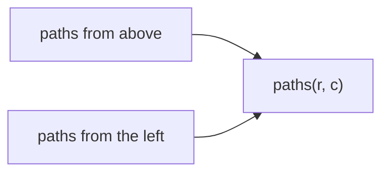
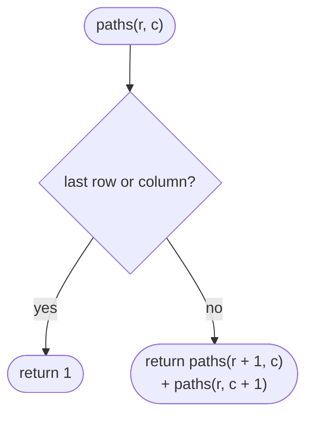
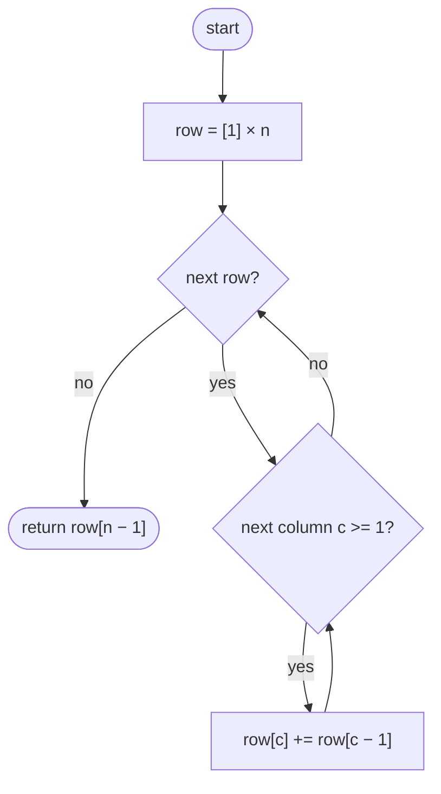

## How to think

**1. Restate the problem.** Count the paths from the top-left to the bottom-right of an `m × n` grid using only right and down moves.

**2. Think about the last move.** You enter a cell either from above or from the left, so:

```
paths(r, c) = paths(r − 1, c) + paths(r, c − 1)
```

and every cell in the first row or first column has exactly 1 path (straight along the edge).



**3. One row is enough.** Filling row by row, each cell needs only the cell above (the old value in the same position) and the cell to its left (already updated). So a single row updated in place works: O(m × n) time, O(n) space.

**4. A counting shortcut.** Every path is exactly `m − 1` down moves and `n − 1` right moves in some order, so the answer is the number of ways to choose which moves are "down": C(m + n − 2, m − 1). The DP is the more general tool (it still works with obstacles); the formula is a nice check.

**5. Watch the edge cases.** A 1 × n or m × 1 grid has exactly one path.

## Approach 1: Brute force — recursion over the next move
<!-- approach: brute_force | time: O(2^(m + n)) | space: O(m + n) -->

From each cell, count the paths going down plus the paths going right, until the last row or column is reached (from there only one path remains). Every path is effectively walked separately.

**Dry run** on a 3 × 3 grid (rows r, columns c):

| Cell | Down + Right | Paths |
|---|---|---|
| (1, 1) | (2, 1) + (1, 2) = 1 + 1 | 2 |
| (0, 1) | (1, 1) + (0, 2) = 2 + 1 | 3 |
| (1, 0) | (2, 0) + (1, 1) = 1 + 2 | 3 |
| (0, 0) | (1, 0) + (0, 1) = 3 + 3 | **6** |

### Code
```python
class Solution:
    def uniquePaths(self, m: int, n: int) -> int:
        def paths(r, c):
            if r == m - 1 or c == n - 1:
                return 1
            return paths(r + 1, c) + paths(r, c + 1)

        return paths(0, 0)
```

### Line by line
- `3` `paths(r, c)` is the number of ways from cell `(r, c)` to the bottom-right corner.
- `4-5` On the last row or column there's only one way: straight along it.
- `6` Go down or go right, and add both counts. Shared cells are recounted, which is exponential.
- `8` Start at the top-left.

### Flowchart


## Approach 2: Optimized — one row of DP
<!-- approach: optimized | time: O(m × n) | space: O(n) -->

Start with the first row (all 1s). For each next row, update each cell in place to "above + left".

**Dry run** on a 3 × 3 grid:

| Row | Values |
|---|---|
| 0 | 1, 1, 1 |
| 1 | 1, 1 + 1 = 2, 1 + 2 = 3 |
| 2 | 1, 2 + 1 = 3, 3 + 3 = **6** |

### Code
```python
class Solution:
    def uniquePaths(self, m: int, n: int) -> int:
        row = [1] * n
        for _ in range(1, m):
            for c in range(1, n):
                row[c] += row[c - 1]
        return row[-1]
```

### Line by line
- `3` The first row: one path to each cell, straight along the top.
- `4` Build each following row in place.
- `5-6` Before the update, `row[c]` still holds the paths into the cell above; `row[c − 1]` already holds the new value to the left. Their sum is the paths into this cell. Column 0 stays 1.
- `7` The bottom-right cell.

### Flowchart

