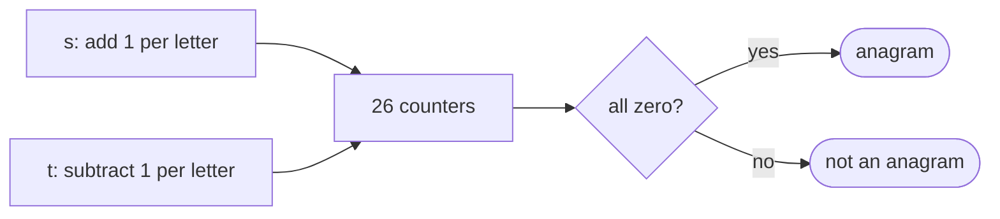
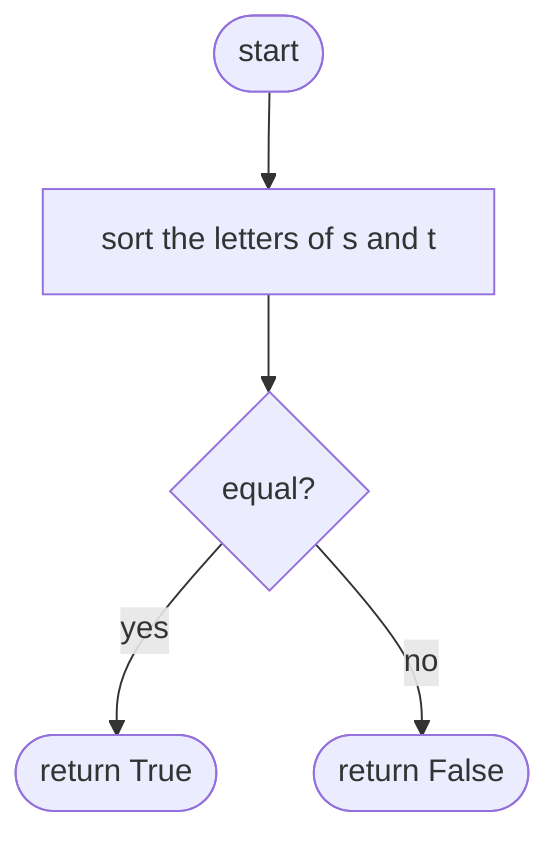
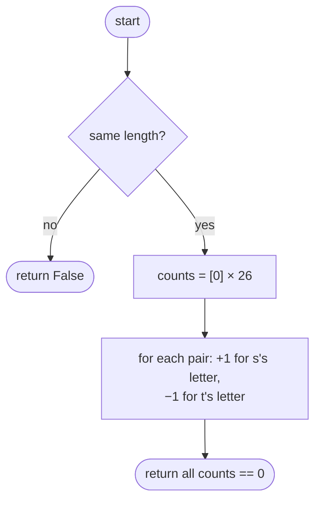

## How to think

**1. Restate the problem.** Are `s` and `t` made of exactly the same letters, the same number of times each?

**2. Two ways to compare "the same letters, any order".**

- **Sort both.** Anagrams become identical strings once sorted: O(n log n).
- **Count letters.** Only 26 letters exist, so a fixed array of counts compares them in O(n): add one for each letter of `s` and subtract one for each letter of `t`. They're anagrams exactly when every count ends at zero.



**3. A quick early exit.** Different lengths can never be anagrams.

**4. Watch the edge cases.** The same letters with different counts, such as `aab` and `abb`, must be rejected; only counting (or sorting) catches that, not "same set of letters".

## Approach 1: Brute force — sort and compare
<!-- approach: brute_force | time: O(n log n) | space: O(n) -->

Sort both strings' characters and compare the results. Short and clearly correct; sorting is the only cost.

**Dry run** on `"listen"` and `"silent"`: both sort to `e i l n s t`, so the answer is **true**.

### Code
```python
class Solution:
    def isAnagram(self, s: str, t: str) -> bool:
        return sorted(s) == sorted(t)
```

### Line by line
- `3` Anagrams have identical sorted letter sequences; different lengths or counts make the lists differ.

### Flowchart


## Approach 2: Optimized — 26 counters
<!-- approach: optimized | time: O(n) | space: O(1) -->

Walk both strings together, adding for `s` and subtracting for `t`, then check that every counter is zero.

**Dry run** on `"aab"` and `"abb"`:

| Step | s letter | t letter | counts (a, b) |
|---|---|---|---|
| 1 | a | a | 0, 0 |
| 2 | a | b | 1, −1 |
| 3 | b | b | 1, −1 |

Not all zero: **false**.

### Code
```python
class Solution:
    def isAnagram(self, s: str, t: str) -> bool:
        if len(s) != len(t):
            return False
        counts = [0] * 26
        for a, b in zip(s, t):
            counts[ord(a) - ord("a")] += 1
            counts[ord(b) - ord("a")] -= 1
        return all(count == 0 for count in counts)
```

### Line by line
- `3-4` Different lengths can't be anagrams.
- `5` One counter per lowercase letter.
- `6-8` Letters of `s` add, letters of `t` subtract; `ord(c) − ord("a")` maps a…z to 0…25.
- `9` Every letter balanced out means identical counts.

### Flowchart

