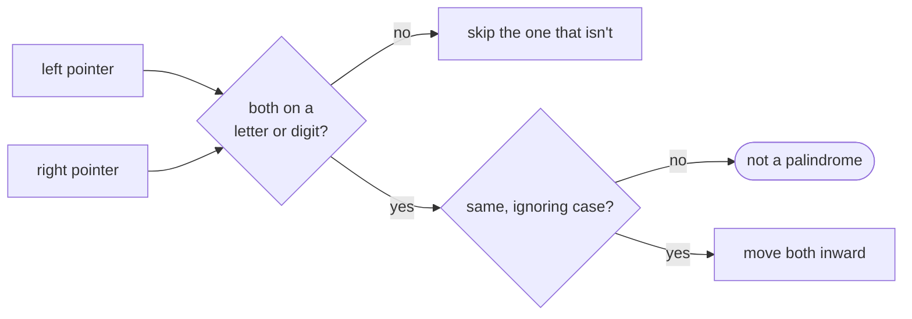
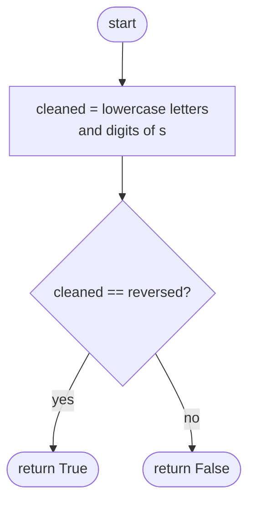
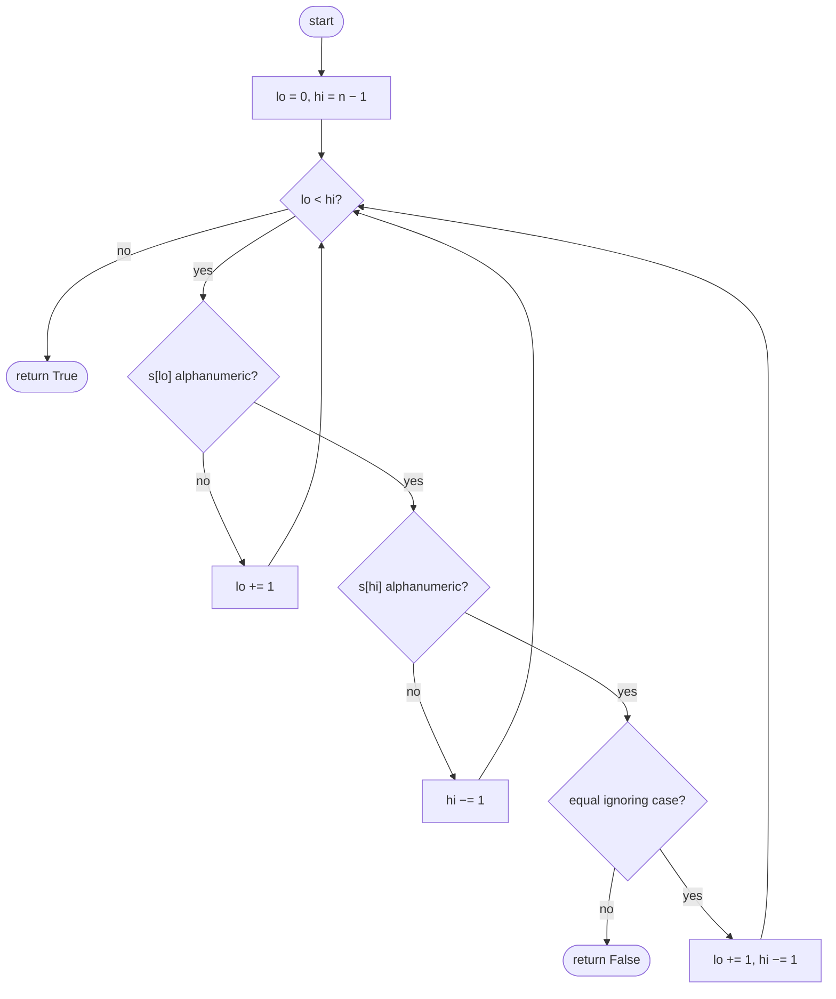

## How to think

**1. Restate the problem.** Keep only letters and digits, ignore case, and check whether the result reads the same both ways.

**2. The direct way: clean, then compare.** Build the cleaned lowercase string and compare it with its reverse. That's O(n) time, but it builds a new string of up to n characters.

**3. Without copying: two pointers.** Put one pointer at each end. Skip characters that aren't letters or digits; compare the rest case-insensitively; move both inward after a match.



**4. Digits are not letters.** `"0P"` compares `0` with `p`, which differ. Lowercasing only affects letters.

**5. Watch the edge cases.** A string with no letters or digits at all is a palindrome (the empty string reads the same both ways).

## Approach 1: Brute force — build the cleaned string and reverse it
<!-- approach: brute_force | time: O(n) | space: O(n) -->

Filter and lowercase into a new string, then compare it with its reverse.

**Dry run** on `"race a car"`: cleaned is `"raceacar"`, reversed is `"racaecar"`. They differ: **false**.

### Code
```python
class Solution:
    def isPalindrome(self, s: str) -> bool:
        cleaned = "".join(char.lower() for char in s if char.isalnum())
        return cleaned == cleaned[::-1]
```

### Line by line
- `3` Keep letters and digits only, in lowercase. This new string is the O(n) extra space.
- `4` A palindrome equals its own reverse.

### Flowchart


## Approach 2: Optimized — two pointers, no copy
<!-- approach: optimized | time: O(n) | space: O(1) -->

Move inward from both ends, skipping punctuation and spaces, comparing the remaining characters case-insensitively.

**Dry run** on `"A,b a"`:

| lo | hi | Characters | Action |
|---|---|---|---|
| 0 | 4 | A, a | match → move both |
| 1 | 3 | ",", " " | skip "," |
| 2 | 3 | b, " " | skip " " |
| 2 | 2 | | pointers met → **true** |

### Code
```python
class Solution:
    def isPalindrome(self, s: str) -> bool:
        lo, hi = 0, len(s) - 1
        while lo < hi:
            if not s[lo].isalnum():
                lo += 1
            elif not s[hi].isalnum():
                hi -= 1
            elif s[lo].lower() != s[hi].lower():
                return False
            else:
                lo, hi = lo + 1, hi - 1
        return True
```

### Line by line
- `3` One pointer at each end.
- `4` Stop when they meet or cross: everything in between has been matched.
- `5-8` Skip anything that isn't a letter or digit, one pointer at a time.
- `9-10` Two real characters that differ, ignoring case: not a palindrome.
- `11-12` They match; move both inward.
- `13` Every pair matched.

### Flowchart

