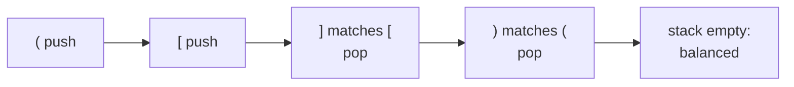
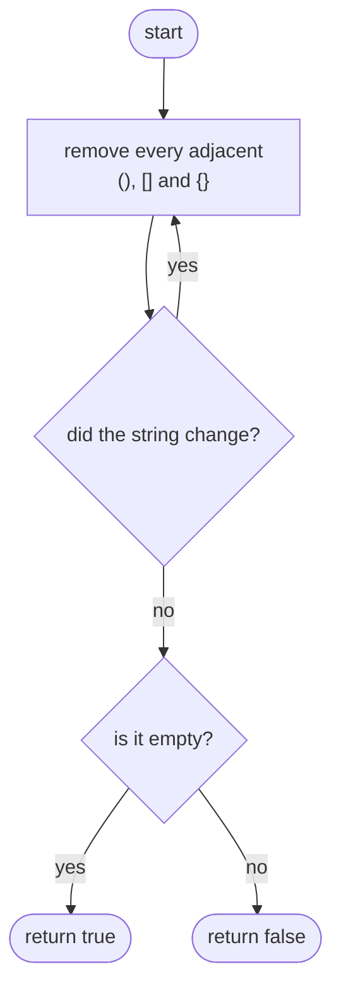
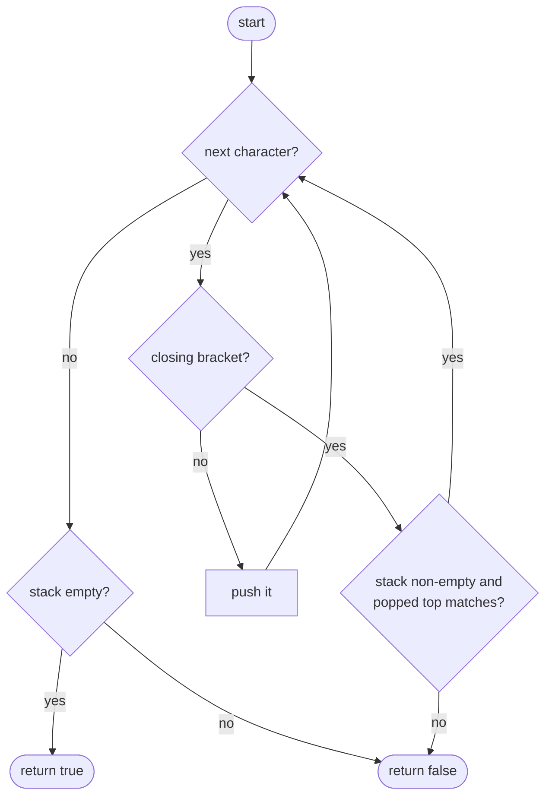

## How to think

**1. Restate the problem.** A string of `()[]{}` is balanced when every opening bracket is closed by the same kind, in properly nested order. `([])` is fine; `([)]` is not, even though the counts match.

**2. Counting isn't enough.** Counting opens and closes per type would accept `([)]`. What matters is **order**: a closing bracket must match the *most recent* opening bracket that hasn't been closed yet.

**3. "Most recent unclosed" means a stack.** Push every opening bracket. For each closing bracket, the top of the stack must be its partner; pop it. Last in, first out is exactly how nesting works.



That's `([])`.

**4. Three ways to fail.**

- A closing bracket arrives when the stack is empty: `)`.
- A closing bracket doesn't match the top: `(]`.
- The string ends with brackets still open: `((`.

**5. Watch the edge cases.** A single character is never balanced. Very long inputs such as 5,000 `(` followed by 5,000 `)` are fine for a stack, but repeated string rebuilding (the brute force) gets slow.

## Approach 1: Brute force — repeatedly delete matched pairs
<!-- approach: brute_force | time: O(n²) | space: O(n) -->

Any balanced string contains at least one adjacent matching pair, `()`, `[]` or `{}`. Deleting it leaves another balanced string. So keep deleting adjacent pairs until nothing changes: the string was balanced exactly if it ends up empty.

**Dry run** on `"{[]}"` and `"([)]"`:

| String | Remove pairs | Result |
|---|---|---|
| `{[]}` | `[]` | `{}` |
| `{}` | `{}` | `""` → balanced |
| `([)]` | none adjacent | stuck → not balanced |

Each round rebuilds the string, and up to n/2 rounds may be needed: O(n²).

### Code
```python
class Solution:
    def isValid(self, s: str) -> bool:
        previous = None
        while previous != s:
            previous = s
            s = s.replace("()", "").replace("[]", "").replace("{}", "")
        return s == ""
```

### Line by line
- `3` Remembers the string from the previous round, to detect when nothing changes.
- `4` Keep going while the last round removed something.
- `5-6` Remove every adjacent matched pair. Each `replace` builds a new string in O(n).
- `7` Everything cancelled out exactly when the string is empty.

### Flowchart


## Approach 2: Optimized — a stack of open brackets
<!-- approach: optimized | time: O(n) | space: O(n) -->

Scan left to right. Push opening brackets. On a closing bracket, pop and check that it's the matching kind. At the end, the stack must be empty.

**Dry run** on `"([)]"`:

| char | Action | Stack afterwards |
|---|---|---|
| ( | push | ( |
| [ | push | ( [ |
| ) | pop `[`; does `[` match `)`? **no** | return false |

And on `"([]){}"`: push `(`, push `[`, `]` pops `[`, `)` pops `(`, push `{`, `}` pops `{`. The stack is empty: true.

### Code
```python
class Solution:
    def isValid(self, s: str) -> bool:
        partner = {")": "(", "]": "[", "}": "{"}
        stack = []
        for char in s:
            if char in partner:
                if not stack or stack.pop() != partner[char]:
                    return False
            else:
                stack.append(char)
        return not stack
```

### Line by line
- `3` For each closing bracket, the opening bracket it must match.
- `4` Opening brackets still waiting to be closed, most recent on top.
- `5` Look at each character once.
- `6-8` A closing bracket needs a matching opener on top of the stack. An empty stack (nothing to close) or the wrong kind means the string is invalid. `not stack` is checked first, so `pop()` never runs on an empty stack.
- `9-10` An opening bracket waits on the stack.
- `11` Every opener must have been closed: valid only if the stack is empty.

### Flowchart

