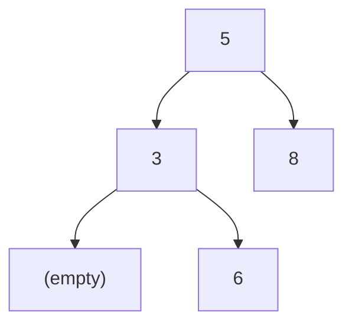
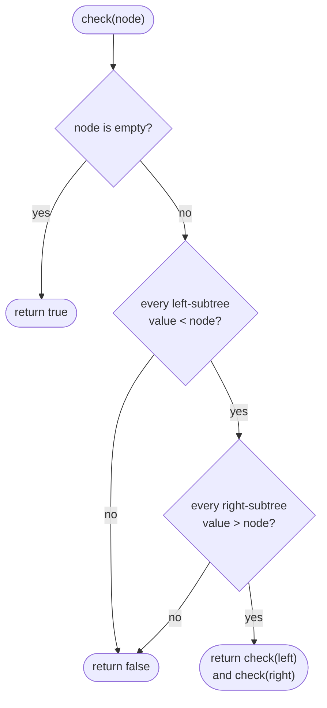
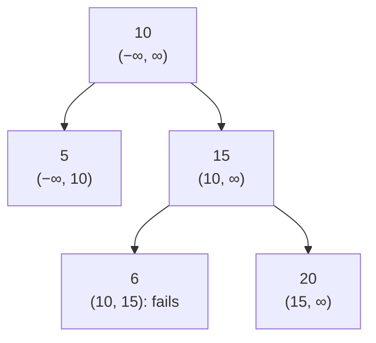
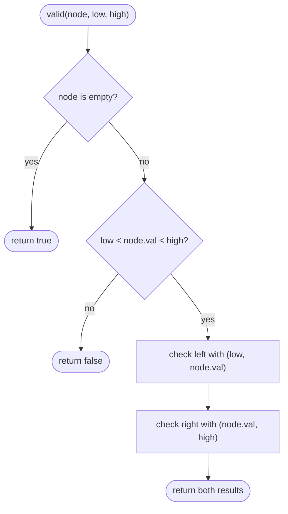

## How to think

**1. Restate the problem.** A binary search tree needs **every** value in a node's left subtree to be smaller than the node, and **every** value in its right subtree to be larger. Equal values aren't allowed.

**2. The trap: checking only children.** It's tempting to check `left.val < node.val < right.val` at each node. The second example, `[5, 3, 8, null, 6]`, passes that check everywhere but isn't a BST:



`6` is a fine right child of `3`, but it's inside the *left* subtree of `5`, so it must be less than 5. The rule is about whole subtrees, not just children.

**3. Turn "whole subtree" into a range.** Walking down from the root, each step tightens the range of values a node may have:

- Going **left** from a node with value v, everything below must be **< v**: v becomes the new upper bound.
- Going **right**, everything below must be **> v**: v becomes the new lower bound.

So each node just checks `low < value < high`, with bounds inherited from its ancestors. One visit per node: O(n).

**4. The other way to see it.** An in-order traversal (left, node, right) of a valid BST gives strictly increasing values. That's an equally good O(n) check.

**5. Watch the edge cases.**

- Duplicates, such as `[2, 2]`, are invalid; the comparisons must be strict.
- Values can be −2³¹ or 2³¹ − 1, so the starting bounds must be beyond them: Python's `float("-inf")` and `float("inf")` work for any integer.

## Approach 1: Brute force — compare each node against its entire subtrees
<!-- approach: brute_force | time: O(n²) | space: O(h) -->

Apply the definition literally: for every node, walk its whole left subtree and check every value is smaller, then walk its whole right subtree and check every value is larger. Correct, but nodes near the bottom are re-checked once for every ancestor.

**Dry run** on `[5, 3, 8, null, 6]`:

| Node | Left subtree values | All < node? | Right subtree values | All > node? |
|---|---|---|---|---|
| 5 | 3, 6 | **6 < 5? no** | | |

It fails immediately at the root, because 6 sits in the root's left subtree.

### Code
```python
class Solution:
    def isValidBST(self, root: Optional[TreeNode]) -> bool:
        def values(node):
            if node:
                yield from values(node.left)
                yield node.val
                yield from values(node.right)

        def check(node):
            if node is None:
                return True
            if any(v >= node.val for v in values(node.left)):
                return False
            if any(v <= node.val for v in values(node.right)):
                return False
            return check(node.left) and check(node.right)

        return check(root)
```

### Line by line
- `3-7` A generator that yields every value in a subtree. It produces values one at a time, so `any` can stop at the first bad value without building a list.
- `9-11` An empty subtree is always valid.
- `12-13` Every value on the left must be strictly smaller than this node.
- `14-15` Every value on the right must be strictly larger.
- `16` Then check each subtree on its own. Their nodes get walked again for every ancestor, which is the repeated work.
- `18` Start at the root.

### Flowchart


## Approach 2: Optimized — pass down the allowed range
<!-- approach: optimized | time: O(n) | space: O(h) -->

Recurse with the open range `(low, high)` each node must fit in. The root may be anything. Going left narrows the upper bound to the parent's value, and going right narrows the lower bound.

**Dry run** on `[10, 5, 15, null, null, 6, 20]`:

| Node | Allowed range | Fits? |
|---|---|---|
| 10 | (−∞, ∞) | yes |
| 5 | (−∞, 10) | yes |
| 15 | (10, ∞) | yes |
| 6 | (10, 15) | **6 > 10? no → invalid** |



### Code
```python
class Solution:
    def isValidBST(self, root: Optional[TreeNode]) -> bool:
        def valid(node, low, high):
            if node is None:
                return True
            if not low < node.val < high:
                return False
            return valid(node.left, low, node.val) and valid(node.right, node.val, high)

        return valid(root, float("-inf"), float("inf"))
```

### Line by line
- `3` `valid` checks a subtree whose values must all lie strictly between `low` and `high`.
- `4-5` An empty subtree breaks no rules.
- `6-7` This node must fit its inherited range; strict comparisons reject duplicates.
- `8` Left children must also be below this node, and right children above it. Each node is visited once.
- `10` The root has no constraints, so start with infinite bounds, which work even for the most extreme 32-bit values.

### Flowchart

