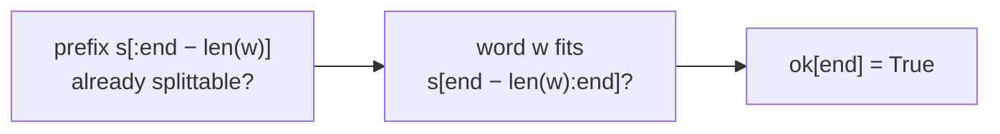
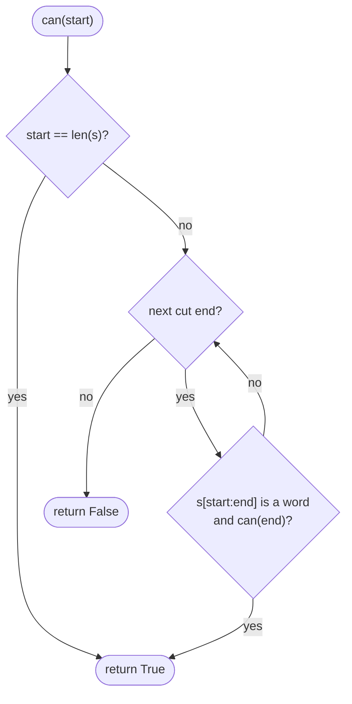
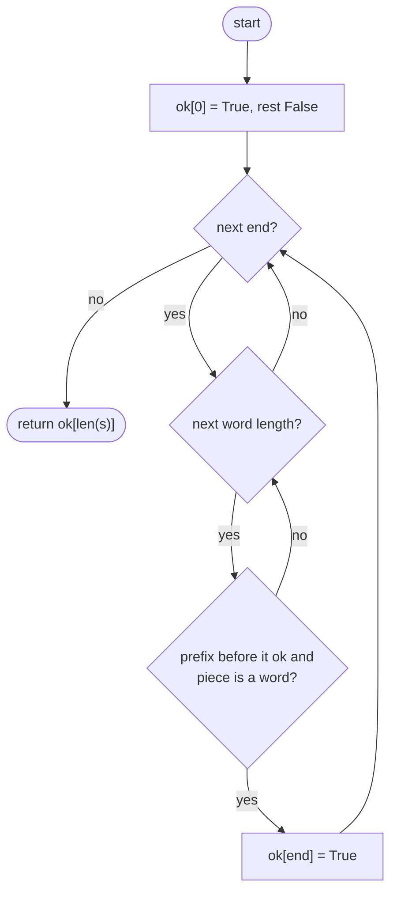

## How to think

**1. Restate the problem.** Can `s` be cut into pieces that are all dictionary words? Words can repeat.

**2. Think about the last word.** If `s[:end]` can be split, its last word is some dictionary word `w` ending at `end`, and everything before it, `s[:end − len(w)]`, must also be splittable. So:

```
ok[end] = some word w fits exactly at the end of s[:end] and ok[end − len(w)]
ok[0] = True   (the empty prefix needs no words)
```



**3. Why plain recursion explodes.** Trying every first word and recursing re-solves the same suffix many times. With `s = "aaaa…ab"` and words `a`, `aa`, `aaa`, the number of ways to split the a's grows exponentially, and every one of them fails at the `b`.

**4. Only try real word lengths.** Instead of every possible cut, check only the lengths that dictionary words actually have (at most 20 here).

**5. Watch the edge cases.** A string made of one repeated word, no word fitting the first character, and words that are prefixes of other words, like `sun` and `sunflower`.

## Approach 1: Brute force — recursion over every first word
<!-- approach: brute_force | time: O(2ⁿ) worst case | space: O(n) -->

From position `start`, try every prefix that's a dictionary word and recurse on the rest. Without memory, failed suffixes are retried over and over.

**Dry run** on `"abab"` with `["ab"]`:

| Call | Word tried | Result |
|---|---|---|
| can(0) | "ab" fits | can(2) |
| can(2) | "ab" fits | can(4) |
| can(4) | end of string | **True** |

### Code
```python
class Solution:
    def wordBreak(self, s: str, wordDict: List[str]) -> bool:
        words = set(wordDict)

        def can(start):
            if start == len(s):
                return True
            for end in range(start + 1, len(s) + 1):
                if s[start:end] in words and can(end):
                    return True
            return False

        return can(0)
```

### Line by line
- `3` A set makes "is this a word?" an O(1) check.
- `5` `can(start)` answers whether `s[start:]` can be split into words.
- `6-7` Nothing left to split: success.
- `8-10` Try every cut. If the first piece is a word and the rest can be split, done.
- `11` No first word worked.
- `13` Start at the beginning.

### Flowchart


## Approach 2: Optimized — DP over prefixes
<!-- approach: optimized | time: O(n × L) for L distinct word lengths | space: O(n) -->

`ok[end]` says whether `s[:end]` can be split. Fill it left to right, trying only lengths that some word has.

**Dry run** on `"sunflowerpot"` with `["sun", "flower", "pot", "sunflower"]` (only the true entries):

| end | Prefix | Word that fits | Earlier prefix ok? |
|---|---|---|---|
| 0 | "" | | base case |
| 3 | "sun" | "sun" | ok[0] ✓ |
| 9 | "sunflower" | "flower" (or "sunflower") | ok[3] ✓ |
| 12 | "sunflowerpot" | "pot" | ok[9] ✓ → **True** |

### Code
```python
class Solution:
    def wordBreak(self, s: str, wordDict: List[str]) -> bool:
        words = set(wordDict)
        lengths = {len(word) for word in words}
        ok = [True] + [False] * len(s)
        for end in range(1, len(s) + 1):
            for length in lengths:
                if length <= end and ok[end - length] and s[end - length:end] in words:
                    ok[end] = True
                    break
        return ok[-1]
```

### Line by line
- `3` Fast word lookups.
- `4` Only these piece lengths can ever work, so there's no need to try any others.
- `5` `ok[0]` is True: the empty prefix needs no words. Everything else starts False.
- `6` Decide each prefix length in increasing order.
- `7-8` Try a last word of each possible length: it must fit, end exactly at `end`, and leave a splittable prefix before it.
- `9-10` One valid way is enough; stop checking this prefix.
- `11` Whether the whole string can be split.

### Flowchart

