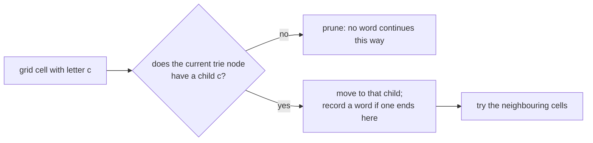
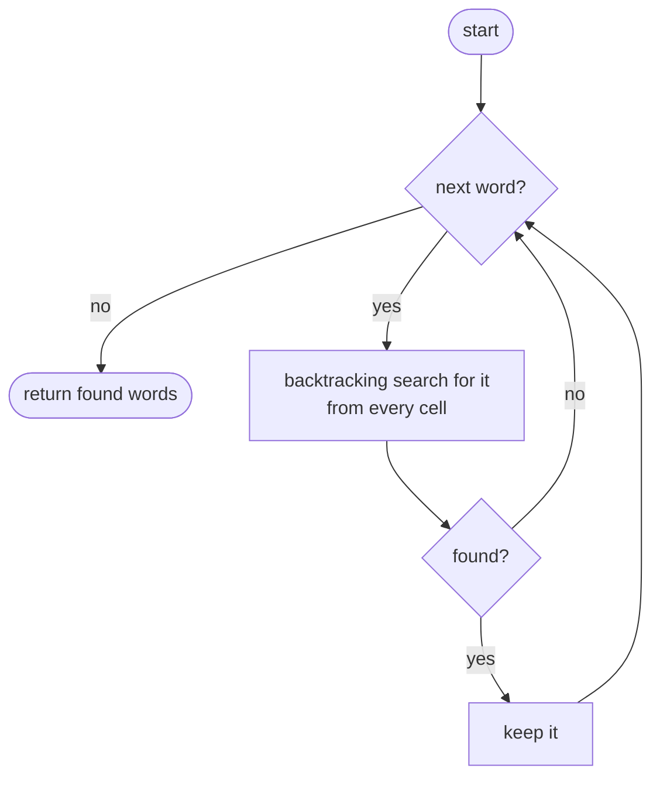
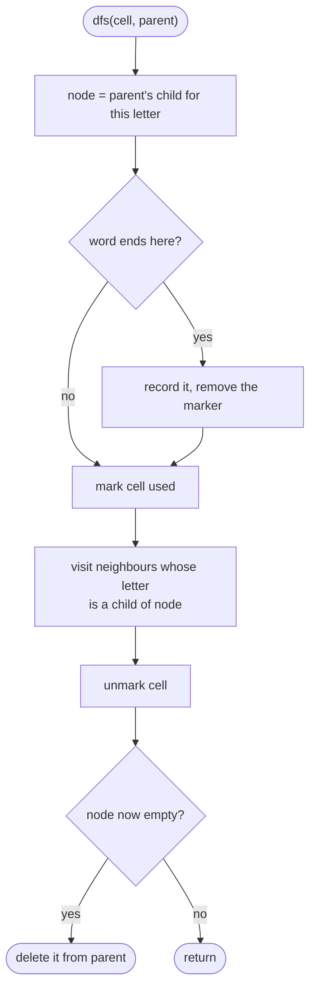

## How to think

**1. Restate the problem.** Like **Word Search**, but with a whole list of words: find every one that can be traced through the grid.

**2. Searching each word separately repeats work.** Running Word Search once per word walks the same grid paths again and again: hundreds of words starting with `ab` each re-explore every `a → b` path.

**3. Search for all words at once with a trie.** Put the words in a **trie**. Then run one backtracking search from each cell, moving through the grid and the trie **together**: a step to a neighbouring cell is only worth taking if the trie has that letter as the next character of some word. Reaching a node that marks a word end means that word was found.



**4. Prune as you go.** Remove a word's end marker once it's found, so it isn't reported twice, and delete trie branches that have nothing left below them. Later searches then skip those paths entirely.

**5. Watch the edge cases.** A cell can't be reused within one word (mark it while it's on the current path). Words that are prefixes of other words (`a` and `aa`) are both reported.

## Approach 1: Brute force — run Word Search once per word
<!-- approach: brute_force | time: O(W × cells × 4^L) | space: O(L) -->

For every word, backtrack from every cell exactly as in Word Search.

**Dry run** on

```
o a t
e t h
i h k
```

with words `oath`, `eat`, `hike`, `tea`:

| Word | Search result |
|---|---|
| oath | o → a → t → h ✓ |
| eat | e's neighbours have no a → ✗ |
| hike | no i next to an h followed by k → ✗ |
| tea | no e next to a t → ✗ |

Answer: **["oath"]**.

### Code
```python
class Solution:
    def findWords(self, board: List[List[str]], words: List[str]) -> List[str]:
        rows, cols = len(board), len(board[0])

        def exists(word):
            def dfs(r, c, i):
                if i == len(word):
                    return True
                if r < 0 or r >= rows or c < 0 or c >= cols or board[r][c] != word[i]:
                    return False
                board[r][c] = "#"
                found = dfs(r + 1, c, i + 1) or dfs(r - 1, c, i + 1) or dfs(r, c + 1, i + 1) or dfs(r, c - 1, i + 1)
                board[r][c] = word[i]
                return found

            return any(dfs(r, c, 0) for r in range(rows) for c in range(cols))

        return [word for word in words if exists(word)]
```

### Line by line
- `3` Grid size.
- `5-14` The Word Search backtracking for one word: match the letter, mark the cell, try four neighbours, restore.
- `16` Try every cell as the start of the word.
- `18` Repeat the whole search for each word.

### Flowchart


## Approach 2: Optimized — one backtracking search guided by a trie
<!-- approach: optimized | time: O(cells × 4 × 3^(L − 1)) worst case | space: O(total characters) -->

Build a trie of the words. From each cell whose letter starts some word, walk the grid and the trie together, recording words at end markers and pruning dead branches.

**Dry run** on the same board, starting at the `o` in the top-left:

| Cell path | Trie position | Event |
|---|---|---|
| o | o | continue |
| o, a | oa | continue |
| o, a, t | oat | continue |
| o, a, t, h | oath $ | **found "oath"**; remove its marker, prune the now-empty branch |

### Code
```python
class Solution:
    def findWords(self, board: List[List[str]], words: List[str]) -> List[str]:
        root = {}
        for word in words:
            node = root
            for char in word:
                node = node.setdefault(char, {})
            node["$"] = word
        rows, cols = len(board), len(board[0])
        found = []

        def dfs(r, c, parent):
            char = board[r][c]
            node = parent[char]
            if "$" in node:
                found.append(node.pop("$"))
            board[r][c] = "#"
            for nr, nc in ((r + 1, c), (r - 1, c), (r, c + 1), (r, c - 1)):
                if 0 <= nr < rows and 0 <= nc < cols and board[nr][nc] in node:
                    dfs(nr, nc, node)
            board[r][c] = char
            if not node:
                parent.pop(char)

        for r in range(rows):
            for c in range(cols):
                if board[r][c] in root:
                    dfs(r, c, root)
        return found
```

### Line by line
- `3-8` Build the trie; the end marker stores the whole word, so it can be reported directly.
- `9-10` Grid size and the words found.
- `12-14` Step from `parent` into the child for this cell's letter.
- `15-16` A word ends here: record it and remove the marker, so it's reported only once.
- `17` Mark this cell as used on the current path.
- `18-20` Continue only to neighbours whose letter continues some word in the trie.
- `21` Restore the cell for other paths.
- `22-23` Prune: if nothing is left below this trie node, delete it so no later search walks into it.
- `25-28` Start from every cell whose letter begins some word.
- `29` All words found, in any order.

### Flowchart

