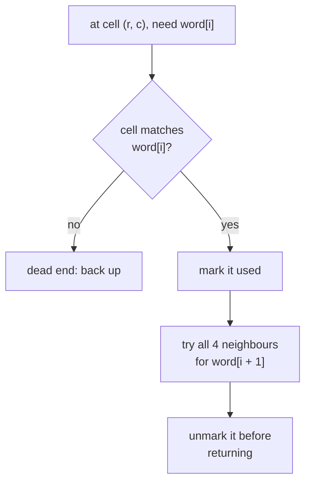
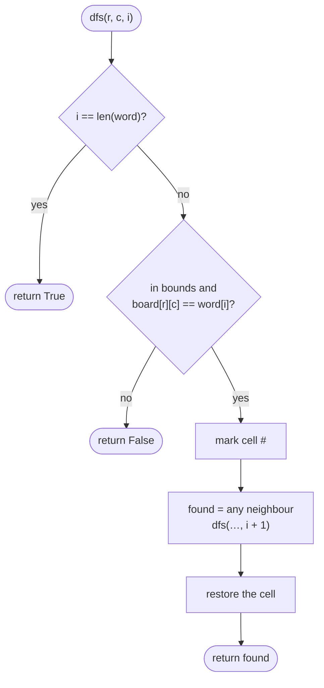
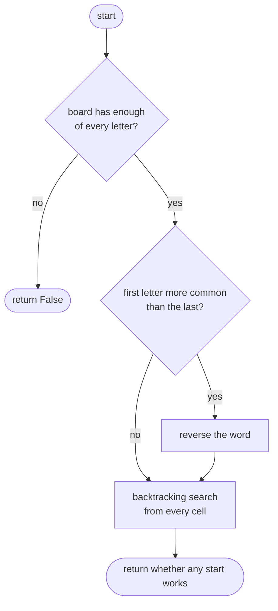

## How to think

**1. Restate the problem.** Trace `word` through the grid, one letter per cell, moving up, down, left or right, without reusing a cell.

**2. This is a search with backtracking.** From every cell matching the first letter, try each neighbour that matches the next letter, and so on. If a path dead-ends, **undo** the last step and try a different neighbour.



**3. Marking cells.** Temporarily overwrite the current cell with `#` so the path can't step on it again, and restore it when backtracking. That avoids a separate visited set.

**4. Prune before searching.** The search can explode: on a grid of all `A`s, looking for `AAAA…AB` explores a huge number of paths before failing. Two cheap checks avoid most of that:

- If the board doesn't contain enough of some letter, answer false without searching.
- Start from whichever end of the word is **rarer** on the board (search for the reversed word if its last letter is rarer). Fewer starting points means fewer paths.

**5. Watch the edge cases.** A word that needs the same cell twice, such as `ABA` on a 2 × 2 grid, must fail. A one-letter word only needs one matching cell.

## Approach 1: Brute force — plain backtracking from every cell
<!-- approach: brute_force | time: O(m × n × 4^L) | space: O(L) recursion -->

Try every cell as the start and run depth-first search with backtracking. It's correct, but on adversarial grids it explores an enormous number of paths.

**Dry run** for `"CATS"` on

```
C A T
X R S
Q T E
```

| Step | Cell | Letter needed | Result |
|---|---|---|---|
| 1 | (0, 0) | C | match |
| 2 | (0, 1) | A | match |
| 3 | (0, 2) | T | match |
| 4 | (1, 2) | S | match → **true** |

### Code
```python
class Solution:
    def exist(self, board: List[List[str]], word: str) -> bool:
        rows, cols = len(board), len(board[0])

        def dfs(r, c, i):
            if i == len(word):
                return True
            if r < 0 or r >= rows or c < 0 or c >= cols or board[r][c] != word[i]:
                return False
            board[r][c] = "#"
            found = dfs(r + 1, c, i + 1) or dfs(r - 1, c, i + 1) or dfs(r, c + 1, i + 1) or dfs(r, c - 1, i + 1)
            board[r][c] = word[i]
            return found

        return any(dfs(r, c, 0) for r in range(rows) for c in range(cols))
```

### Line by line
- `3` Grid size.
- `5` `dfs(r, c, i)`: can the rest of the word, from letter `i`, be traced starting at cell `(r, c)`?
- `6-7` Every letter has been matched.
- `8-9` Off the grid, already used (`#`), or the wrong letter: this path fails.
- `10` Mark the cell as used on the current path.
- `11` Try the four neighbours for the next letter; `or` stops at the first success.
- `12` Restore the letter (backtrack), so other paths can use this cell.
- `13` Report whether any direction worked.
- `15` Try every cell as the starting point.

### Flowchart


## Approach 2: Optimized — backtracking with letter-count pruning
<!-- approach: optimized | time: O(m × n × 4^L) worst case, far less in practice | space: O(L) recursion -->

The same search, but first rule out impossible words by counting letters, and start from the rarer end of the word.

**Dry run** for `"AAAAAAAAAAAAAAB"` on a 6 × 6 grid of `A`s:

| Check | Result |
|---|---|
| Board has a `B`? | 0 available, 1 needed → **false**, with no search at all |

The plain search would try millions of paths before giving up on the same input.

### Code
```python
class Solution:
    def exist(self, board: List[List[str]], word: str) -> bool:
        rows, cols = len(board), len(board[0])
        available = Counter(cell for row in board for cell in row)
        needed = Counter(word)
        if any(available[char] < count for char, count in needed.items()):
            return False
        if available[word[0]] > available[word[-1]]:
            word = word[::-1]

        def dfs(r, c, i):
            if i == len(word):
                return True
            if r < 0 or r >= rows or c < 0 or c >= cols or board[r][c] != word[i]:
                return False
            board[r][c] = "#"
            found = dfs(r + 1, c, i + 1) or dfs(r - 1, c, i + 1) or dfs(r, c + 1, i + 1) or dfs(r, c - 1, i + 1)
            board[r][c] = word[i]
            return found

        return any(dfs(r, c, 0) for r in range(rows) for c in range(cols))
```

### Line by line
- `3` Grid size.
- `4-5` How many of each letter the board has, and how many the word needs.
- `6-7` Not enough of some letter: impossible, so skip the search entirely.
- `8-9` A path reads the same forwards and backwards, so search from the rarer end: fewer matching start cells means fewer paths explored.
- `11-19` The same backtracking search as before: mark, try four neighbours, restore.
- `21` Try every start cell.

### Flowchart

